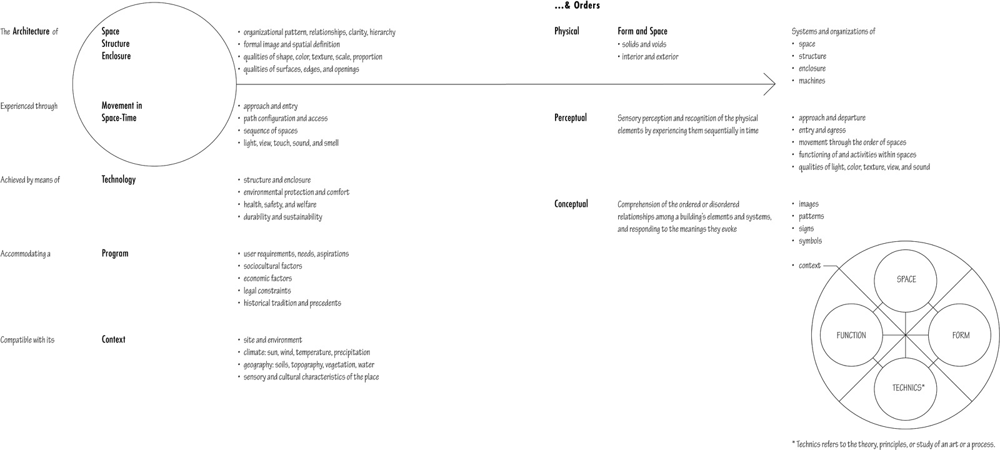
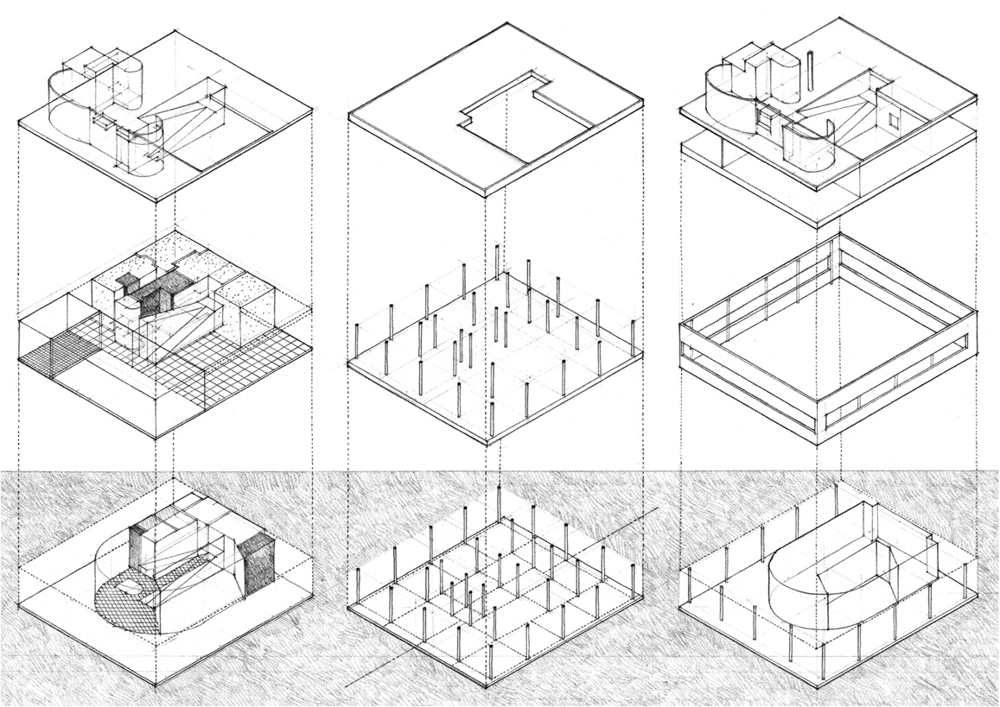
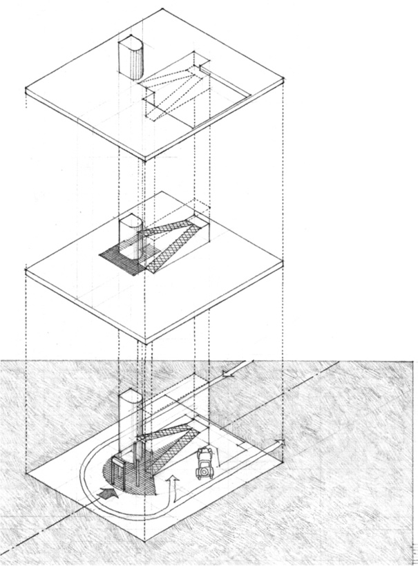
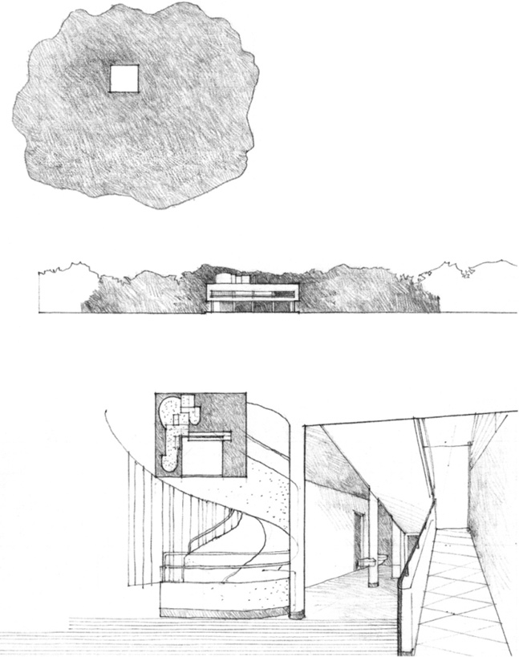
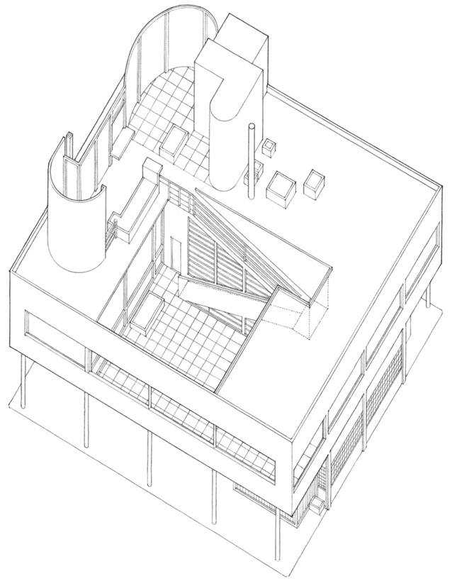

> [BREADCRUMB_CTX: 《Architecture》 > Introduction]

# INTRODUCTION

Architecture is generally conceived—designed—realized—built—in response to an existing set of conditions. These conditions may be purely functional in nature, or they may also reflect in varying degrees the social, political, and economic climate. In any case, it is assumed that the existing set of conditions—the problem—is less than satisfactory and that a new set of conditions—a solution—would be desirable. The act of creating architecture, then, is a problem-solving or design process.

The initial phase of any design process is the recognition of a problematic condition and the decision to find a solution to it. Design is above all a willful act, a purposeful endeavor. A designer must first document the existing conditions of a problem, define its context, and collect relevant data to be assimilated and analyzed. This is the critical phase of the design process since the nature of a solution is inexorably related to how a problem is perceived, defined, and articulated. Piet Hein, the noted Danish poet and scientist, puts it this way: “Art is solving problems that cannot be formulated before they have been solved. The shaping of the question is part of the answer.”

Designers inevitably and instinctively prefigure solutions to the problems they are confronted with, but the depth and range of their design vocabulary influence both their perception of a question and the shaping of its answer. If one’s understanding of a design language is limited, then the range of possible solutions to a problem will also be limited. This book focuses, therefore, on broadening and enriching a vocabulary of design through the study of its essential elements and principles and the exploration of a wide array of solutions to architectural problems developed over the course of human history.

As an art, architecture is more than satisfying the purely functional requirements of a building program. Fundamentally, the physical manifestations of architecture accommodate human activity. However, the arrangement and ordering of forms and spaces also determine how architecture might promote endeavors, elicit responses, and communicate meaning. So while this study focuses on formal and spatial ideas, it is not intended to diminish the importance of the social, political, or economic aspects of architecture. Form and space are presented not as ends in themselves but as means to solve a problem in response to conditions of function, purpose, and context—that is, architecturally.

The analogy may be made that one must know and understand the alphabet before words can be formed and a vocabulary developed; one must understand the rules of grammar and syntax before sentences can be constructed; one must understand the principles of composition before essays, novels, and the like can be written. Once these elements are understood, one can write poignantly or with force, call for peace or incite to riot, comment on trivia or speak with insight and meaning. In a similar way, it might be appropriate to be able to recognize the basic elements of form and space and understand how they can be manipulated and organized in the development of a design concept, before addressing the more vital issue of meaning in architecture.

In order to place this study in proper context, the following is an overview of the basic elements, systems, and orders that constitute a work of architecture. All of these constituents can be perceived and experienced. Some may be readily apparent while others are more obscure to our intellect and senses. Some may dominate while others play a secondary role in a building’s organization. Some may convey images and meaning while others serve as qualifiers or modifiers of these messages.

In all cases, however, these elements and systems should be interrelated to form an integrated whole having a unifying or coherent structure. Architectural order is created when the organization of parts makes visible their relationships to each other and the structure as a whole. When these relationships are perceived as mutually reinforcing and contributing to the singular nature of the whole, then a conceptual order exists—an order that may well be more enduring than transient perceptual visions.

### Architectural Systems

**Villa Savoye**, Poissy, east of Paris, 1923–31, Le Corbusier

This graphic analysis illustrates the way architecture embodies the harmonious integration of interacting and interrelated parts into a complex and unified whole.

### Spatial System

* The three-dimensional integration of program elements and spaces accommodates the multiple functions and relationships of a house.

### Structural System

* A grid of columns supports horizontal beams and slabs.
* The cantilever acknowledges the direction of approach along the longitudinal axis.

### Enclosure System

* Four exterior wall planes define a rectangular volume that contains the program elements and spaces.

### Circulation System

* The stair and ramp penetrate and link the three levels, and heighten the viewer’s perception of forms in space and light.
* The curved form of the entrance foyer reflects the movement of the automobile.

### Context

* A simple exterior form wraps around a complex interior organization of forms and spaces.
* Elevating the main floor provides a better view and avoids the humidity of the ground.
* A garden terrace distributes sunlight to the spaces gathered around it.

“Its severe, almost square exterior surrounds an intricate interior configura-tion glimpsed through openings and from protrusions above…. Its inside order accommodates the multiple functions of a house, domestic scale, and partial mystery inherent in a sense of privacy. Its outside order expresses the unity of the idea of house at an easy scale appropriate to the green field it dominated and possibly to the city it will one day be part of.”

Robert Venturi, *Complexity and Contradiction in Architecture*, 1966

