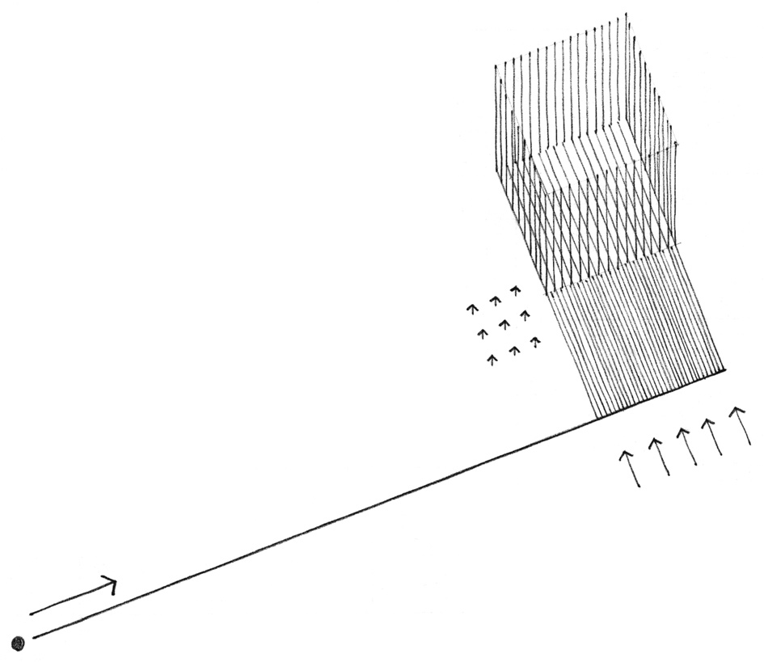
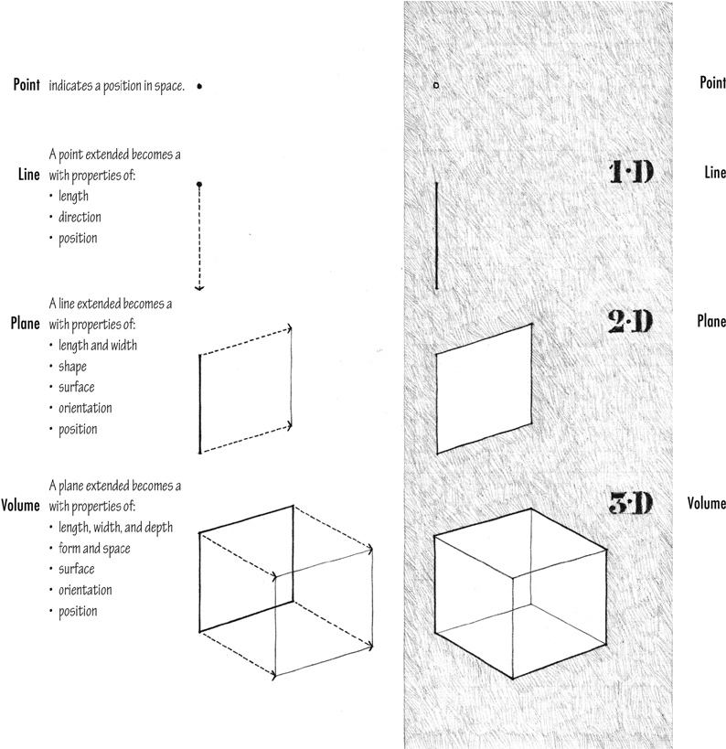

> [BREADCRUMB_CTX: 《Architecture》 > Primary Elements]

## PRIMARY ELEMENTS

This opening chapter presents the primary elements of form in the order of their growth from the point to a one-dimensional line, from the line to a two-dimensional plane, and from the plane to a three-dimensional volume. Each element is first considered as a conceptual element, then as a visual element in the vocabulary of architectural design.

As conceptual elements, the point, line, plane, and volume are not visible except to the mind’s eye. While they do not actually exist, we nevertheless feel their presence. We can sense a point at the meeting of two lines, a line marking the contour of a plane, a plane enclosing a volume, and the volume of an object that occupies space.

When made visible to the eye on paper or in three-dimensional space, these elements become form with characteristics of substance, shape, size, color, and texture. As we experience these forms in our environment, we should be able to perceive in their structure the existence of the primary elements of point, line, plane, and volume.

As the prime generator of form, the

