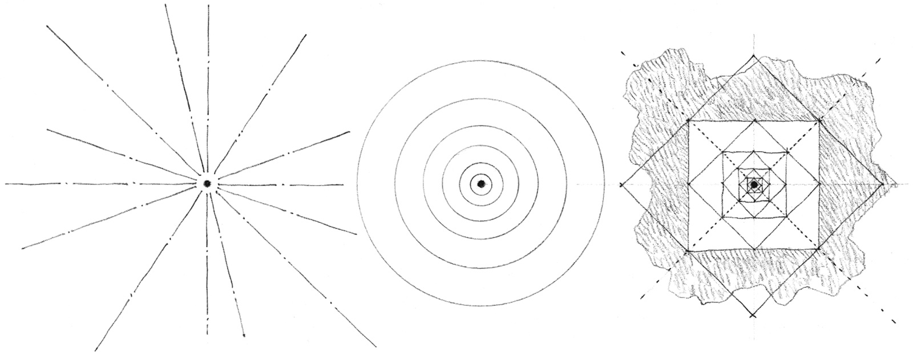
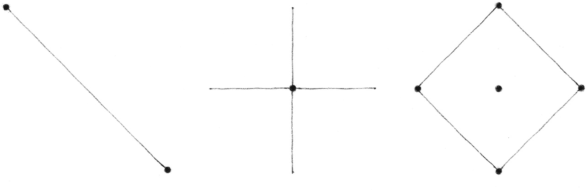
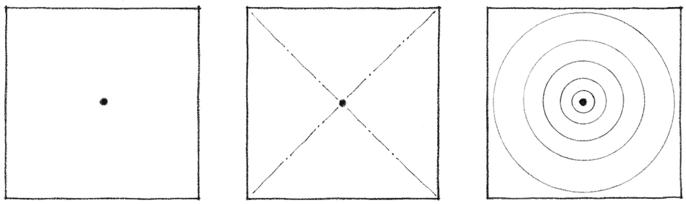
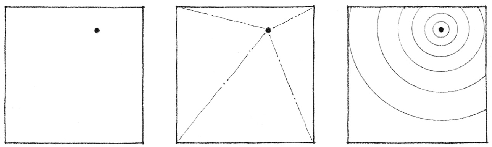

> [BREADCRUMB_CTX: 《Architecture》 > Point]

## POINT

A point marks a position in space. Conceptually, it has no length, width, or depth, and is therefore static, centralized, and directionless.

As the prime element in the vocabulary of form, a point can serve to mark:

* the two ends of a line
* the intersection of two lines
* the meeting of lines at the corner of a plane or volume
* the center of a field

Although a point theoretically has neither shape nor form, it begins to make its presence felt when placed within a visual field. At the center of its environment, a point is stable and at rest, organizing surrounding elements about itself and dominating its field.

When the point is moved off-center, however, its field becomes more aggressive and begins to compete for visual supremacy. Visual tension is created between the point and its field.