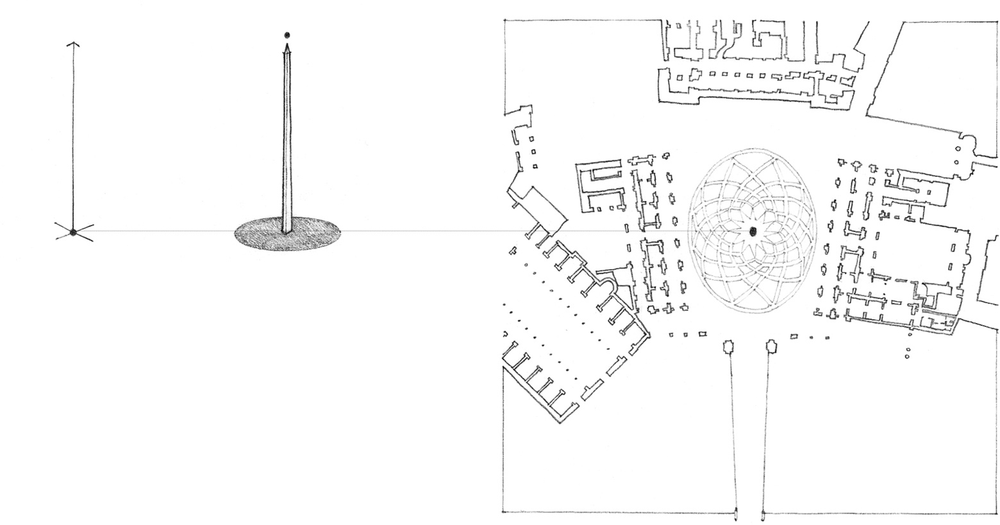
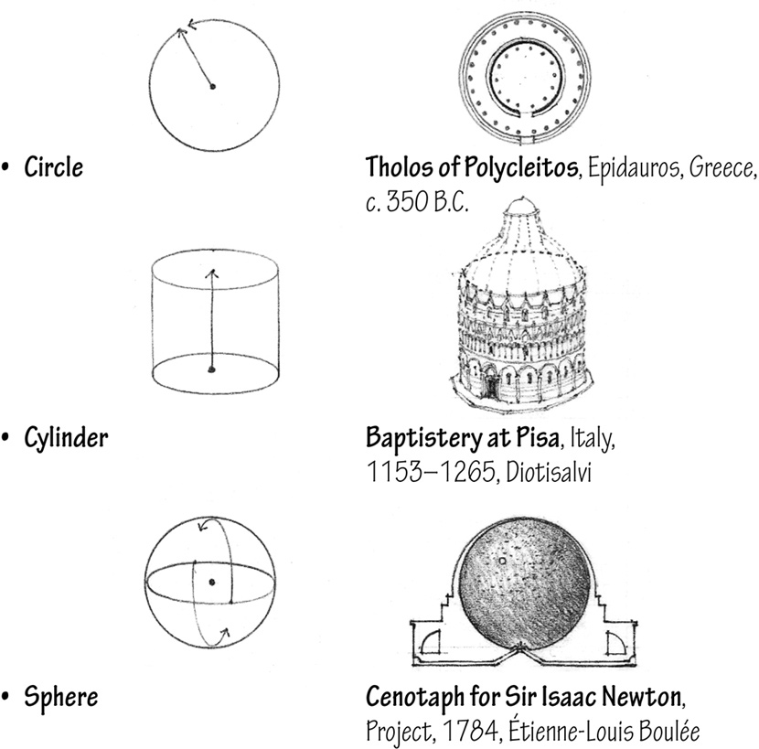
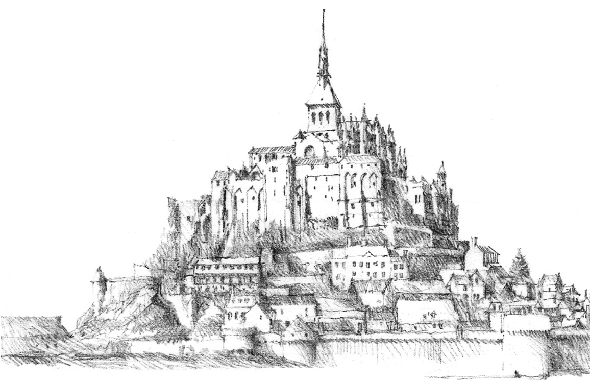

> [BREADCRUMB_CTX: 《Architecture》 > Point Elements]

## POINT ELEMENTS

**Piazza del Campidoglio**, Rome, c. 1544, Michelangelo Buonarroti.  
The equestrian statue of Marcus Aurelius marks the center of this urban space.

A point has no dimension. To visibly mark a position in space or on the ground plane, a point must be projected vertically into a linear form, as a column, obelisk, or tower. Any such columnar element is seen in plan as a point and therefore retains the visual characteristics of a point. Other point-generated forms that share these same visual attributes are the:

**Mont St. Michel**, France, 13th century and later.  
The pyramidal composition culminates in a spire that serves to establish this fortified monastery as a specific place in the landscape.