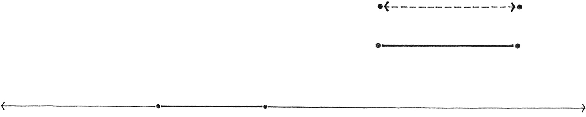
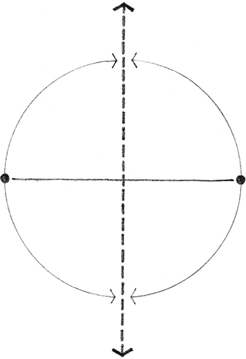
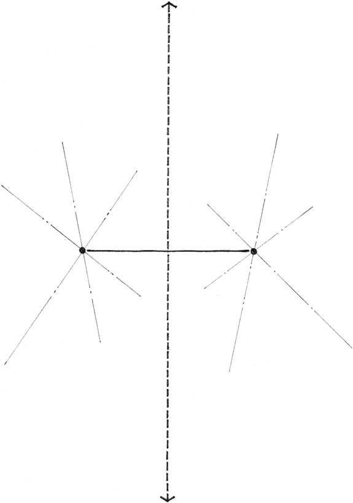
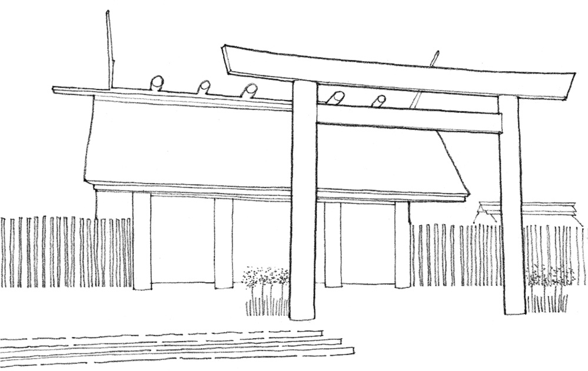
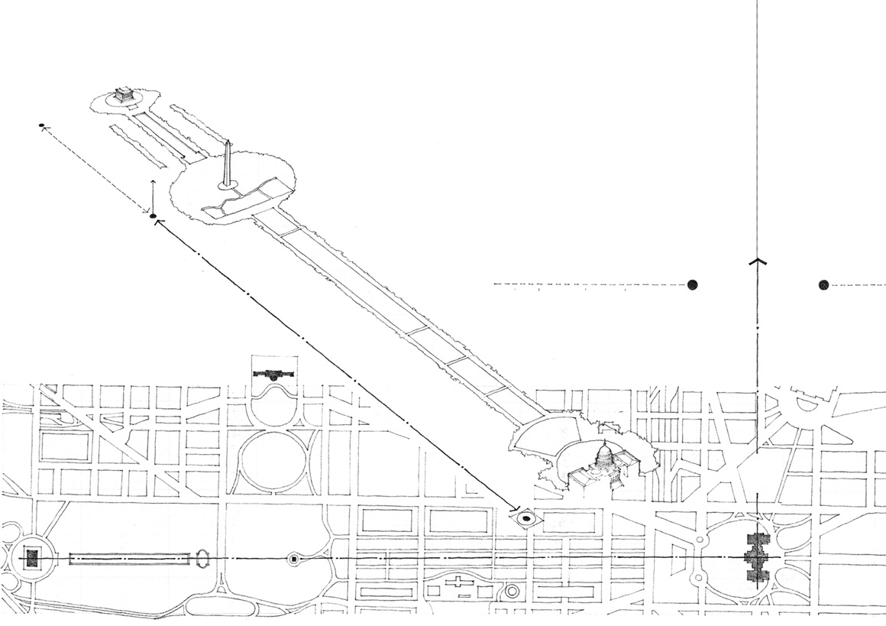

> [BREADCRUMB_CTX: 《Architecture》 > Two Points]

## TWO POINTS

Two points describe a line that connects them. Although the points give this line finite length, the line can also be considered a segment of an infinitely longer path.

Two points further suggest an axis perpendicular to the line they describe and about which they are symmetrical. Because this axis may be infinite in length, it can be at times more dominant than the described line.

In both cases, however, the described line and the perpendicular axis are optically more dominant than the infinite number of lines that may pass through each of the individual points.

Two points established in space by columnar elements or centralized forms can define an axis, an ordering device used throughout history to organize building forms and spaces.

**Torii, Ise Shrine**, Mie Prefecture, Japan, A.D. 690

In plan, two points can denote a gateway signifying passage from one place to another. Extended vertically, the two points define both a plane of entry and an approach perpendicular to it.

**The Mall, Washington, D.C**., lies along the axis established by the Lincoln Memorial, the Washington Monument, and the United States Capitol building.