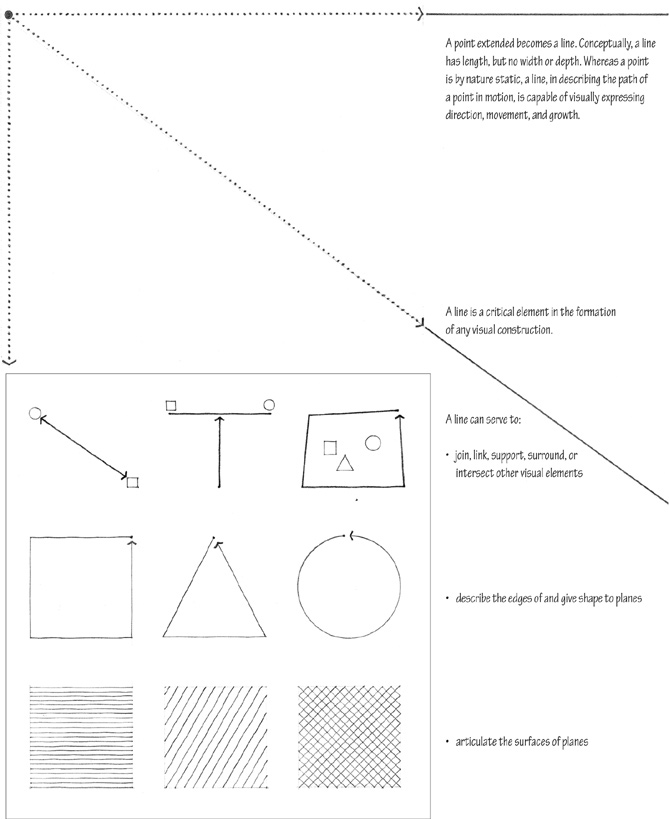
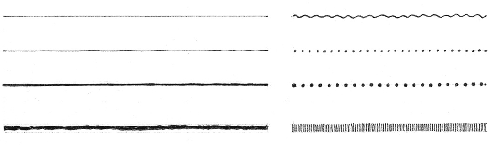
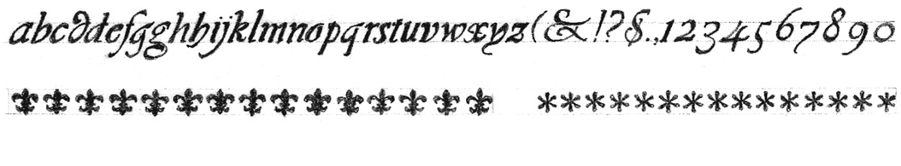
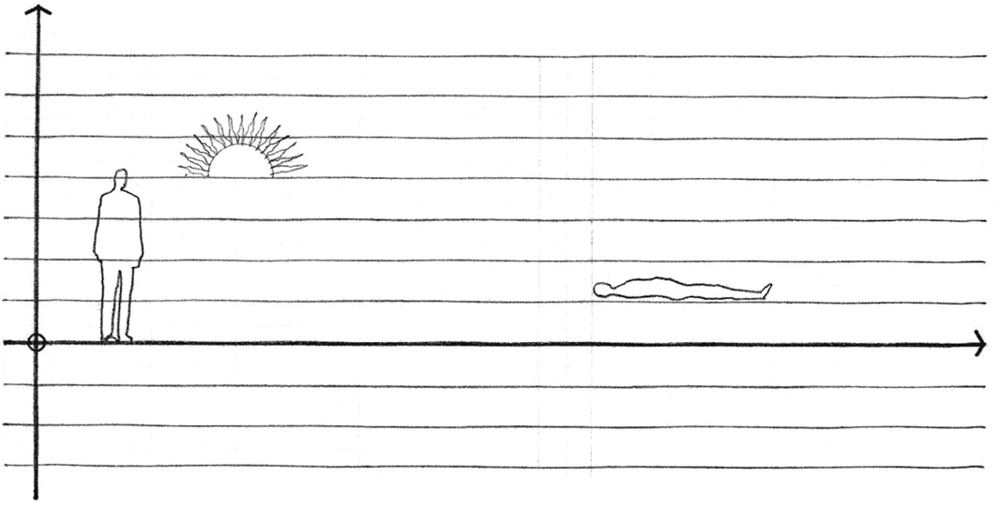
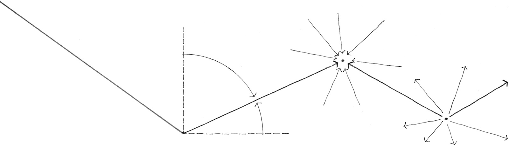

> [BREADCRUMB_CTX: 《Architecture》 > Line]

## LINE

Although a line theoretically has only one dimension, it must have some degree of thickness to become visible. It is seen as a line simply because its length dominates its width. The character of a line, whether taut or limp, bold or tentative, graceful or ragged, is determined by our perception of its length–width ratio, its contour, and its degree of continuity.

Even the simple repetition of like or similar elements, if continuous enough, can be regarded as a line. This type of line has significant textural qualities.

The orientation of a line affects its role in a visual construction. While a vertical line can express a state of equilibrium with the force of gravity, symbolize the human condition, or mark a position in space, a horizontal line can represent stability, the ground plane, the horizon, or a body at rest.

An oblique line is a deviation from the vertical or horizontal.

It may be seen as a vertical line falling or a horizontal line rising. In either case, whether it is falling toward a point on the ground plane or rising to a place in the sky, it is dynamic and visually active in its unbalanced state.

