> [BREADCRUMB_CTX: 《Architecture》 > Linear Elements]

## LINEAR ELEMENTS

Vertical linear elements, such as columns, obelisks, and towers, have been used throughout history to commemorate significant events and establish particular points in space.

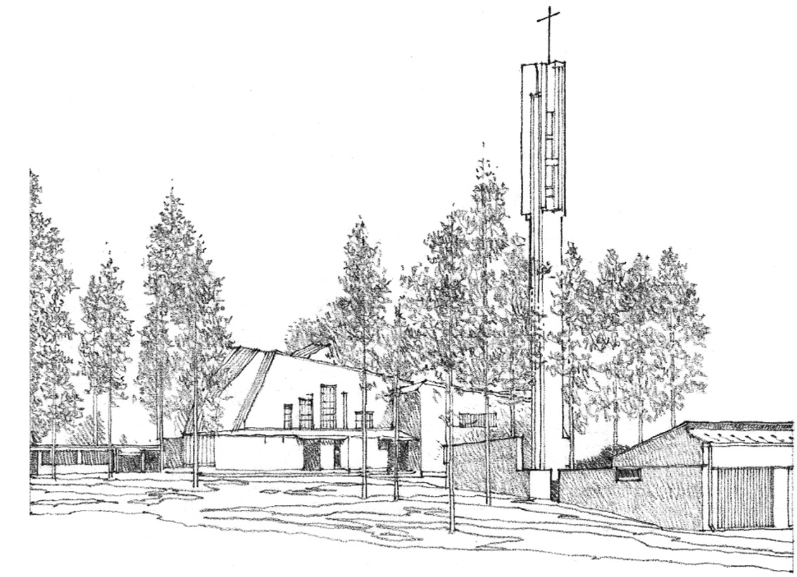

**Bell Tower, Church at Vuoksenniska**, Imatra, Finland, 1956, Alvar Aalto

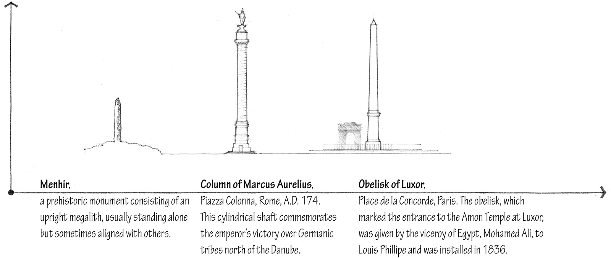

Vertical linear elements can also define a transparent volume of space. In the example illustrated to the left, four minaret towers outline a spatial field from which the dome of the Selim Mosque rises in splendor.

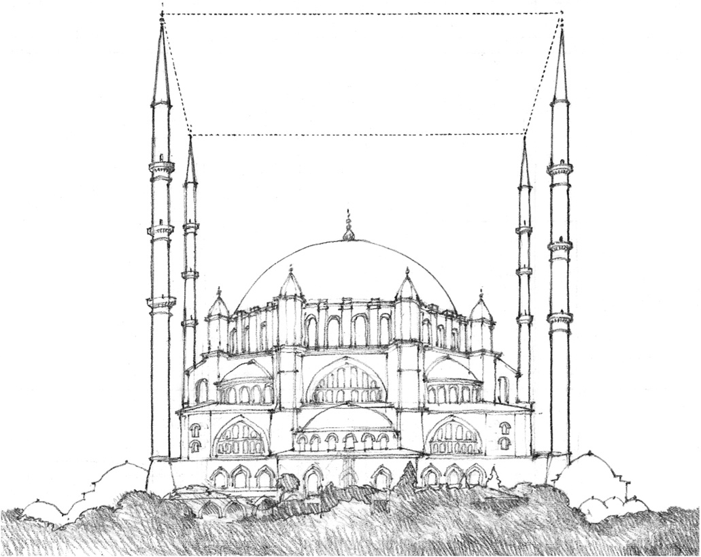

**Selim Mosque**, Edirne, Turkey,  
A.D. 1569–1575

Linear members that possess the necessary material strength can perform structural functions. In these three examples, linear elements:

* express movement across space
* provide support for an overhead plane
* form a three-dimensional structural frame for architectural space

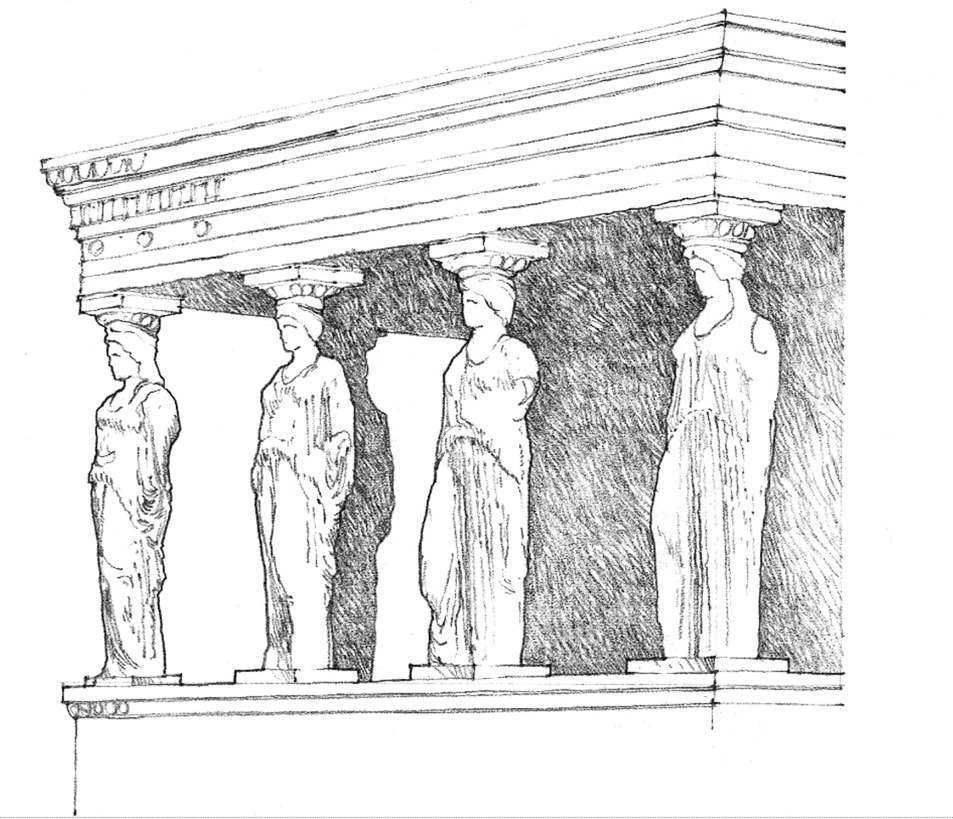

**Caryatid Porch**, The Erechtheion, Athens, 421–405 B.C., Mnesicles.  
The sculptured female figures stand as columnar supports for the entablature.

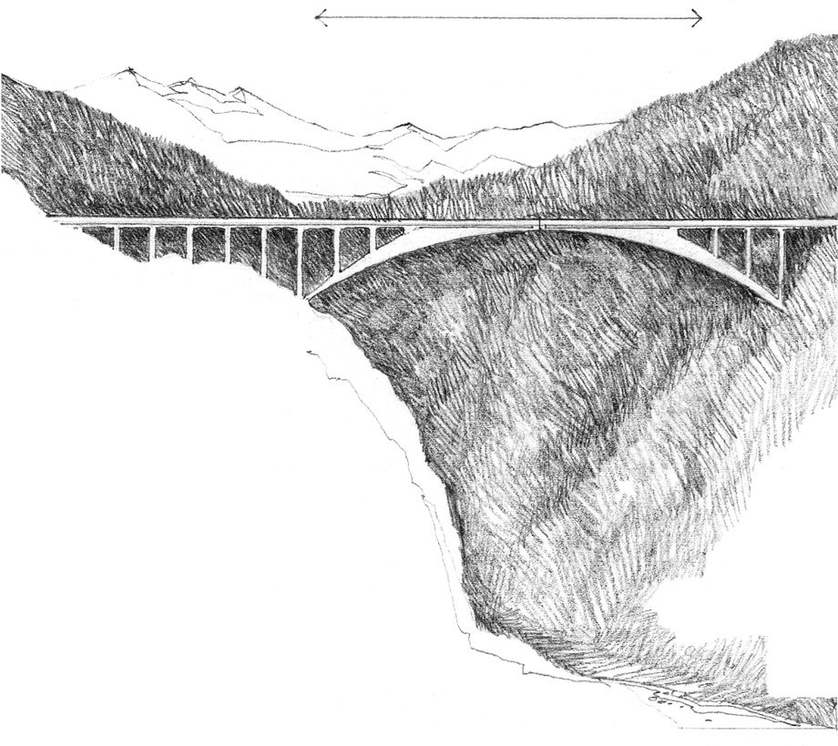

**Salginatobel Bridge**, Switzerland, 1929–1930, Robert Maillart.  
Beams and girders have the bending strength to span the space between their supports and carry transverse loads.

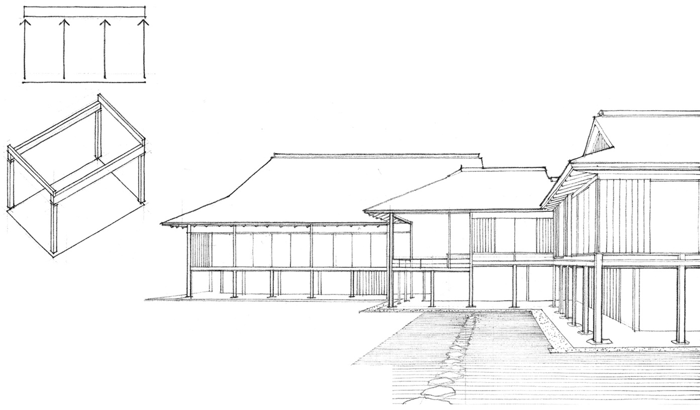

**Katsura Imperial Villa**, Kyoto, Japan, 17th century.  
Linear columns and beams together form a three-dimensional framework for architectural space.

A line can be an imagined element rather than a visible one in architecture. An example is the axis, a regulating line established by two distant points in space and about which elements are symmetrically arranged.

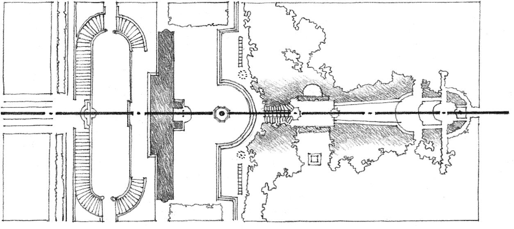

**Villa Aldobrandini**, Italy, 1598–1603, Giacomo Della Porta

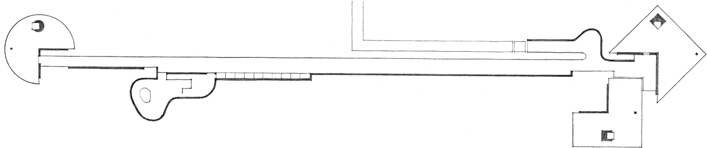

**House 10**, 1966, John Hejduk

Although architectural space exists in three dimensions, it can be linear in form to accommodate the path of movement through a building and link its spaces to one another.

Buildings also can be linear in form, particularly when they consist of repetitive spaces organized along a circulation path. As illustrated here, linear building forms have the ability to enclose exterior spaces as well as adapt to the environmental conditions of a site.

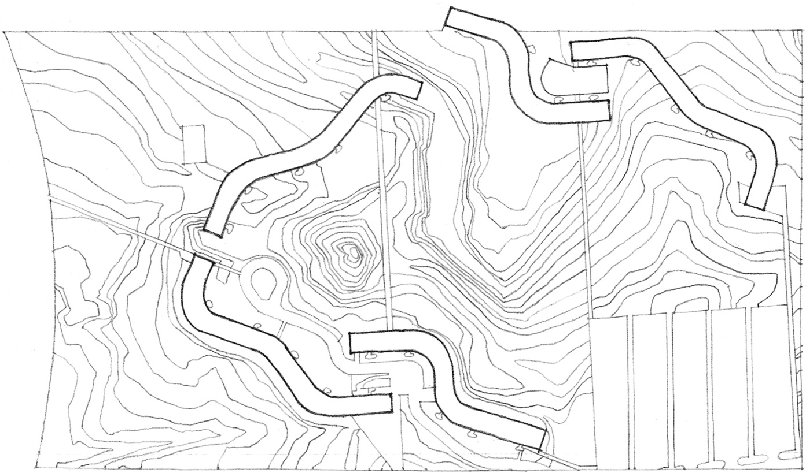

**Cornell University Undergraduate Housing** (Project), Ithaca, New York, 1974, Richard Meier

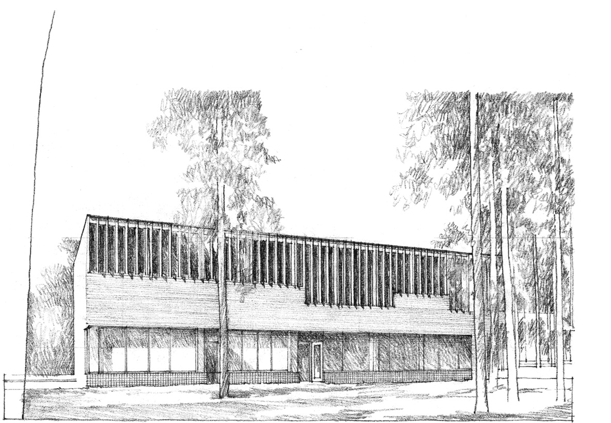

**Town Hall, Säynätsalo**, Finland, 1950–1952, Alvar Aalto

At a smaller scale, lines articulate the edges and surfaces of planes and volumes. These lines can be expressed by joints within or between building materials, by frames around window or door openings, or by a structural grid of columns and beams. How these linear elements affect the texture of a surface will depend on their visual weight, spacing, and direction.

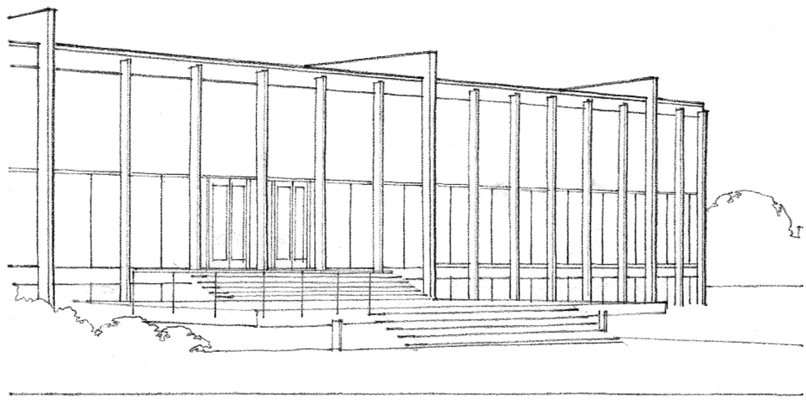

**Crown Hall**, School of Architecture and Urban Design, Illinois Institute of Technology, Chicago, 1956, Mies van der Rohe

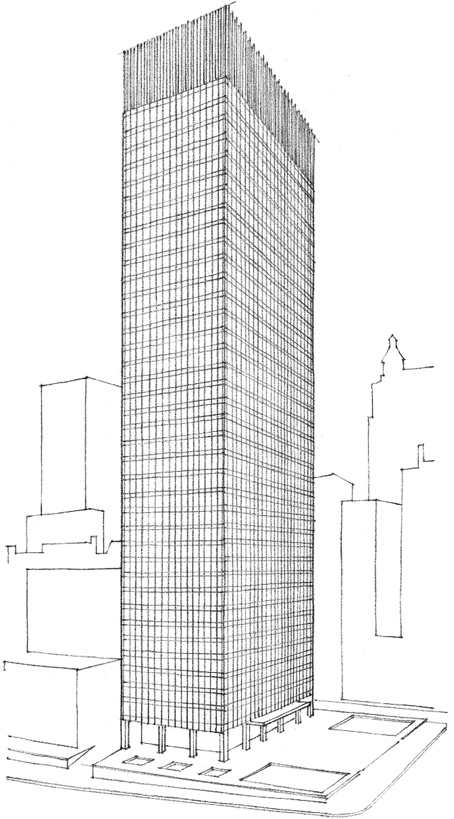

**Seagram Building**, New York City, 1956–1958,  
Mies van de Rohe and Philip Johnson