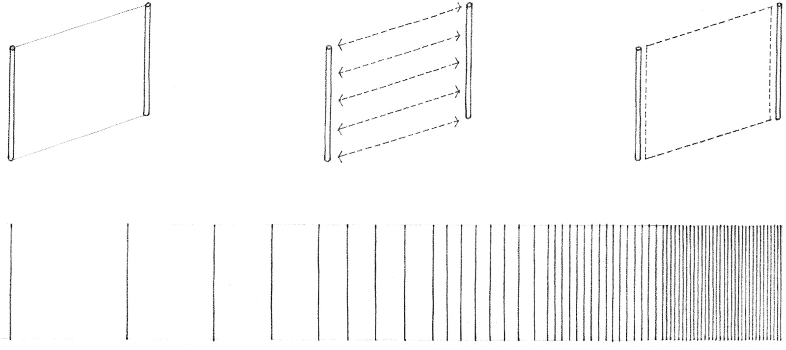
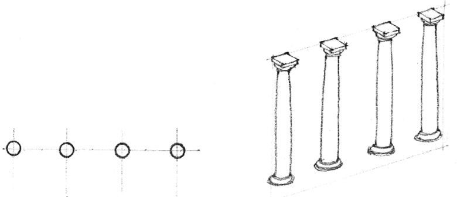
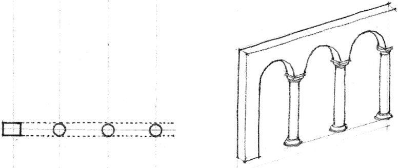
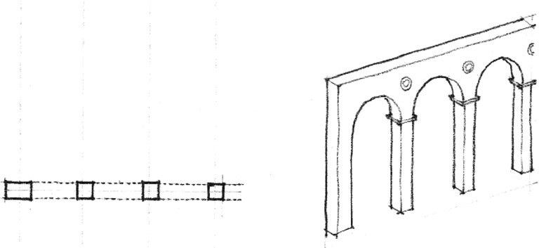
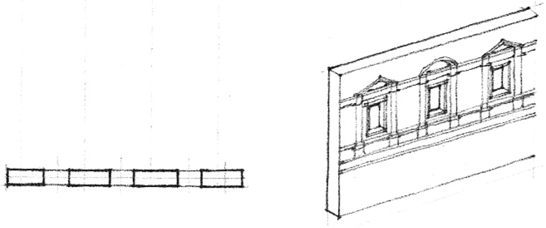

> [BREADCRUMB_CTX: 《Architecture》 > From Line to Plane]

## FROM LINE TO PLANE

Two parallel lines have the ability to visually describe a plane. A transparent spatial membrane can be stretched between them to acknowledge their visual relationship. The closer these lines are to each other, the stronger will be the sense of plane they convey.

A series of parallel lines, through their repetitiveness, reinforces our perception of the plane they describe. As these lines extend themselves along the plane they describe, the implied plane becomes real and the original voids between the lines revert to being mere interruptions of the planar surface.

The diagrams illustrate the transformation of a row of round columns, initially supporting a portion of a wall, then evolving into square piers which are an integral part of the wall plane, and finally becoming pilasters—remnants of the original columns occurring as a relief along the surface of the wall.

“The column is a certain strengthened part of a wall, carried up perpendicular from the foundation to the top … A row of columns is indeed nothing but a wall, open and discontinued in several places.” *Leon Battista Alberti*