> [BREADCRUMB_CTX: 《Architecture》 > Linear Elements Defining Planes]

## LINEAR ELEMENTS DEFINING PLANES

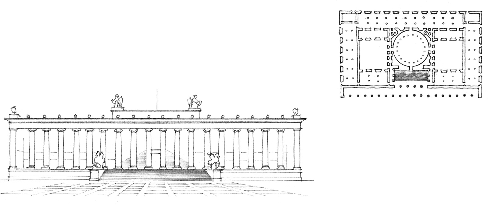

**Altes Museum**, Berlin, 1823–1830, Karl Friedrich Schinkel

A row of columns supporting an entablature—a colonnade—is often used to define the public face or facade of a building, especially one that fronts on a major civic space. A colonnaded facade can be penetrated easily for entry, offers a degree of shelter from the elements, and forms a semi-transparent screen that unifies individual building forms behind it.

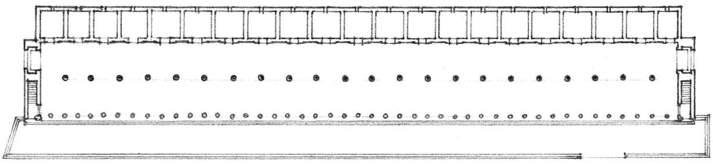
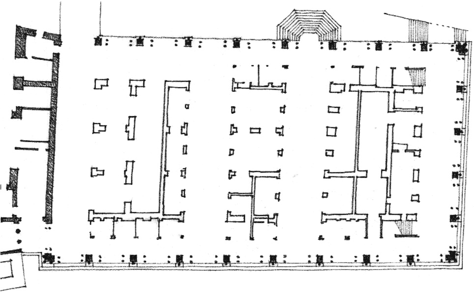

**The Basilica**, Vicenza, Italy.  
Andrea Palladio designed this two-story loggia in 1545 to wrap around an existing medieval structure. This addition not only buttressed the existing structure but also acted as a screen that disguised the irregularity of the original core and presented a uniform but elegant face to the Piazza del Signori.

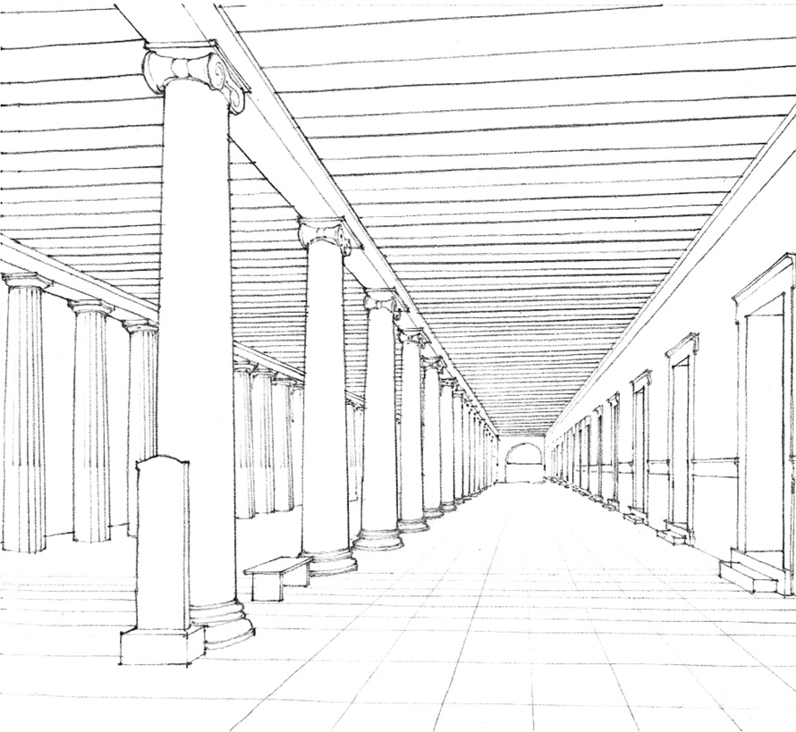

**Stoa of Attalus** fronting the Agora in Athens

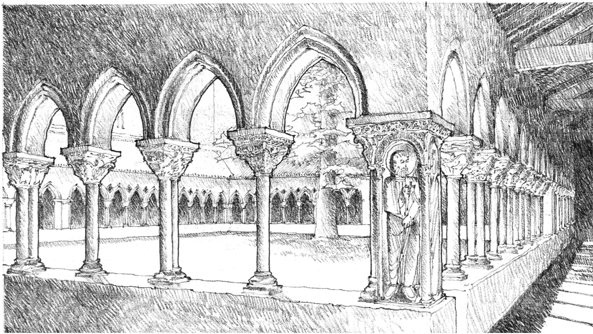

Cloister of **Moissac Abbey**, France, c. 1100

In addition to the structural role columns play in supporting an overhead floor or roof plane, they can articulate the penetrable boundaries of spatial zones which mesh easily with adjacent spaces.

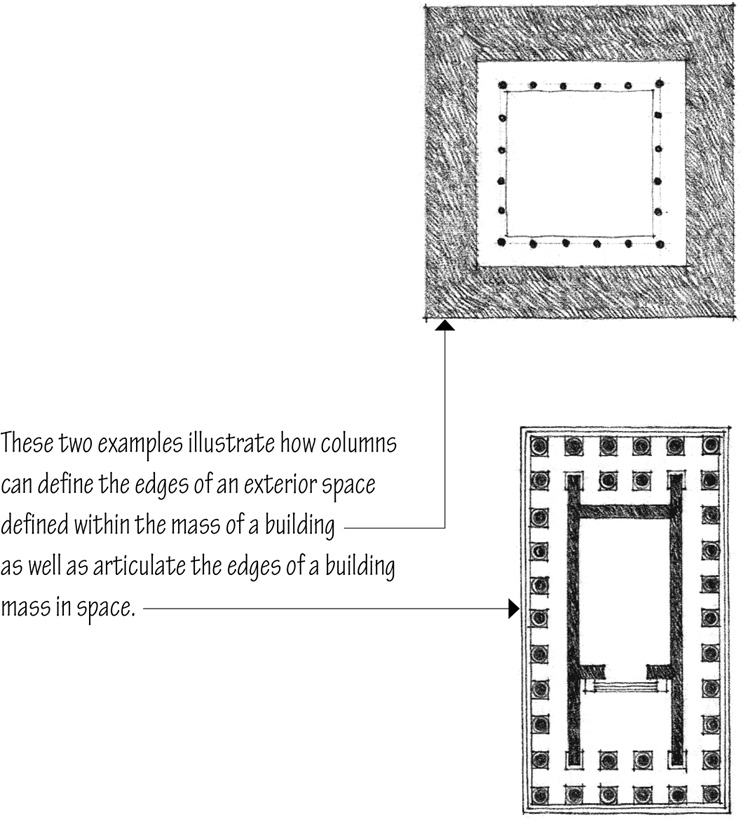

**Temple of Athena Polias**, Priene, c. 334 B.C., Pythius

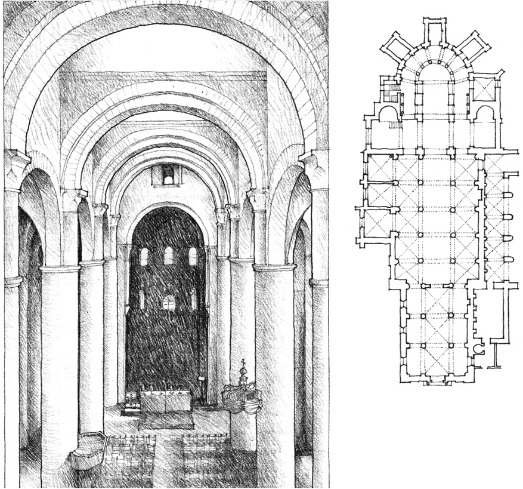

**St. Philibert**, Tournus, France, 950–1120.  
This view of the nave shows how rows of columns can provide a rhythmic measure of space.

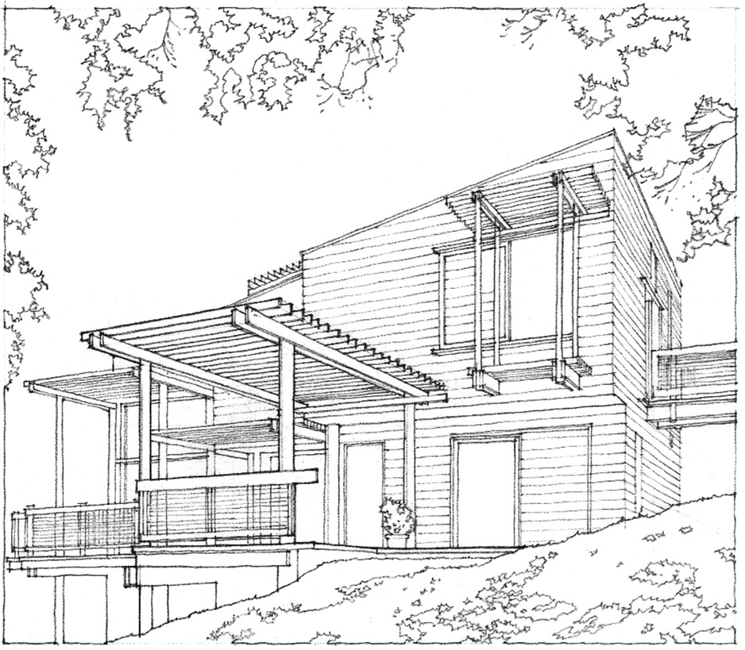

**Cary House**, Mill Valley, California, 1963, Joseph Esherick

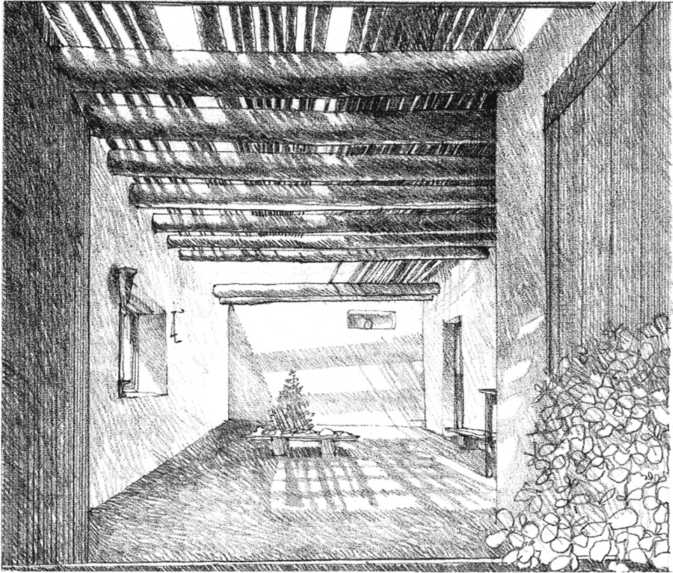

Trellised Courtyard, **Georgia O’Keefe Residence**, Abiquiu, northwest of Sante Fe, New Mexico

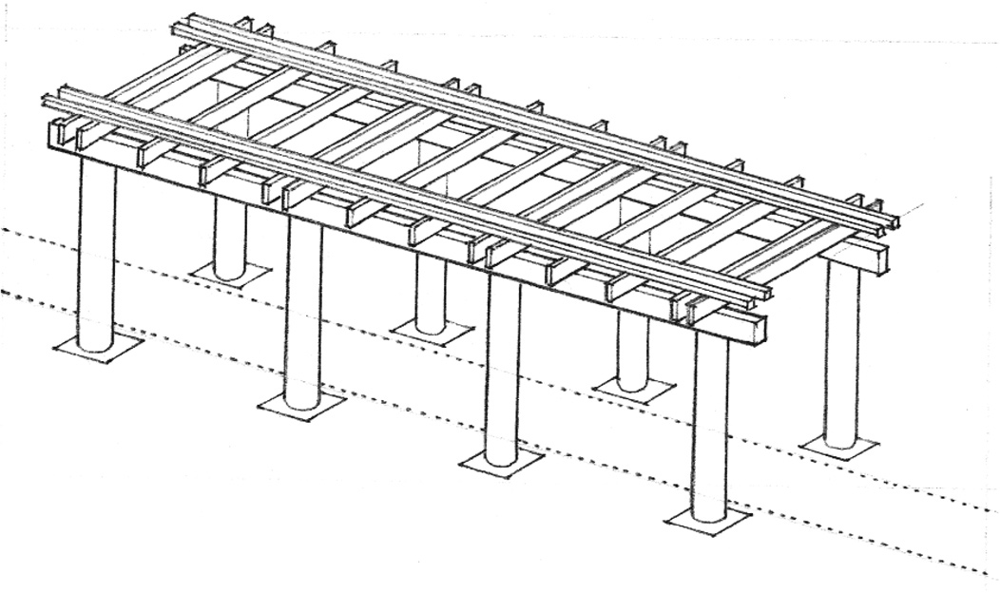

The linear members of trellises and pergolas can provide a moderate degree of definition and enclosure for outdoor spaces while allowing filtered sunlight and breezes to penetrate.

Vertical and horizontal linear elements together can define a volume of space such as the solarium illustrated to the right. Note that the form of the volume is determined solely by the configuration of the linear elements.

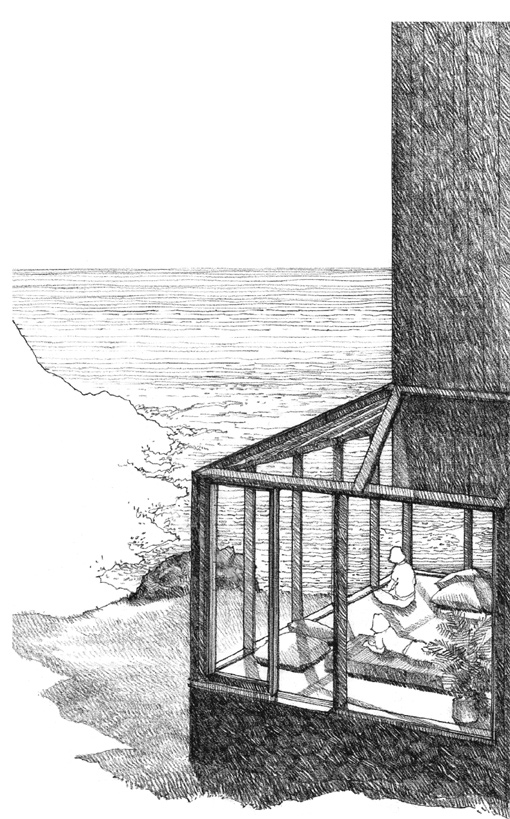

Solarium of **Condominium Unit 1, Sea Ranch**, California, 1966, Moore, Lyndon, Turnbull, Whitaker (MLTW)