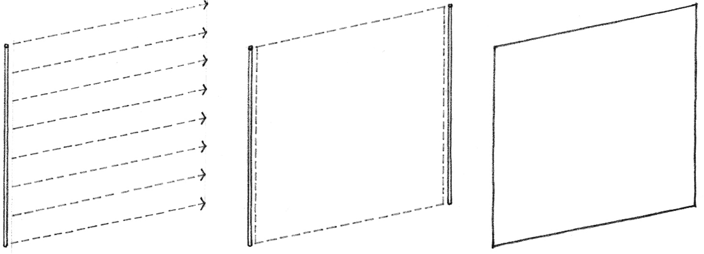
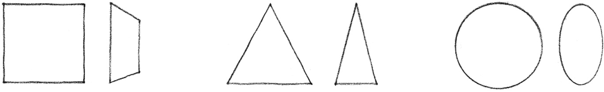
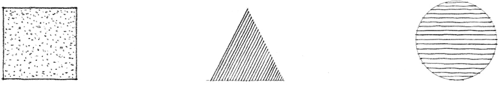
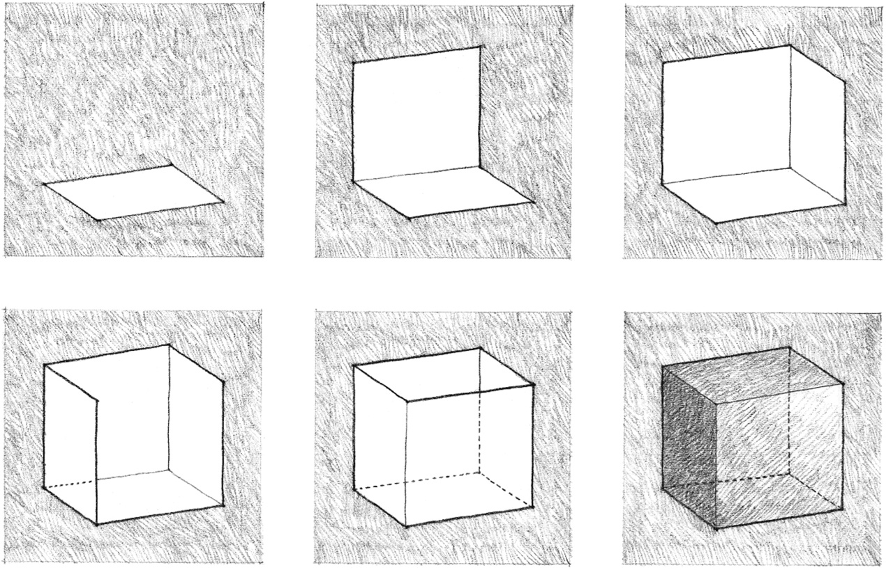
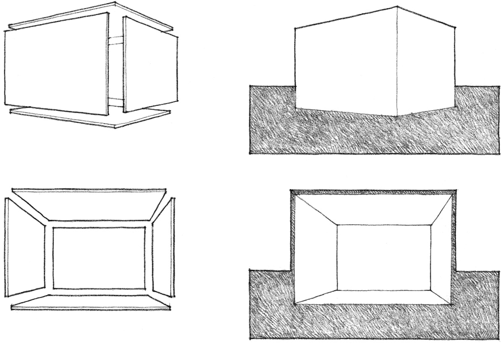
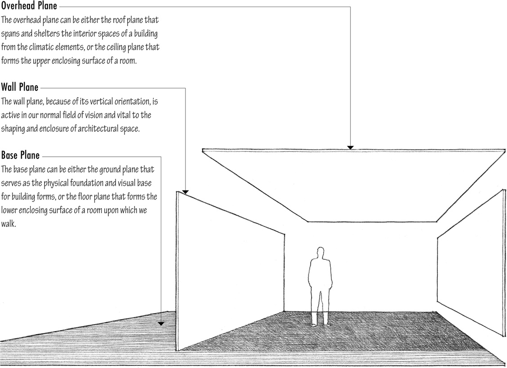

> [BREADCRUMB_CTX: 《Architecture》 > Plane]

## PLANE

A line extended in a direction other than its intrinsic direction becomes a plane. Conceptually, a plane has length and width, but no depth.

Shape is the primary identifying characteristic of a plane. It is determined by the contour of the line forming the edges of a plane. Because our perception of shape can be distorted by perspective foreshortening, we see the true shape of a plane only when we view it frontally.

The supplementary properties of a plane—its surface color, pattern, and texture—affect its visual weight and stability.

In the composition of a visual construction, a plane serves to define the limits or boundaries of a volume. If architecture as a visual art deals specifically with the formation of three-dimensional volumes of mass and space, then the plane should be regarded as a key element in the vocabulary of architectural design.

Planes in architecture define three-dimensional volumes of mass and space. The properties of each plane—size, shape, color, texture —as well as their spatial relationship to one another ultimately determine the visual attributes of the form they define and the qualities of the space they enclose.

In architectural design, we manipulate three generic types of planes:

