> [BREADCRUMB_CTX: 《Architecture》 > Planar Elements (Part 1)]

## PLANAR ELEMENTS

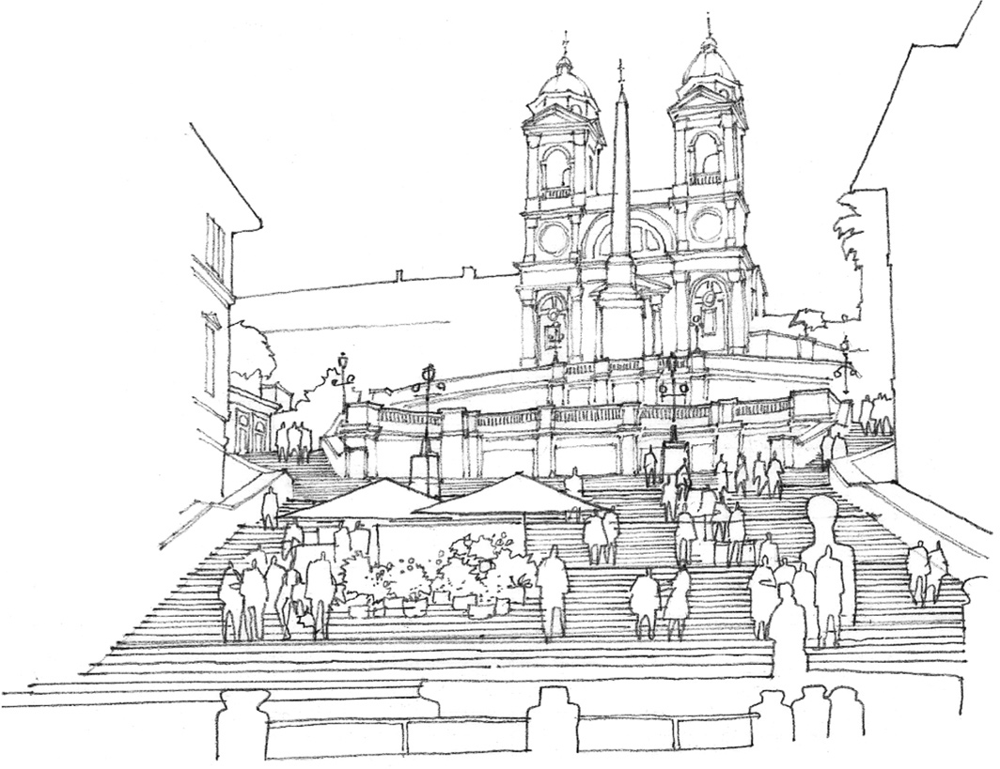

**Scala de Spagna (Spanish Steps)**, Rome, 1721–1725.  
Alessandro Specchi designed this civic project to connect the Piazza di Spagna with SS. Trinita de’ Monti; completed by Francesco de Sanctis.

The ground plane ultimately supports all architectural construction. Along with climate and other environmental conditions of a site, the topographical character of the ground plane influences the form of the building that rises from it. The building can merge with the ground plane, rest firmly on it, or be elevated above it.

The ground plane itself can be manipulated as well to establish a podium for a building form. It can be elevated to honor a sacred or significant place; bermed to define outdoor spaces or buffer against undesirable conditions; carved or terraced to provide a suitable platform on which to build; or stepped to allow changes in elevation to be easily traversed.

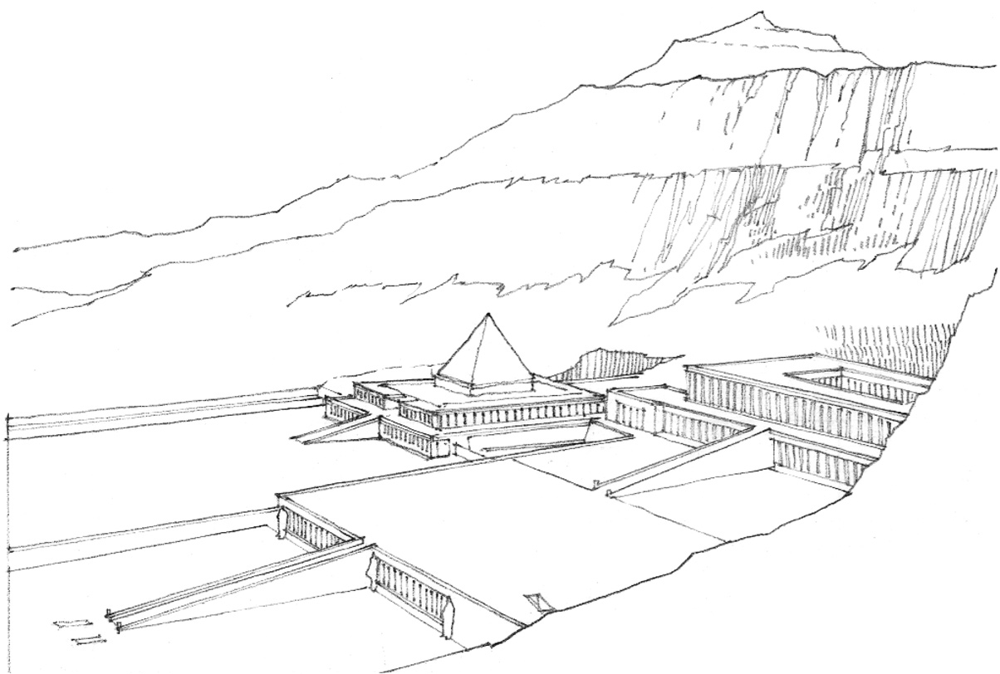

**Mortuary Temple of Queen Hatshepsut**, Dêr el-Bahari, Thebes, 1511–1480 B.C., Senmut.  
Three terraces approached by ramps rise toward the base of the cliffs where the chief sanctuary is cut deep into the rock.

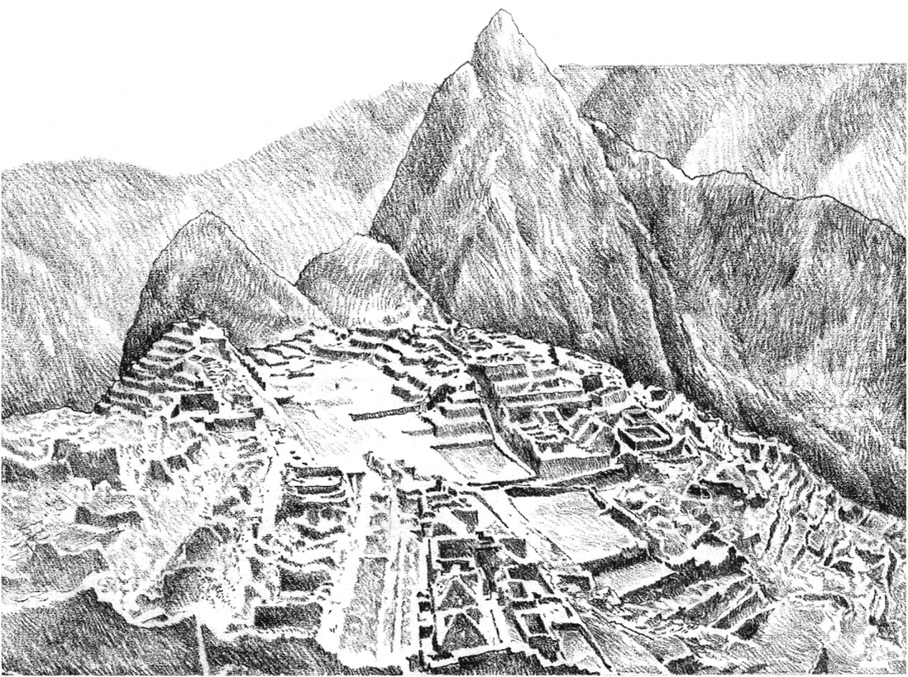

**Machu Picchu**, an ancient Incan city established c.1500 in the Andes Mountains on a saddle between two peaks, 8000 ft. above the Urubamba River in south-central Peru.

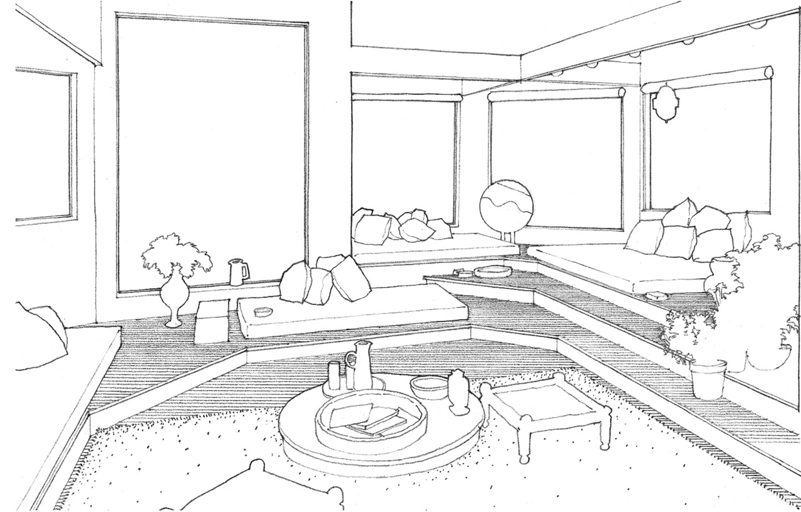

Sitting Area, **Lawrence House**, Sea Ranch, California, 1966, MLTW

The floor plane is the horizontal element that sustains the force of gravity as we move around and place objects for our use on it. It may be a durable covering of the ground plane or a more artificial, elevated plane spanning the space between its supports. In either case, the texture and density of the flooring material influences both the acoustical quality of a space and how we feel as we walk across its surface.

While the pragmatic, supportive nature of the floor plane limits the extent to which it can be manipulated, it is nonetheless an important element of architectural design. Its shape, color, and pattern determine to what degree it defines spatial boundaries or serves as a unifying element for the different parts of a space.

Like the ground plane, the form of a floor plane can be stepped or terraced to break the scale of a space down to human dimensions and create platforms for sitting, viewing, or performing. It can be elevated to define a sacred or honorific place. It can be rendered as a neutral ground against which other elements in a space are seen as figures.

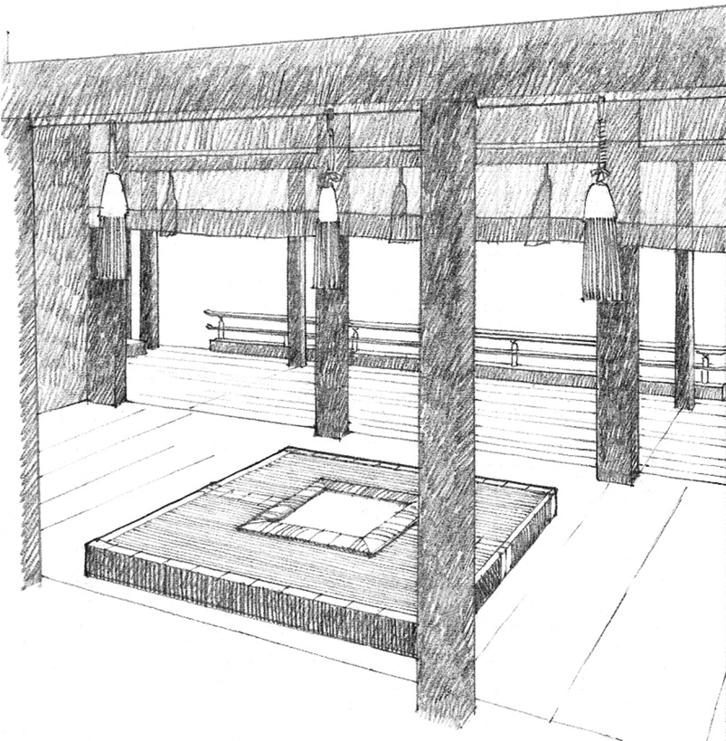

**Emperor’s Seat, Imperial Palace**, Kyoto, Japan, 17th century

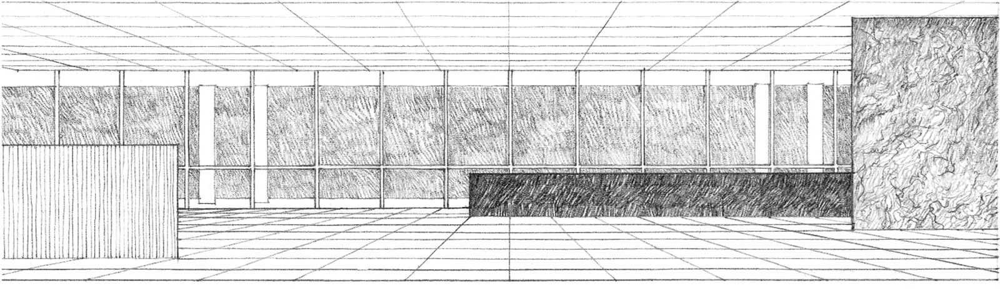

**Bacardi Office Building** (Project), Santiago de Cuba, 1958, Mies van der Rohe

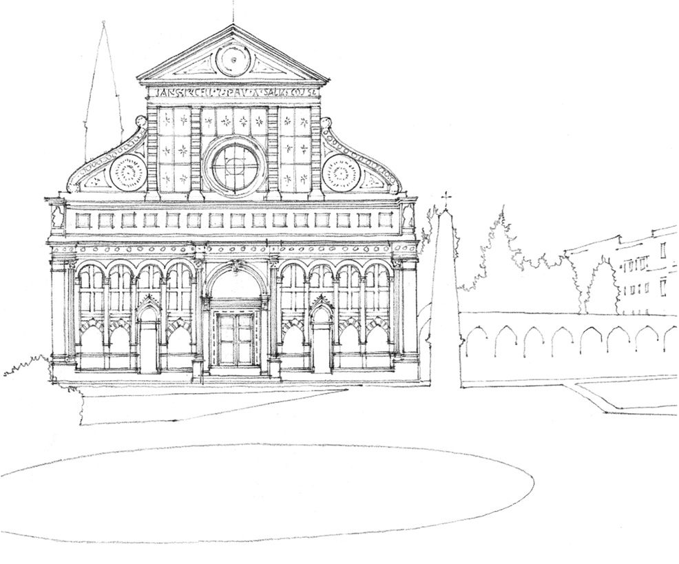

**S. Maria Novella**, Florence, 1456–1470.  
The Renaissance facade by Alberti presents a public face to a square.

Exterior wall planes isolate a portion of space to create a controlled interior environment. Their construction provides both privacy and protection from the climatic elements for the interior spaces of a building, while openings within or between their boundaries reestablish a connection with the exterior environment. As exterior walls mold interior space, they simultaneously shape exterior space and describe the form, massing, and image of a building in space.

As a design element, the plane of an exterior wall can be articulated as the front or primary facade of a building. In urban situations, these facades serve as walls that define courtyards, streets, and such public gathering places as squares and marketplaces.

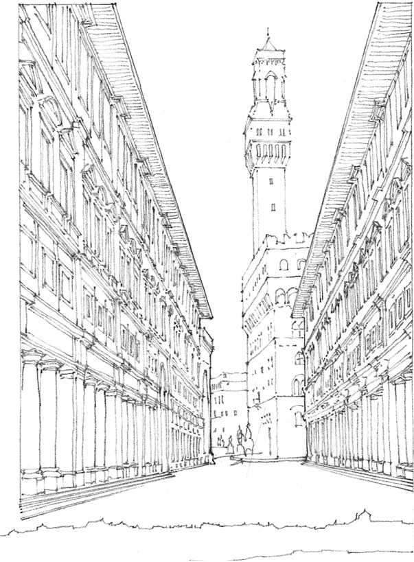

**Uffizi Palace**, 1560–1565, Giorgio Vasari.  
This Florentine street defined by the two wings of the Uffizi Palace links the Piazza della Signoria with the River Arno.

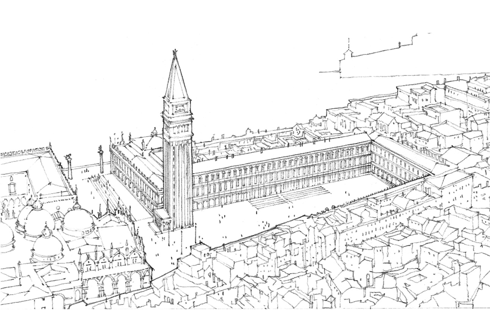

**Piazza San Marco**, Venice.  
The continuous facades of buildings form the “walls” of the urban space.

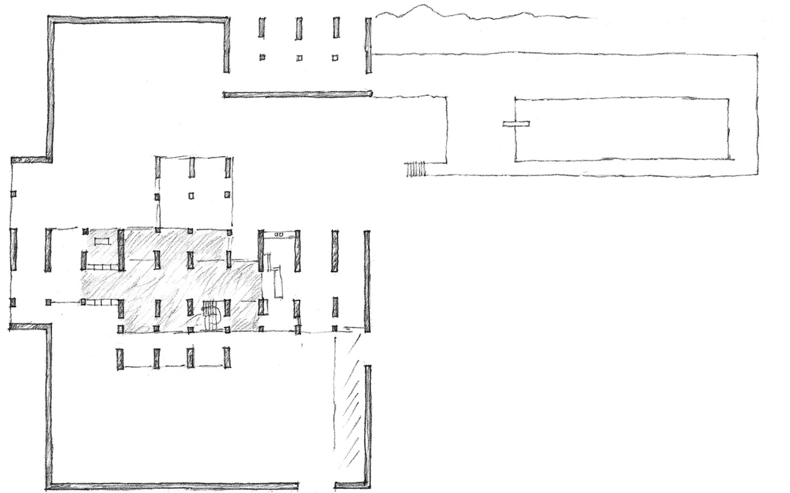

**Peyrissac Residence**, Cherchell, Algeria, 1942, Le Corbusier

A compelling way to use the vertical wall plane is as a supporting element in the bearing-wall structural system. When arranged in a parallel series to support an overhead floor or roof plane, bearing walls define linear slots of space with strong directional qualities. These spaces can be related to one another only by interrupting the bearing walls to create perpendicular zones of space.

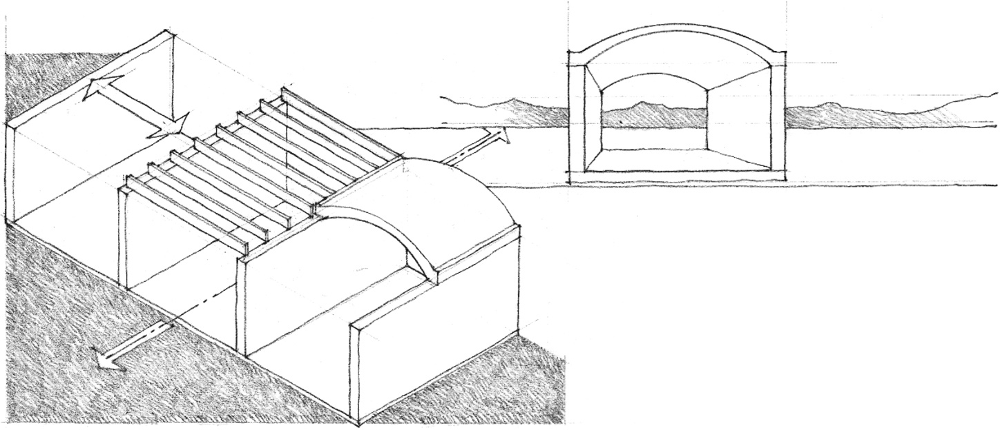
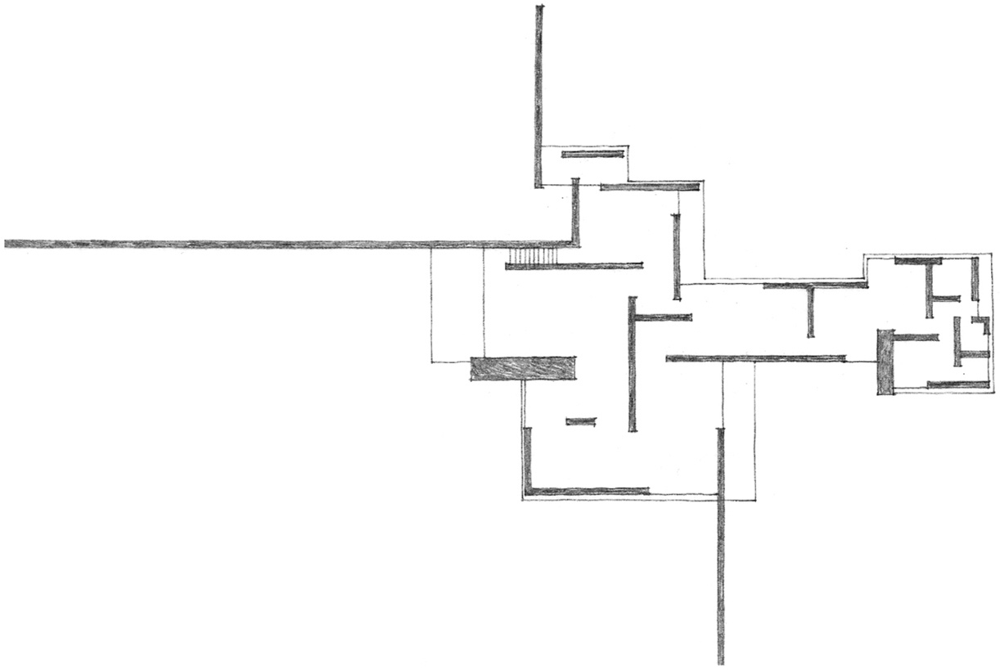

**Country House in Brick** (Project), 1923, Mies van der Rohe

In the project to the right, freestanding brick bearing walls, together with L-shaped and T-shaped configurations of planes, create an interlocking series of spaces.

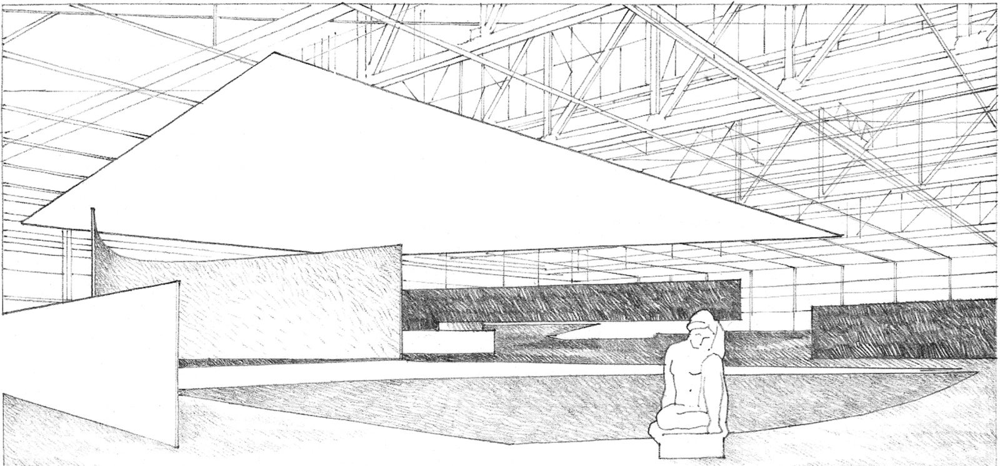

**Concert Hall** (Project), 1942, Mies van der Rohe

Interior wall planes govern the size and shape of the internal spaces or rooms within a building. Their visual properties, their relationship to one another, and the size and distribution of openings within their boundaries determine both the quality of the spaces they define and the degree to which adjoining spaces relate to one another.

As a design element, a wall plane can merge with the floor or ceiling plane, or be articulated as an element isolated from adjacent planes. It can be treated as a passive or receding backdrop for other elements in the space, or it can assert itself as a visually active element within a room by virtue of its form, color, texture, or material.

While walls provide privacy for interior spaces and serve as barriers that limit our movement, doorways and windows reestablish continuity with neighboring spaces and allow the passage of light, heat, and sound. As they increase in size, these openings begin to erode the natural sense of enclosure walls provide. Views seen through the openings become part of the spatial experience.

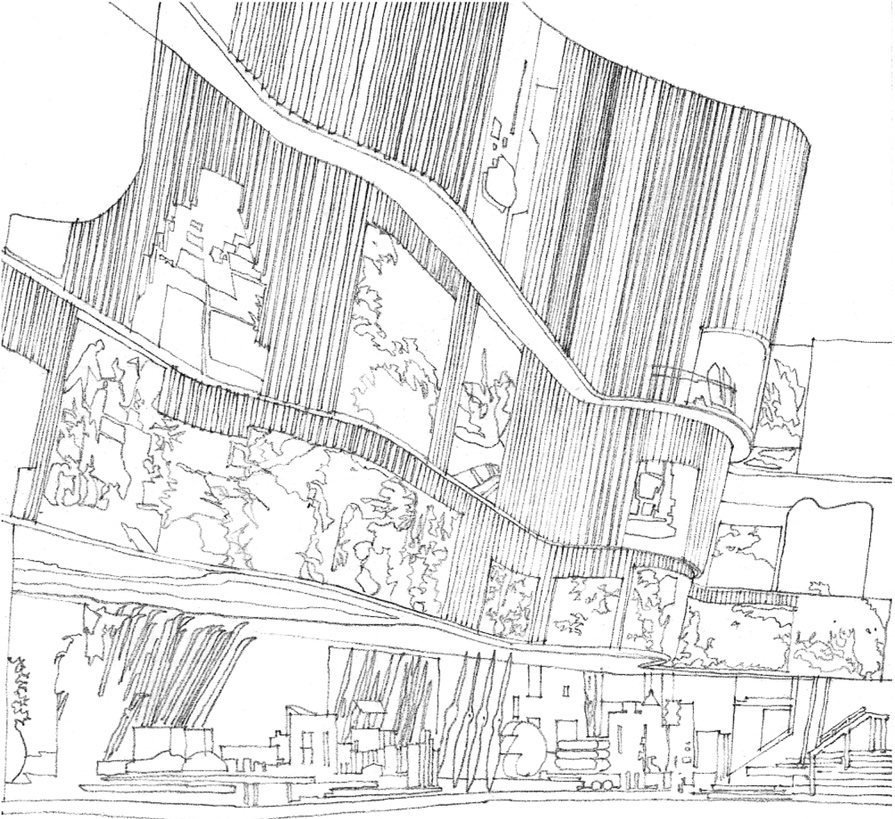

**Finnish Pavilion**, New York World’s Fair, 1939, Alvar Aalto

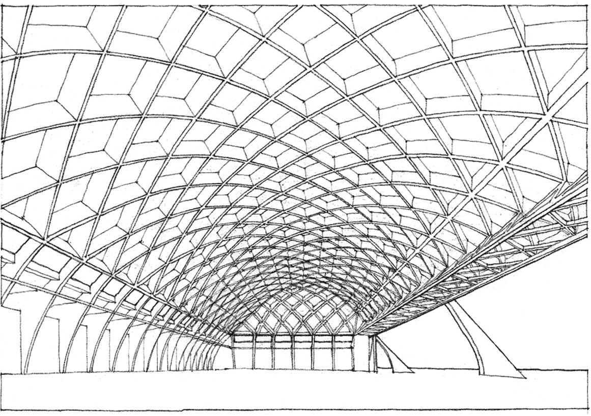

**Hangar, Design I**, 1935, Pier Luigi Nervi.  
The lamella structure expresses the way forces are resolved and channeled down to the roof supports.

While we walk on a floor and have physical contact with walls, the ceiling plane is usually out of our reach and is almost always a purely visual event in a space. It may be the underside of an overhead floor or roof plane and express the form of its structure as it spans the space between its supports, or it may be suspended as the upper enclosing surface of a room or hall.

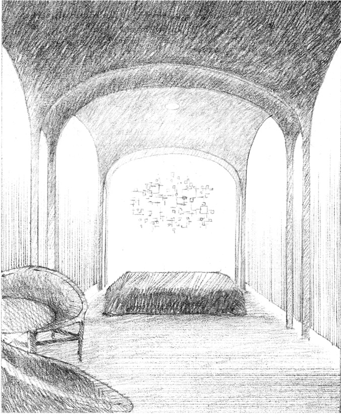

**Brick House**, New Canaan, Connecticut, 1949, Philip Johnson. The detached vaulted ceiling plane appears to float above the bed.

As a detached lining, the ceiling plane can symbolize the sky vault or be the primary sheltering element that unifies the different parts of a space. It can serve as a repository for frescoes and other means of artistic expression or be treated simply as a passive or receding surface. It can be raised or lowered to alter the scale of a space or to define spatial zones within a room. Its form can be manipulated to control the quality of light or sound within a space.

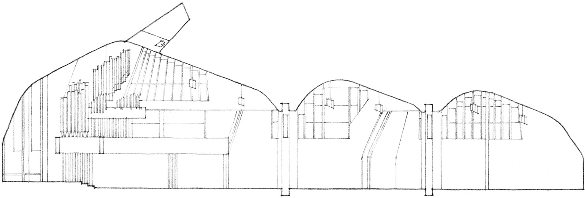

**Church at Vuoksenniska**, Imatra, Finland, 1956, Alvar Aalto.  
The form of the ceiling plane defines a progression of spaces and enhances their acoustical quality.

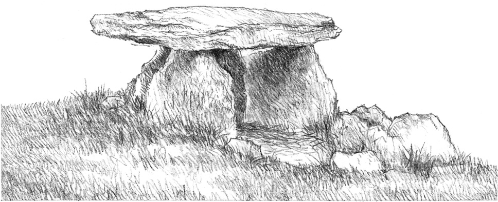

**Dolmen**, a prehistoric monument consisting of two or more large upright stones supporting a horizontal stone slab, found especially in Britain and France and usually regarded as a burial place for an important person.