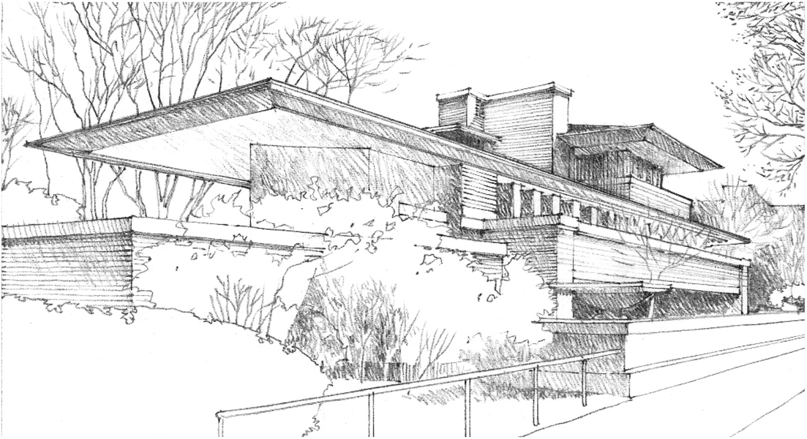
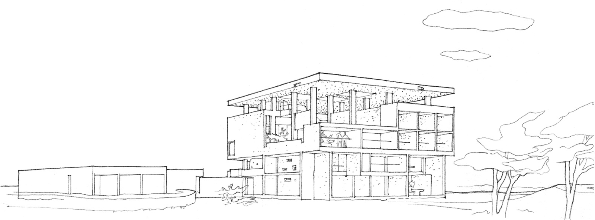
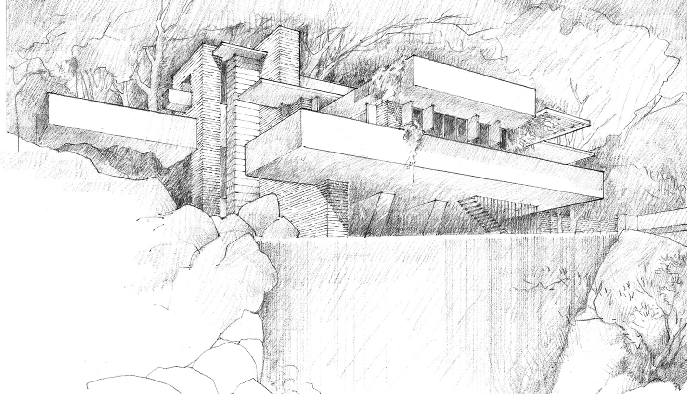
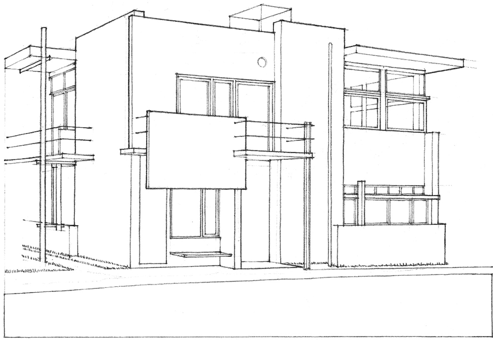

## Planar Elements (Part 2)

> [BREADCRUMB_CTX: 《Architecture》 > Planar Elements (Part 2)]

The roof plane is the essential sheltering element that protects the interior of a building from the climatic elements. The form and geometry of its structure is established by the manner in which it spans across space to bear on its supports and slopes to shed rain and melting snow. As a design element, the roof plane is significant because of the impact it can have on the form and silhouette of a building within its setting.

The roof plane can be hidden from view by the exterior walls of a building or merge with the walls to emphasize the volume of the building mass. It can be expressed as a single sheltering form that encompasses a variety of spaces beneath its canopy, or comprise a number of hats that articulate a series of spaces within a single building.

**Robie House**, Chicago,1909, Frank Lloyd Wright.  
The low sloping roof planes and broad overhangs are characteristic of the Prairie School of Architecture.

A roof plane can extend outward to form overhangs that shield door and window openings from sun or rain, or continue downward further still to relate itself more closely to the ground plane. In warm climates, it can be elevated to allow cooling breezes to flow across and through the interior spaces of a building.

**Shodhan House**, Ahmedabad, India, 1956, Le Corbusier.  
A grid of columns elevates the reinforced concrete roof slab above the main volume of the house.

**Fallingwater (Kaufmann House)**, near Ohiopyle, Pennsylvania, 1936–1937, Frank Lloyd Wright.  
Reinforced concrete slabs express the horizontality of the floor and roof planes as they cantilever outward from a central vertical core.

The overall form of a building can be endowed with a distinctly planar quality by carefully introducing openings that expose the edges of vertical and horizontal planes. These planes can be further differentiated and accentuated by changes in color, texture, or material.

**Schröder House**, Utrecht, 1924–1925, Gerrit Thomas Rietveld.  
Asymmetrical compositions of simple rectangular forms and primary colors characterized the de Stijl School of Art and Architecture.