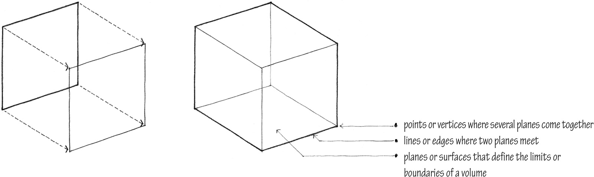
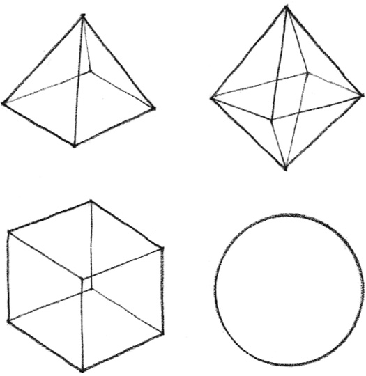
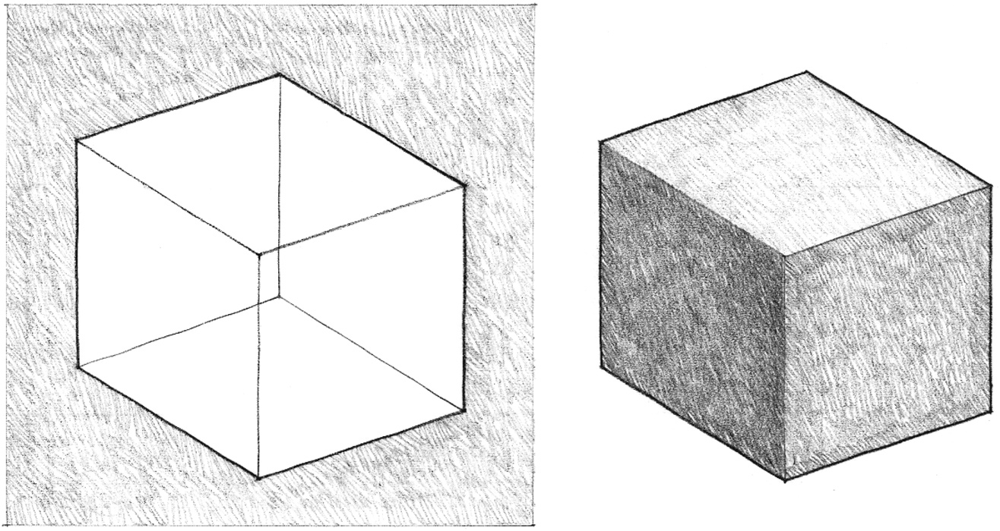
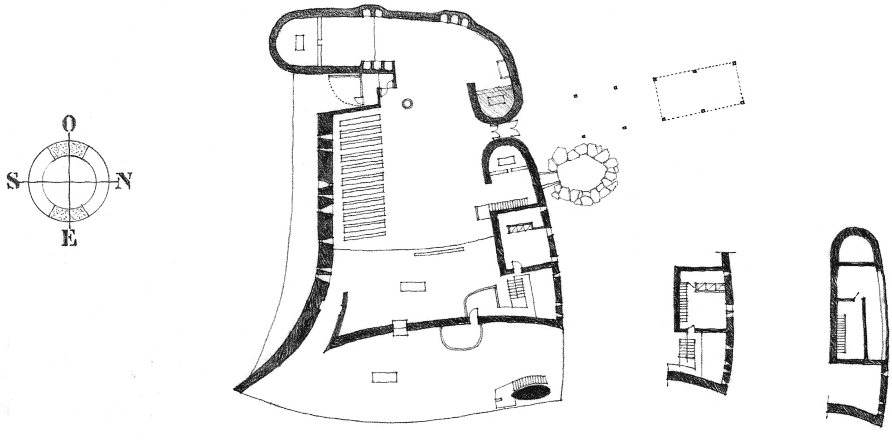
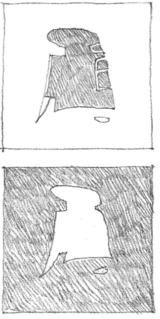
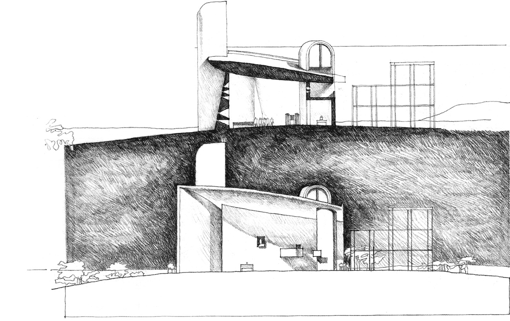

> [BREADCRUMB_CTX: 《Architecture》 > Volume]

## VOLUME

A plane extended in a direction other than its intrinsic direction becomes a volume. Conceptually, a volume has three dimensions: length, width, and depth.

All volumes can be analyzed and understood to consist of:

Form is the primary identifying characteristic of a volume. It is established by the shapes and interrelationships of the planes that describe the boundaries of the volume.

As the three-dimensional element in the vocabulary of architectural design, a volume can be either a solid—space displaced by mass—or a void—space contained or enclosed by planes.

### Plan and Section

Space defined by wall, floor, and ceiling or roof planes

In architecture, a volume can be seen to be either a portion of space contained and defined by wall, floor, and ceiling or roof planes, or a quantity of space displaced by the mass of a building. It is important to perceive this duality, especially when reading orthographic plans, elevations, and sections.

### Elevation

Space displaced by the mass of a building

**Notre Dame Du Haut**, Ronchamp, France, 1950–1955, Le Corbusier