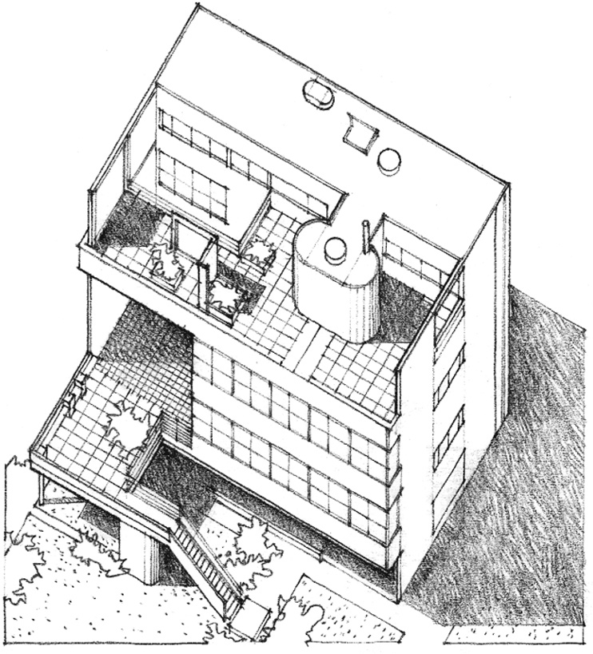
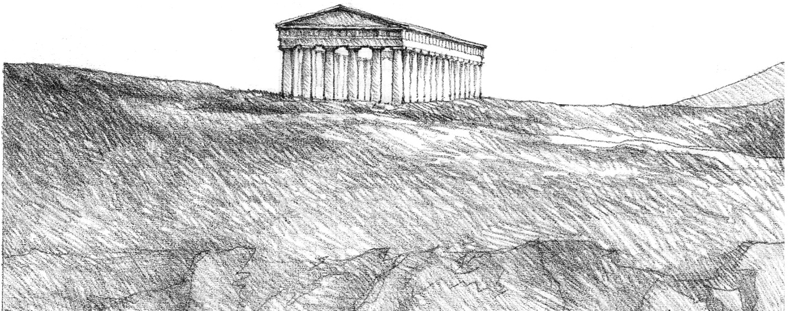
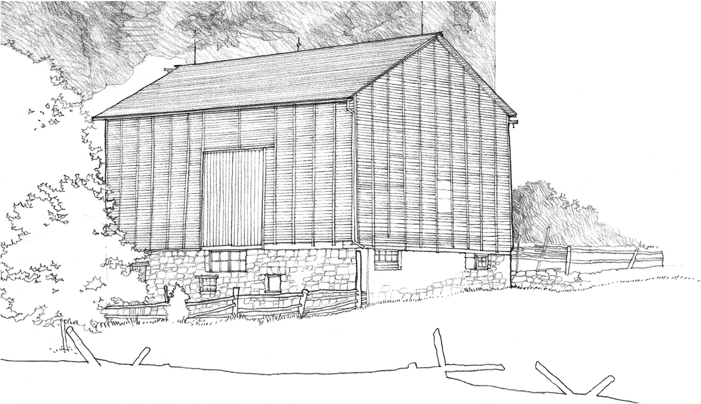
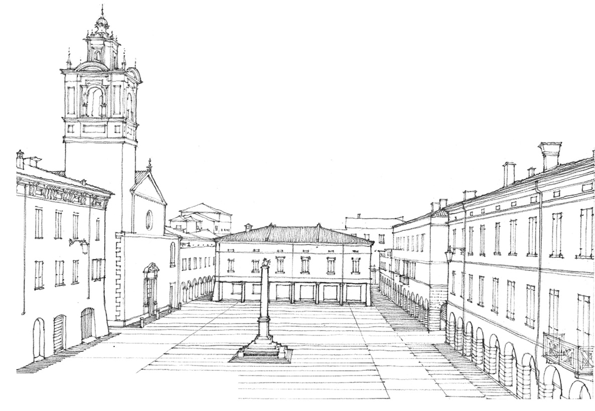
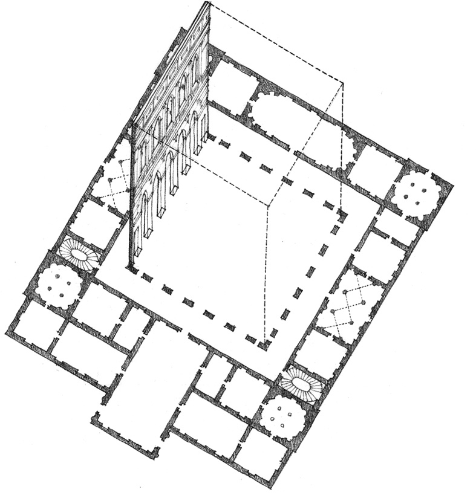
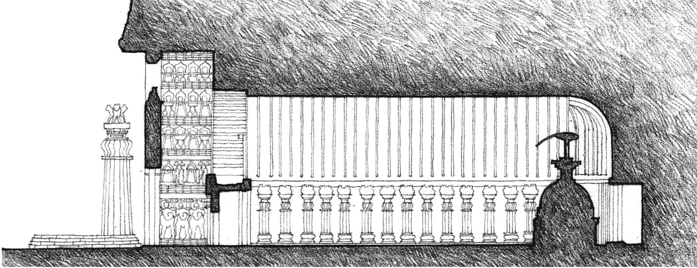
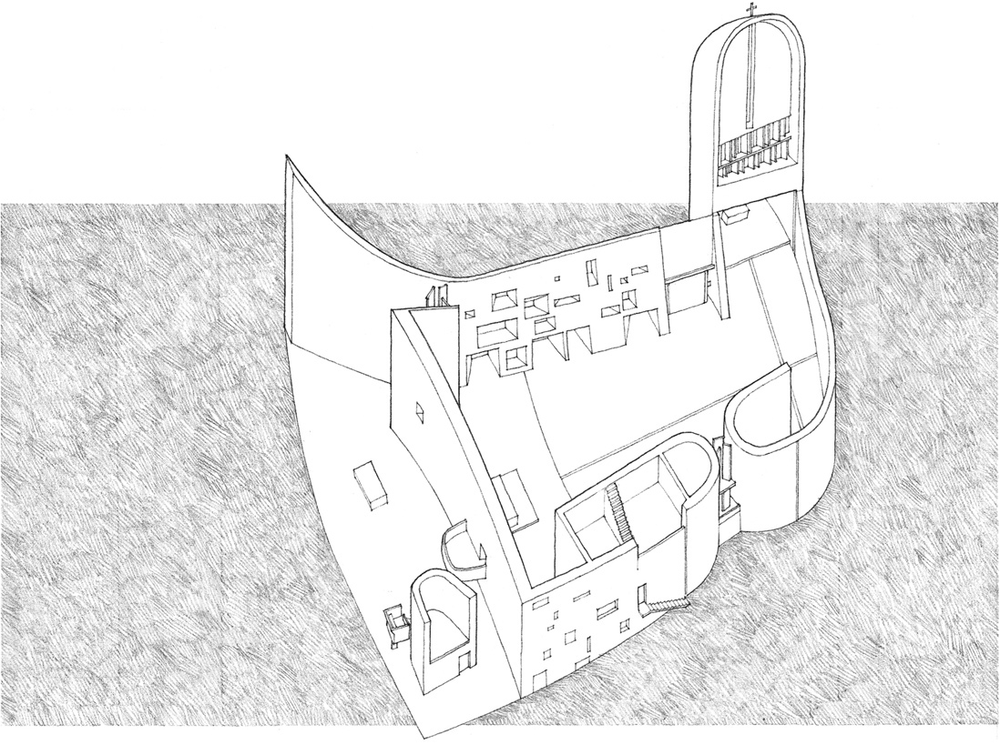

> [BREADCRUMB_CTX: 《Architecture》 > Volumetric Elements]

## VOLUMETRIC ELEMENTS

Building forms that stand as objects in the landscape can be read as occupying volumes in space.

**Villa Garches**, Vaucresson, France, 1926–1927, Le Corbusier

**Doric Temple at Segesta**, Sicily, c. 424–416 B.C.

**Barn** in Ontario, Canada

Building forms that serve as containers can be read as masses that define volumes of space.

**Piazza Maggiore**, Sabbioneta, Italy.  
A series of buildings enclose an urban square.

**Palazzo Thiene**, Vicenza, Italy, 1545, Andrea Palladio.  
The interior rooms surround a cortile— the principal courtyard of an Italian palazzo.

**Buddhist Chaitya Hall at Karli**, Maharashtra, India, A.D. 100–125.  
The sanctuary is a volume of space carved out of the mass of solid rock.

**Notre Dame Du Haut**, Ronchamp, France, 1950–1955, Le Corbusier