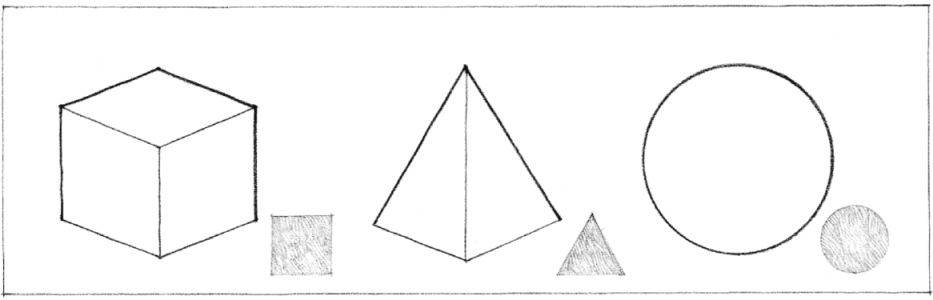
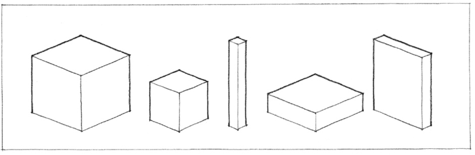
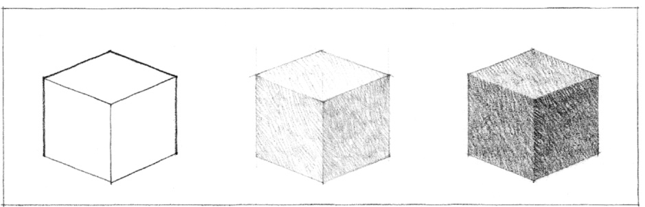
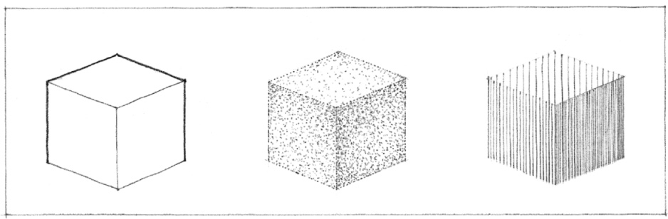

> [BREADCRUMB_CTX: 《Architecture》 > Form]

## FORM

Form is an inclusive term that has several meanings. It may refer to an external appearance that can be recognized, as that of a chair or the human body that sits in it. It may also allude to a particular condition in which something acts or manifests itself, as when we speak of water in the form of ice or steam. In art and design, we often use the term to denote the formal structure of a work—the manner of arranging and coordinating the elements and parts of a composition so as to produce a coherent image.

In the context of this study, form suggests reference to both internal structure and external outline and the principle that gives unity to the whole. While form often includes a sense of three-dimensional mass or volume, shape refers more specifically to the essential aspect of form that governs its appearance—the configuration or relative disposition of the lines or contours that delimit a figure or form.

### Shape

The characteristic outline or surface configuration of a particular form. Shape is the principal aspect by which we identify and categorize forms.

In addition to shape, forms have visual properties of:

### Size

The physical dimensions of length, width, and depth of a form. While these dimensions determine the proportions of a form, its scale is determined by its size relative to other forms in its context.

### Color

A phenomenon of light and visual perception that may be described in terms of an individual’s perception of hue, saturation, and tonal value. Color is the attribute that most clearly distinguishes a form from its environment. It also affects the visual weight of a form.

### Texture

The visual and especially tactile quality given to a surface by the size, shape, arrangement, and proportions of the parts. Texture also determines the degree to which the surfaces of a form reflect or absorb incident light.

