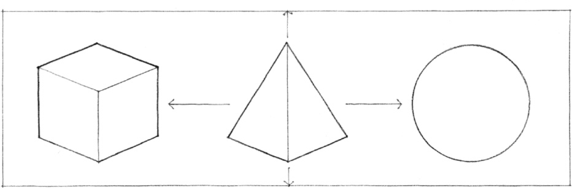
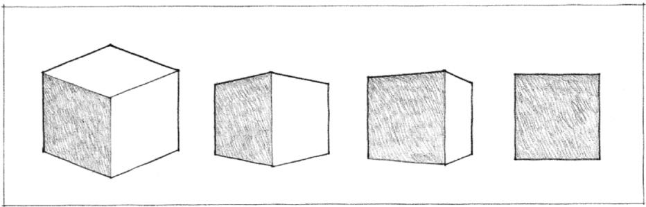
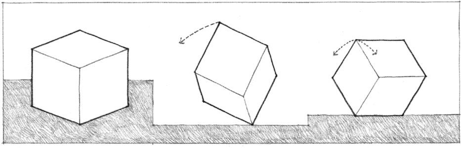
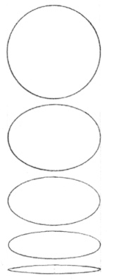

> [BREADCRUMB_CTX: 《Architecture》 > Properties of Form]

## PROPERTIES OF FORM

Forms also have relational properties that govern the pattern and composition of elements:

### Position

The location of a form relative to its environment or the visual field within which it is seen.

### Orientation

The direction of a form relative to the ground plane, the compass points, other forms, or to the person viewing the form.

### Visual Inertia

The degree of concentration and stability of a form. The visual inertia of a form depends on its geometry as well as its orientation relative to the ground plane, the pull of gravity, and our line of sight.

All of these properties of form are in reality affected by the conditions under which we view them.

* A changing perspective or angle of view presents different shapes or aspects of a form to our eyes.
* Our distance from a form determines its apparent size.
* The lighting conditions under which we view a form affects the clarity of its shape and structure.
* The visual field surrounding a form influences our ability to read and identify it.

