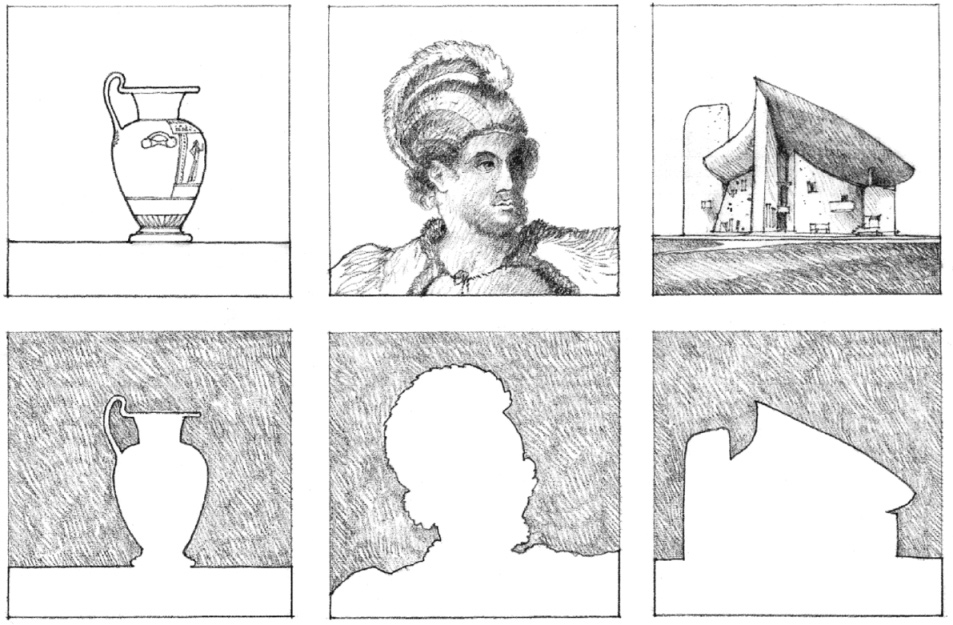
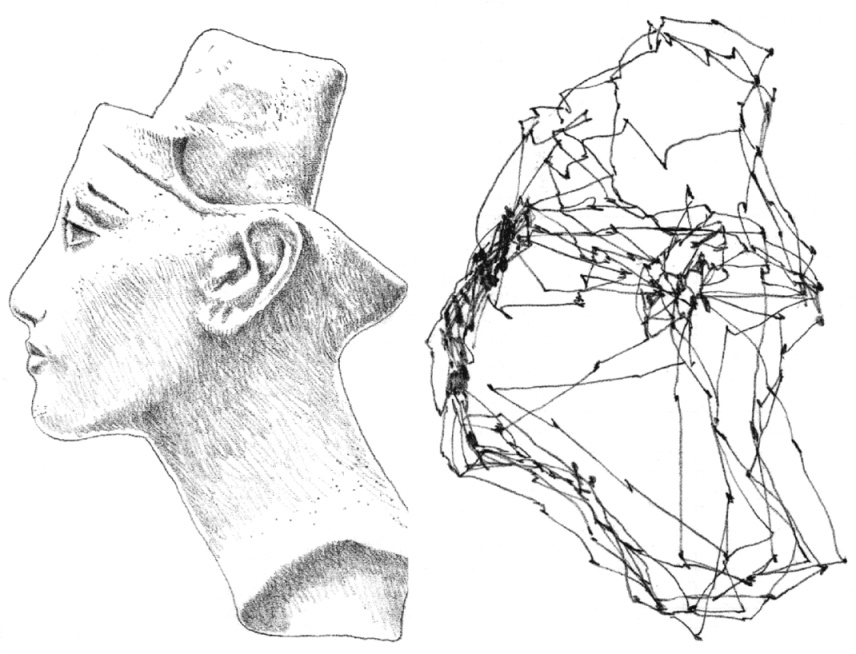
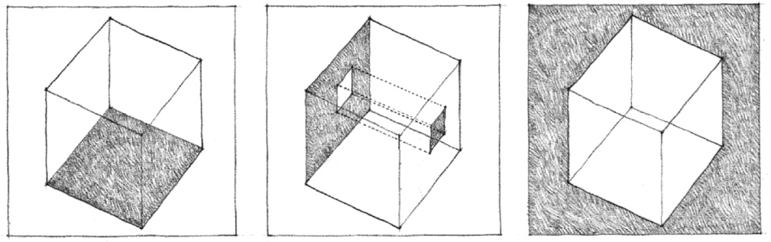
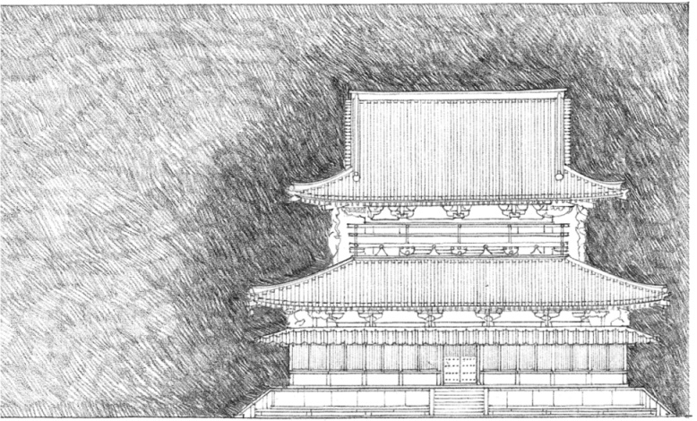
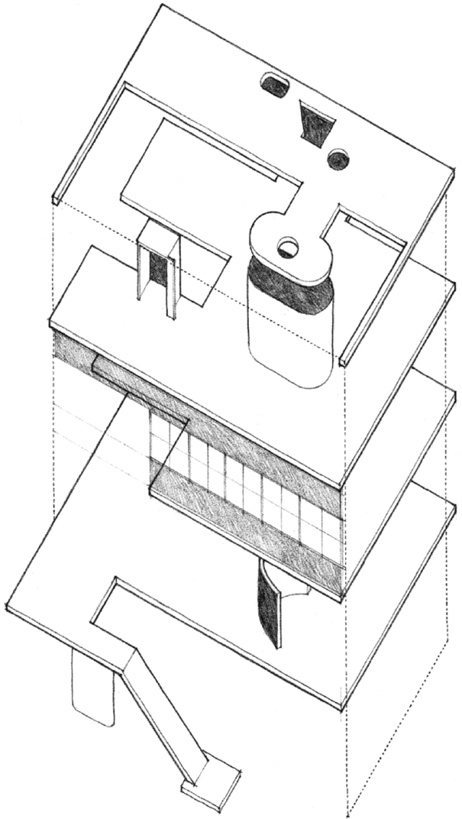
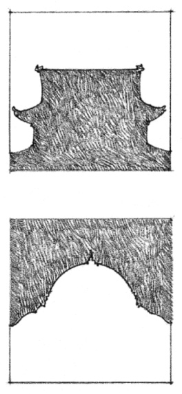
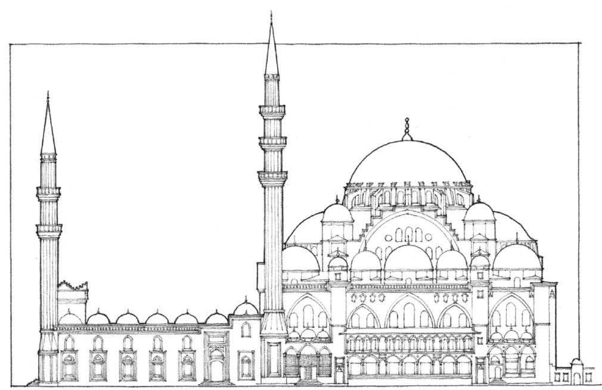

> [BREADCRUMB_CTX: 《Architecture》 > Shape]

## SHAPE

Shape refers to the characteristic outline of a plane figure or the surface configuration of a volumetric form. It is the primary means by which we recognize, identify, and categorize particular figures and forms. Our perception of shape depends on the degree of visual contrast that exists along the contour separating a figure from its ground or between a form and its field.

**Bust of Queen Nefertiti**  
The pattern of eye movement of a person viewing the figure, from research by Alfred L. Yarbus of the Institute for Problems of Information Transmission in Moscow.

In architecture, we are concerned with the shapes of:

* floor, wall, and ceiling planes that enclose space
* door and window openings within a spatial enclosure
* silhouettes and contours of building forms

These examples illustrate how shaping the juncture between mass and space expresses the manner in which the contours of a building mass rise from the ground plane and meet the sky.

**Central Pavilion, Horyu-Ji Temple**, Nara, Japan, A.D. 607

**Villa Garches**, Vaucresson, France, 1926–1927, Le Corbusier. This architectural composition illustrates the interplay between the shapes of planar solids and voids.

**Suleymaniye Mosque,** Constantinople (Istanbul), 1551–1558, Mimar Sinan