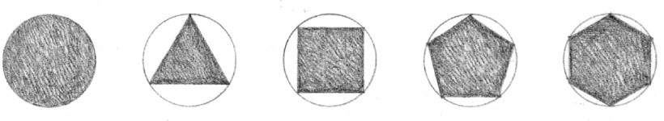
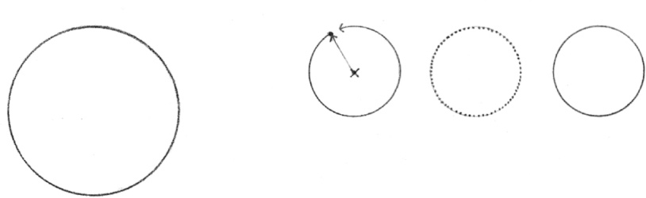
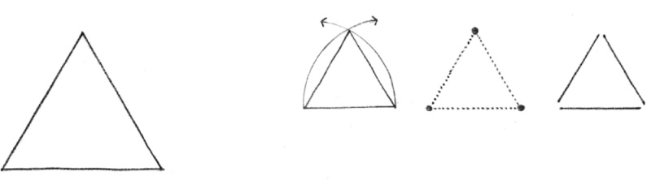
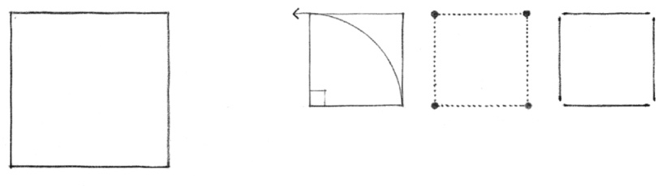

> [BREADCRUMB_CTX: 《Architecture》 > Primary Shapes]

## PRIMARY SHAPES

Gestalt psychology affirms that the mind will simplify the visual environment in order to understand it. Given any composition of forms, we tend to reduce the subject matter in our visual field to the simplest and most regular shapes. The simpler and more regular a shape is, the easier it is to perceive and understand.

From geometry we know the regular shapes to be the circle, and the infinite series of regular polygons that can be inscribed within it. Of these, the most significant are the primary shapes: the circle, the triangle, and the square.

### Circle

A plane curve every point of which is equidistant from a fixed point within the curve

### Triangle

A plane figure bounded by three sides and having three angles

### Square

A plane figure having four equal sides and four right angles

