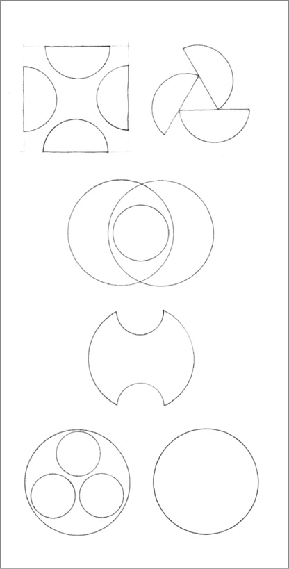
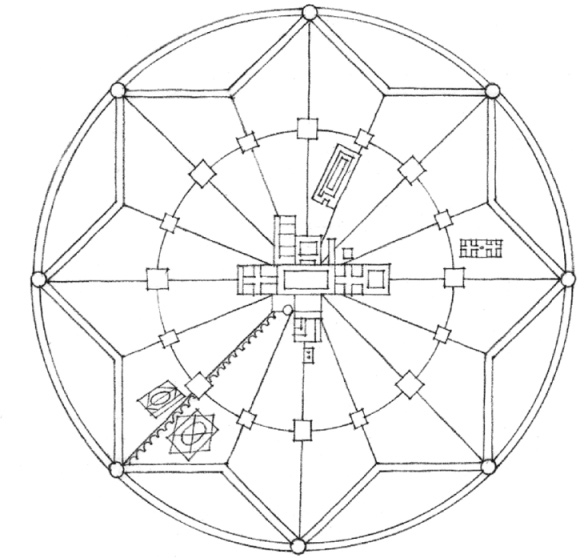
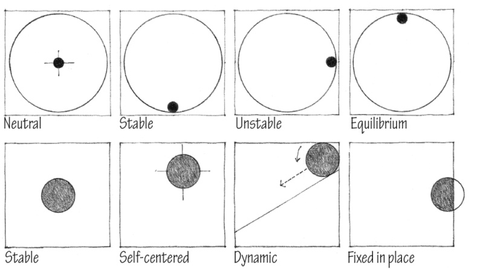
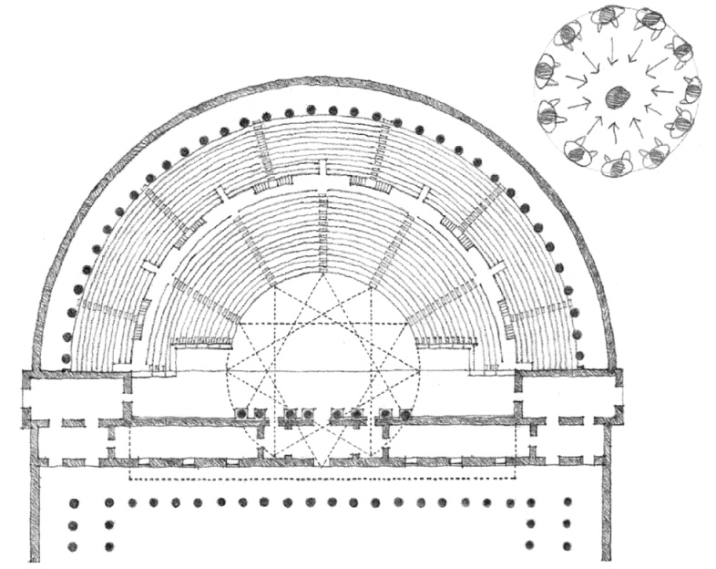

> [BREADCRUMB_CTX: 《Architecture》 > Circle]

## CIRCLE

Compositions of circles and circular segments

**Plan of the Ideal City of Sforzinda**, 1464, Antonio Filarete

The circle is a centralized, introverted figure that is normally stable and self-centering in its environment. Placing a circle in the center of a field reinforces its inherent centrality. Associating it with straight or angular forms or placing an element along its circumference, however, can induce in the circle an apparent rotary motion.

**Roman Theater** according to Vitruvius