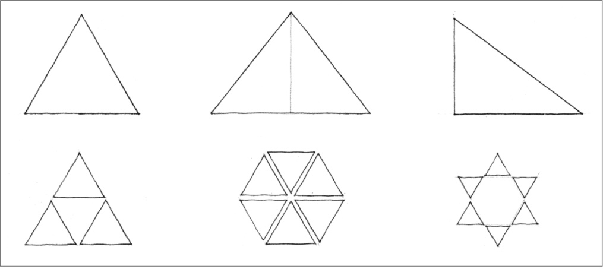
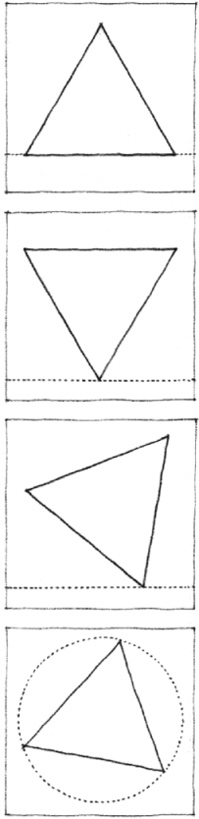
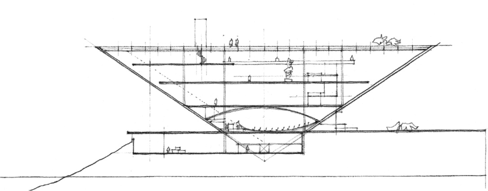
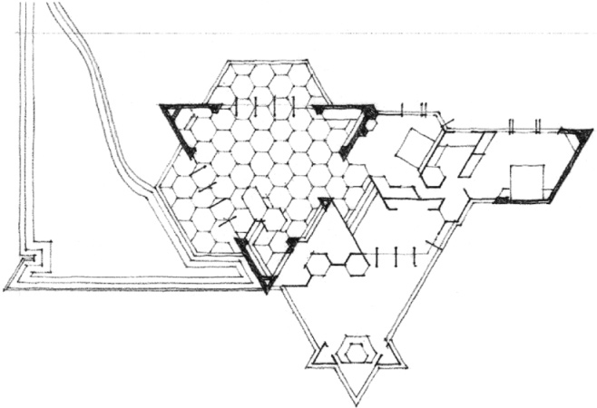
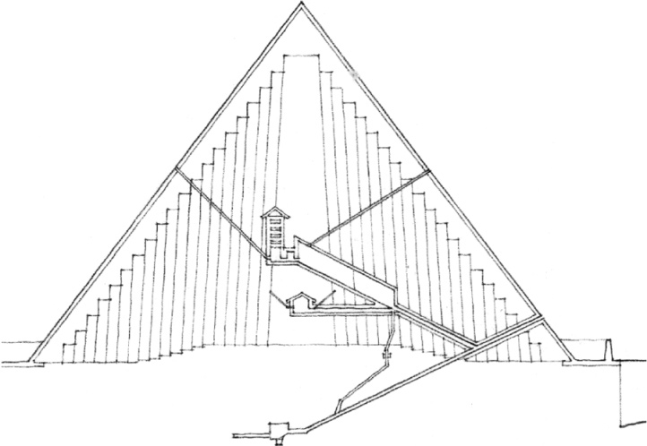

> [BREADCRUMB_CTX: 《Architecture》 > Triangle]

## TRIANGLE

The triangle signifies stability. When resting on one of its sides, the triangle is an extremely stable figure. When tipped to stand on one of its vertices, however, it can either be balanced in a precarious state of equilibrium or be unstable and tend to fall over onto one of its sides.

**Modern Art Museum, Caracas** (Project), Venezuela, 1955, Oscar Niemeyer

**Vigo Sundt House**, Madison, Wisconsin, 1942, Frank Lloyd Wright

**Great Pyramid of Cheops at Giza**, Egypt, c. 2500 B.C.