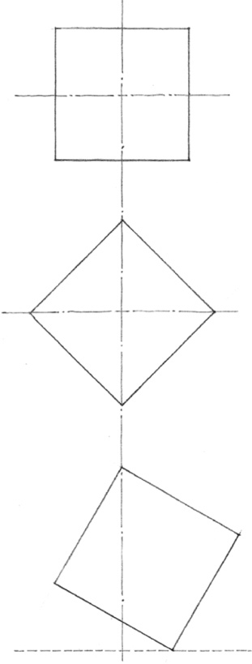
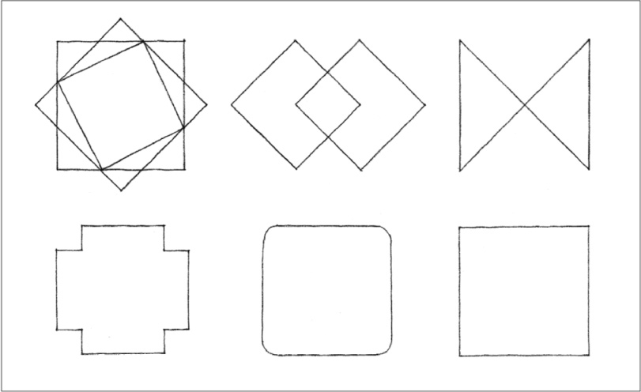
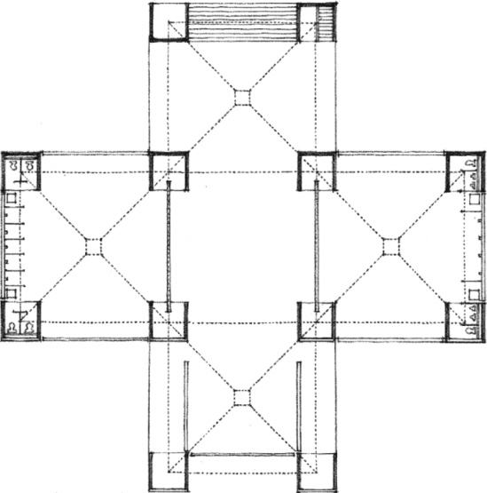
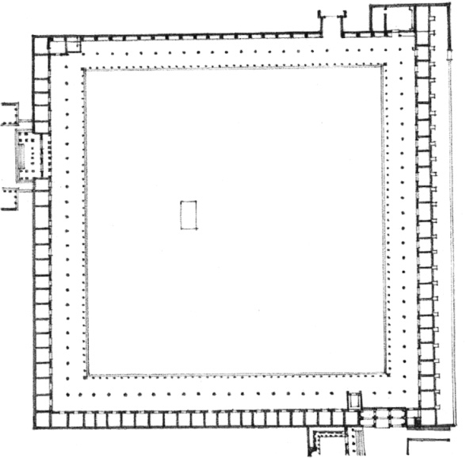

> [BREADCRUMB_CTX: 《Architecture》 > Square]

## SQUARE

**Compositions resulting from the rotation and modification of the square**

The square represents the pure and the rational. It is a bilaterally symmetrical figure having two equal and perpendicular axes. All other rectangles can be considered variations of the square—deviations from the norm by the addition of height or width. Like the triangle, the square is stable when resting on one of its sides and dynamic when standing on one of its corners. When its diagonals are vertical and horizontal, however, the square exists in a balanced state of equilibrium.

**Bathhouse, Jewish Community Center**, Trenton, New Jersey, 1954–1959, Louis Kahn

**Agora of Ephesus**, Asia Minor, 3rd century B. C.