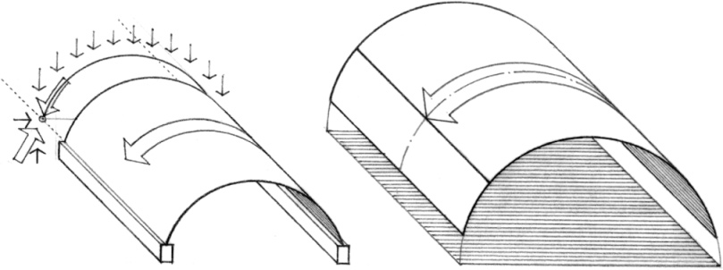
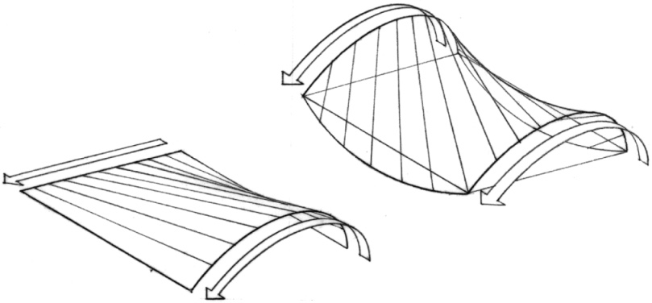
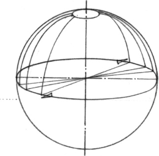
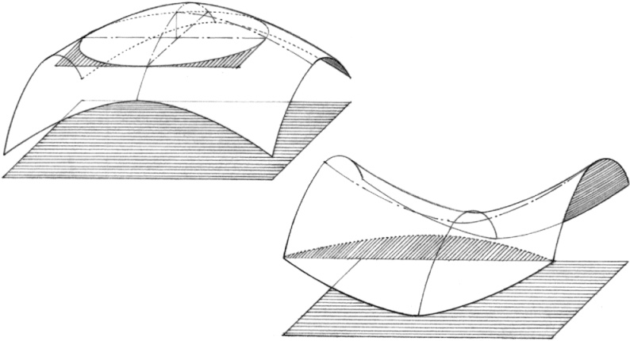

> [BREADCRUMB_CTX: 《Architecture》 > Surfaces]

## SURFACES

In the transition from the shapes of planes to the forms of volumes is situated the realm of surfaces. Surface first refers to any figure having only two dimensions, such as a flat plane. The term, however, can also allude to a curved two-dimensional locus of points defining the boundary of a three-dimensional solid. There is a special class of the latter that can be generated from the geometric family of curves and straight lines. This class of curved surfaces include the following:

* Cylindrical surfaces are generated by sliding a straight line along a plane curve, or vice versa. Depending on the curve, a cylindrical surface may be circular, elliptic, or parabolic. Because of its straight line geometry, a cylindrical surface can be regarded as being either a translational or a ruled surface.
* Translational surfaces are generated by sliding a plane curve along a straight line or over another plane curve.

* Ruled surfaces are generated by the motion of a straight line. Because of its straight line geometry, a ruled surface is generally easier to form and construct than a rotational or translational surface.

* Rotational surfaces are generated by rotating a plane curve about an axis.

* Paraboloids are surfaces all of whose intersections by planes are either parabolas and ellipses or parabolas and hyperbolas. Parabolas are plane curves generated by a moving point that remains equidistant from a fixed line and a fixed point not on the line. Hyperbolas are plane curves formed by the intersection of a right circular cone with a plane that cuts both halves of the cone.
* Hyperbolic paraboloids are surfaces generated by sliding a parabola with downward curvature along a parabola with upward curvature, or by sliding a straight line segment with its ends on two skew lines. It can thus be considered to be both a translational and a ruled surface.

