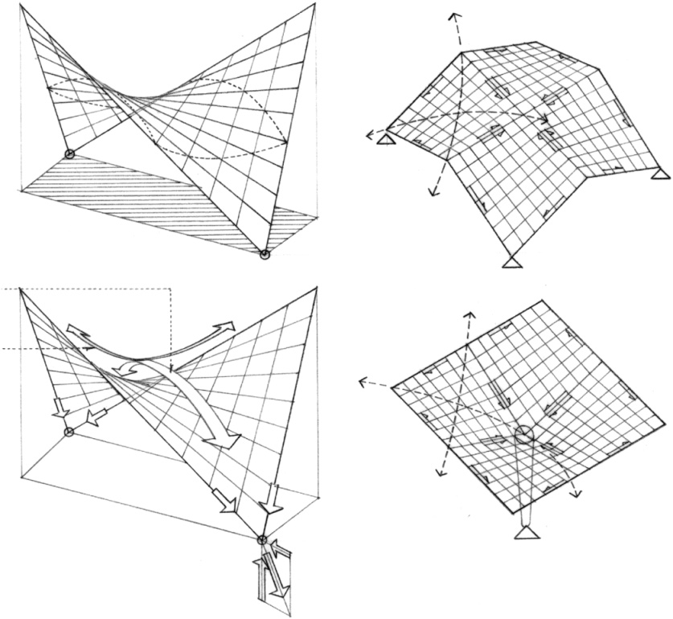
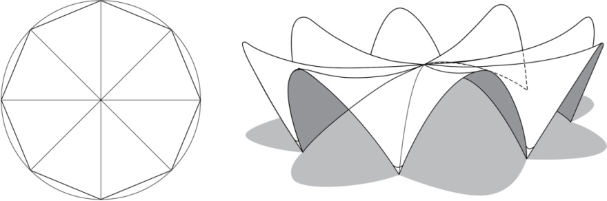
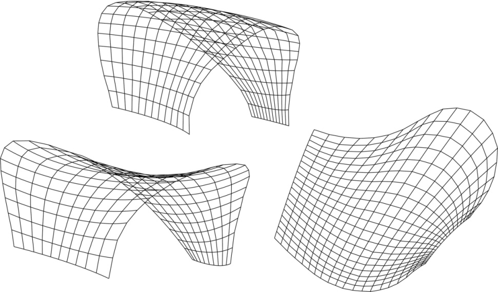
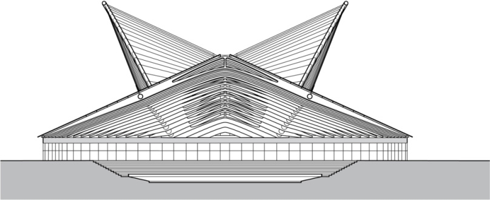
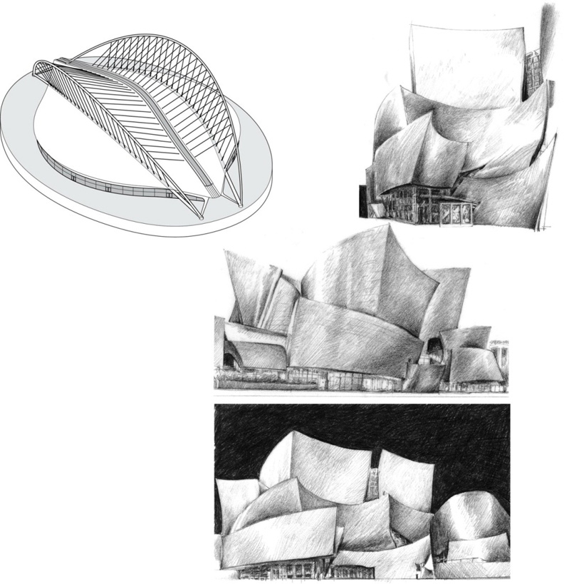
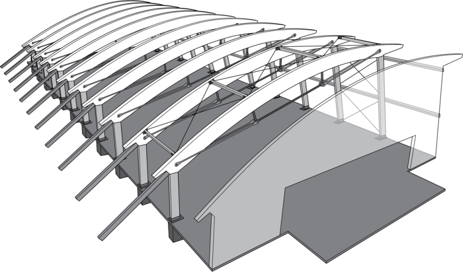
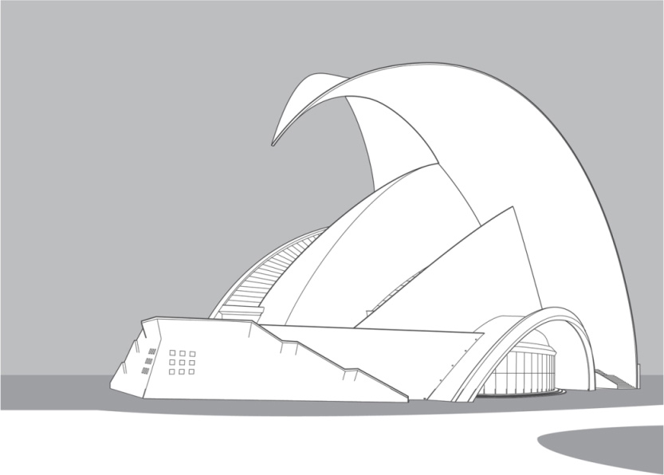
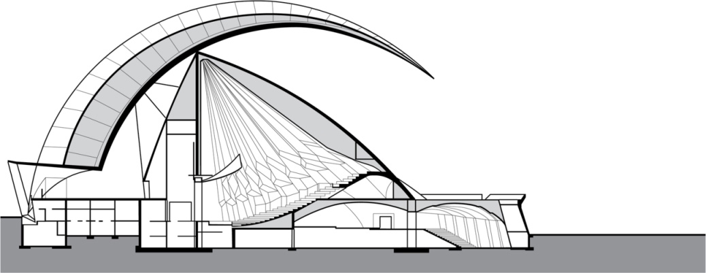

> [BREADCRUMB_CTX: 《Architecture》 > Curved Surfaces]

## CURVED SURFACES

Saddle surfaces have an upward curvature in one direction and a downward curvature in the perpendicular direction. Regions of downward curvature exhibit archlike action while regions of upward curvature behave as a cable structure. If the edges of a saddle surface are not supported, beam behavior may also be present.

The type of structural system that can best take advantage of this doubly curved geometry is the shell structure—a thin, plate structure, usually of reinforced concrete, which is shaped to transmit applied forces by compressive, tensile, and shear stresses acting in the plane of the curved surface.

**Restaurant Los Manantiales**, Xochimilco, Mexico, 1958, Felix Candela. The structure consists of a radial arrangement of eight hyperbolic paraboloid segments.

Related to shell structures are gridshell structures, which were pioneered by the Russian engineer Vladimir Shukhov in the late-19th century. Like shell structures, gridshells rely on their double curvature geometry for their strength but are constructed of a grid or lattice, usually of wood or steel. Gridshells are capable of being formed into irregular curved surfaces, relying on computer modeling programs for their structural analysis and optimization and sometimes their fabrication and assembly as well.

See also pages 172–173 for a related discussion of diagrids.

**Olympic Velodrome**, Athens, Greece, 2004 (renovation of original 1991 structure), Santiago Calatrava

The fluid quality of curved surfaces contrasts with the angular nature of rectilinear forms and is appropriate for describing the form of shell structures as well as non-load-bearing elements of enclosure.

Symmetrical curved surfaces, such as domes and barrel vaults, are inherently stable. Asymmetrical curved surfaces, on the other hand, can be more vigorous and expressive in nature. Their shapes change dramatically as we view them from different perspectives.

**Walt Disney Concert Hall**, Los Angeles, California, 1987–2003, Frank O. Gehry & Partners

**Banff Community Recreation Center**, Banff, Alberta, Canada, 2011, GEC Architecture

**Tenerife Concert Hall**, Canary Islands, Spain 1997–2003, Santiago Calatrava

