> [BREADCRUMB_CTX: 《Architecture》 > Primary Solids]

## PRIMARY SOLIDS

“…cubes, cones, spheres, cylinders, or pyramids are the great primary forms that light reveals to advantage; the image of these is distinct and tangible within us and without ambiguity. It is for this reason that these are beautiful forms, the most beautiful forms.” *Le Corbusier*

The primary shapes can be extended or rotated to generate volumetric forms or solids that are distinct, regular, and easily recognizable. Circles generate spheres and cylinders; triangles generate cones and pyramids; squares generate cubes. In this context, the term “solid” does not refer to firmness of substance but rather to a three-dimensional geometric body or figure.

### Sphere

A solid generated by the revolution of a semicircle about its diameter, whose surface is at all points equidistant from the center. A sphere is a centralized and highly concentrated form. Like the circle from which it is generated, it is self-centering and normally stable in its environment. It can be inclined toward a rotary motion when placed on a sloping plane. From any viewpoint, it retains its circular shape.

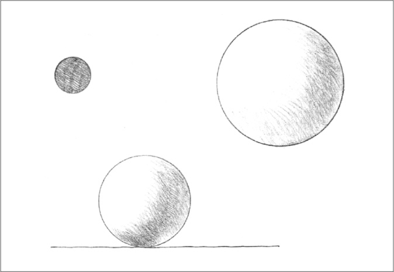

### Cylinder

A solid generated by the revolution of a rectangle about one of its sides. A cylinder is centralized about the axis passing through the centers of its two circular faces. Along this axis, it can be easily extended. The cylinder is stable if it rests on one of its circular faces; it becomes unstable when its central axis is inclined from the vertical.

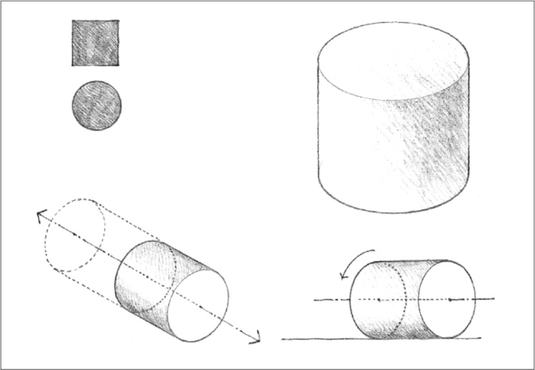

### Cone

A solid generated by the revolution of a right triangle about one of its sides. Like the cylinder, the cone is a highly stable form when resting on its circular base, and unstable when its vertical axis is tipped or overturned. It can also rest on its apex in a precarious state of balance.

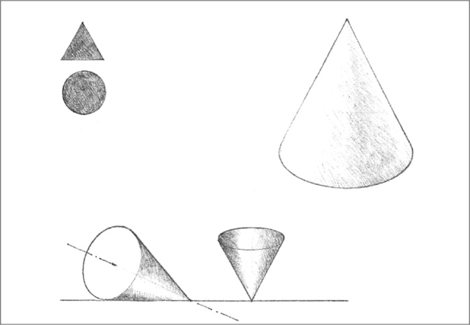

### Pyramid

A polyhedron having a polygonal base and triangular faces meeting at a common point or vertex. The pyramid has properties similar to those of the cone. Because all of its surfaces are flat planes, however, the pyramid can rest in a stable manner on any of its faces. While the cone is a soft form, the pyramid is relatively hard and angular.

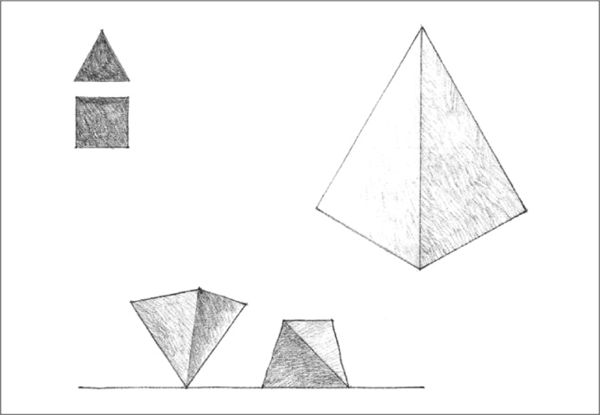

### Cube

A prismatic solid bounded by six equal square sides, the angle between any two adjacent faces being a right angle. Because of the equality of its dimensions, the cube is a static form that lacks apparent movement or direction. It is a stable form except when it stands on one of its edges or corners. Even though its angular profile is affected by our point of view, the cube remains a highly recognizable form.

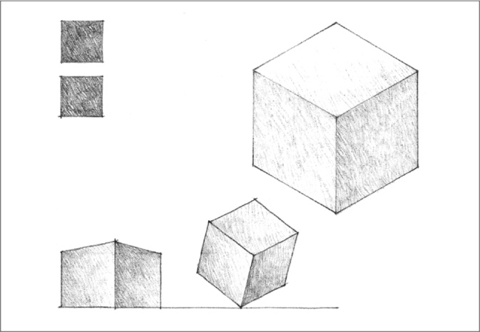
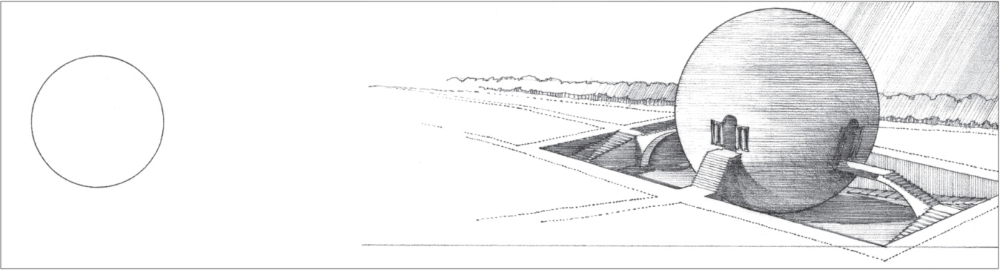

**Maupertius, Project for an Agricultural Lodge**, 1775, Claude-Nicolas Ledoux

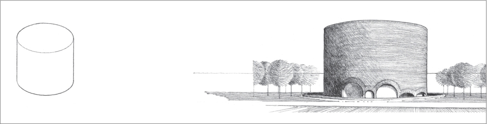

**Chapel, Massachusetts Institute of Technology**, Cambridge, Massachusetts, 1955, Eero Saarinen and Associates

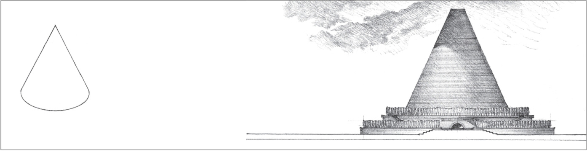

**Project for a Conical Cenotaph**, 1784, Étienne-Louis Boulée

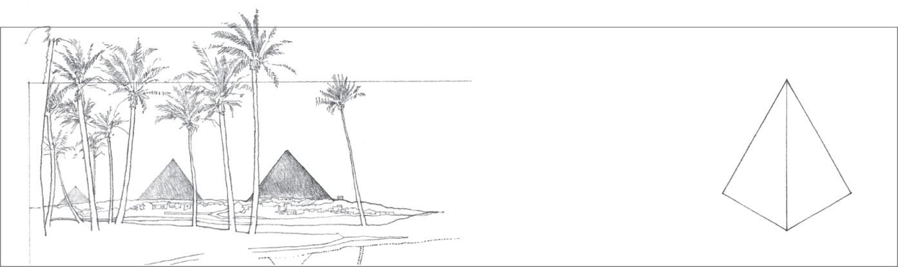

**Pyramids of Cheops, Chephren, and Mykerinos at Giza**, Egypt, c. 2500 B.C.

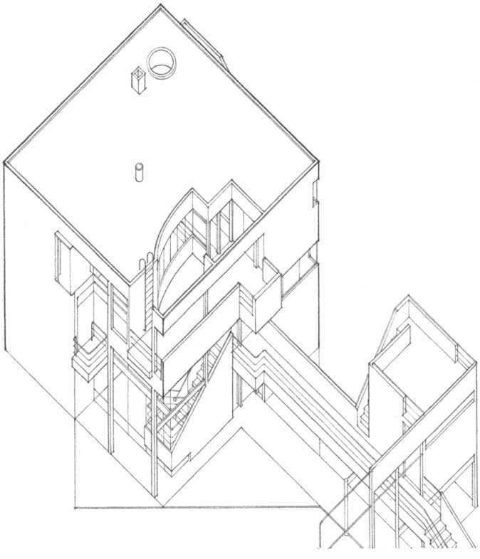

**Hanselmann House**, Fort Wayne, Indiana, 1967, Michael Graves

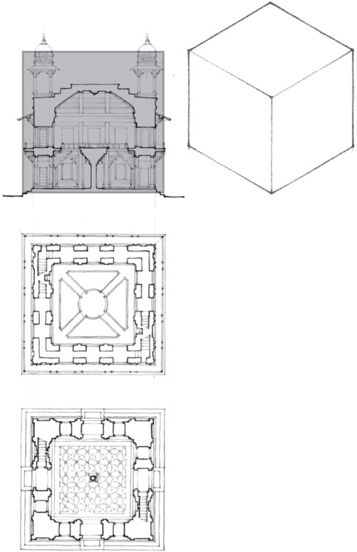

**Diwan-i-Khas, Fatehpur Sikri**, Palace Complex of Akbar the Great Mogul Emperor of India, 1569–1574