> [BREADCRUMB_CTX: 《Architecture》 > Regular & Irregular Forms]

## REGULAR & IRREGULAR FORMS

Regular forms refer to those whose parts are related to one another in a consistent and orderly manner. They are generally stable in nature and symmetrical about one or more axes. The sphere, cylinder, cone, cube, and pyramid are prime examples of regular forms.

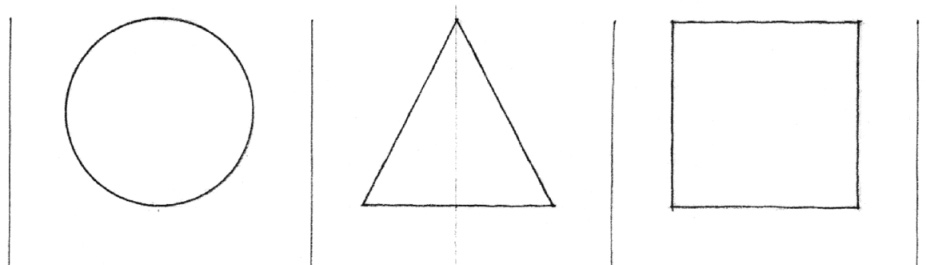

Forms can retain their regularity even when transformed dimensionally or by the addition or subtraction of elements. From our experiences with similar forms, we can construct a mental model of the original whole even when a fragment is missing or another part is added.

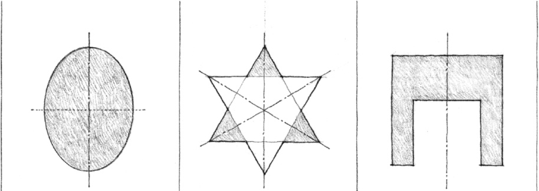

Irregular forms are those whose parts are dissimilar in nature and related to one another in an inconsistent manner. They are generally asymmetrical and more dynamic than regular forms. They can be regular forms from which irregular elements have been subtracted or result from an irregular composition of regular forms.

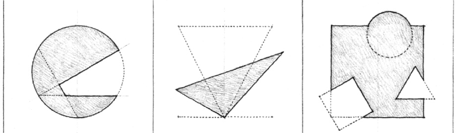

Since we deal with both solid masses and spatial voids in architecture, regular forms can be contained within irregular forms. In a similar manner, irregular forms can be enclosed by regular forms.

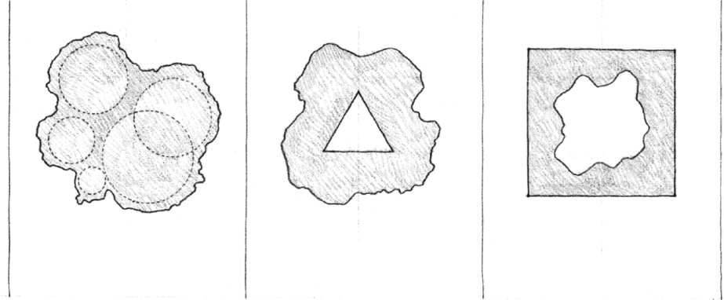
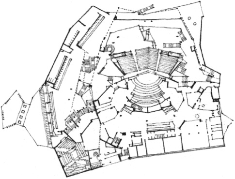

**Irregular Forms:**  
**Philharmonic Hall, Berlin**, 1956–1963, Hans Scharoun

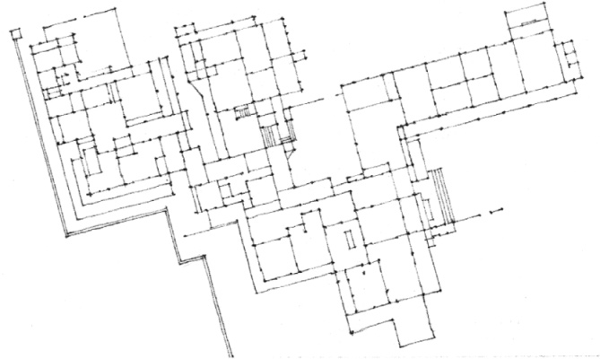

**An Irregular Composition of Regular Forms:**  
**Katsura Imperial Villa**, Kyoto, Japan, 17th century

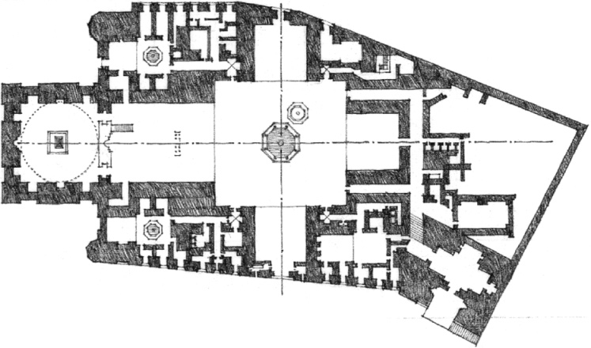

**Regular Forms within an Irregular Composition:**  
**Mosque of Sultan Hasan**, Cairo, Egypt, 1356–1363

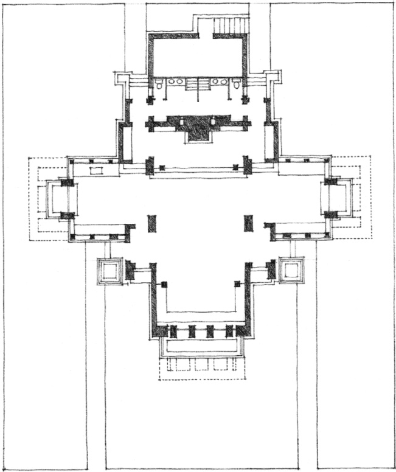

**A Regular Composition of Regular Forms:**  
**Coonley Playhouse**, Riverside, Illinois, 1912, Frank Lloyd Wright

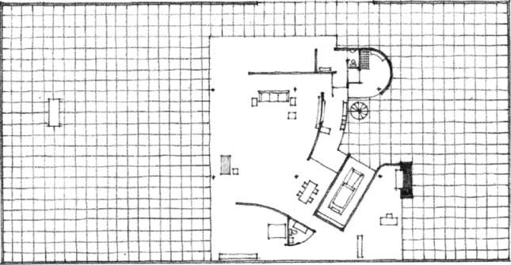

**Irregular Forms within a Regular Field:**  
**Courtyard House Project**, 1934, Mies van de Rohe

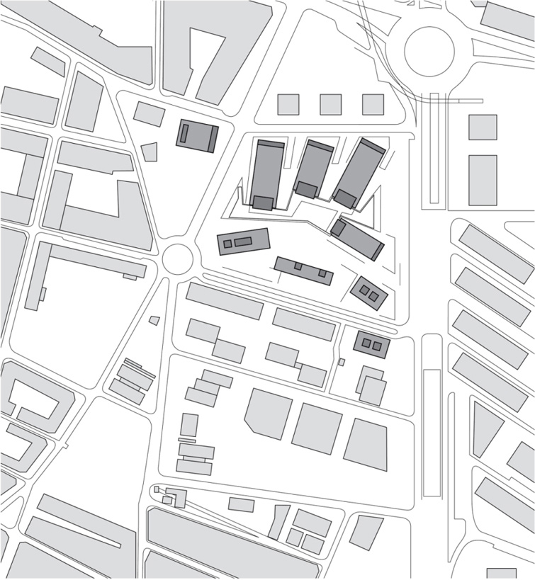

**An Irregular Array of Regular Forms in the Horizontal Dimension:**  
**City of Justice**, Barcelona, Spain, 2010, David Chipperfield Architects, b720 Arquitectos

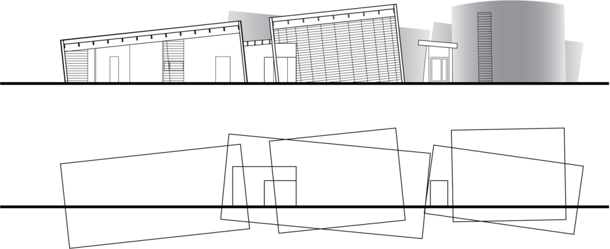

**An Irregular Array of Regular Forms in the Vertical Dimension:** **Poteries du Don**, Le Fel, France, 2008, Lacombe–De Florinier

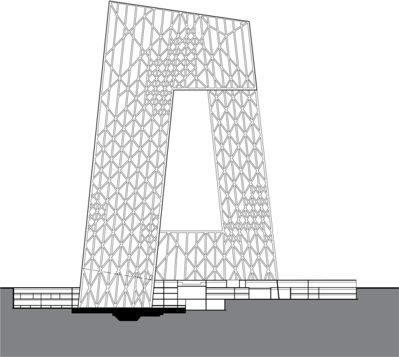

**Regular and Irregular Structural Patterns**

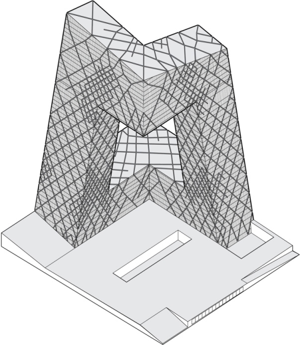

**China Central Television Headquarters (CCTV)**, Beijing, China, 2004–2012, Rem Koolhaas and Ole Scheeren/OMA. What may appear to be a random pattern is often based on rational structural principles. Note how the diagrid pattern becomes more dense in areas where moment stresses are higher.

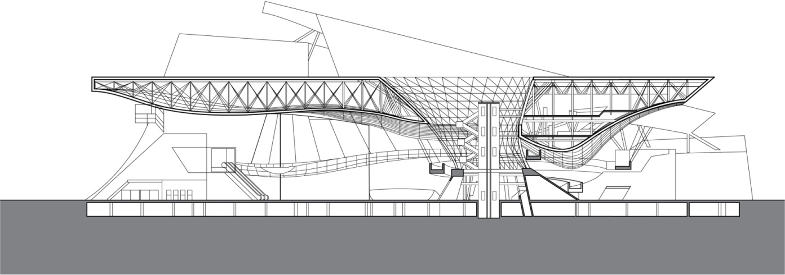

**Busan Cinema Center**, Busan, South Korea, 2012, COOP HIMMELB(l)au.  
This example shows how irregular forms contrast with and play off of the horizontal ground and roof planes.