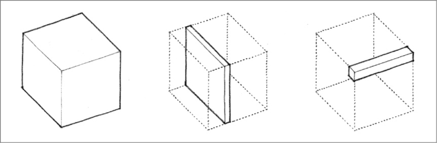
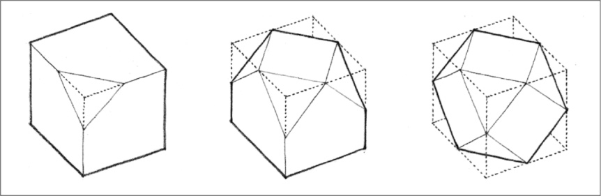
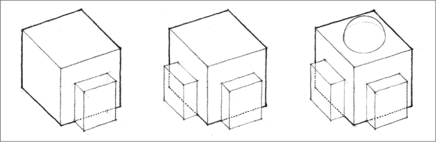
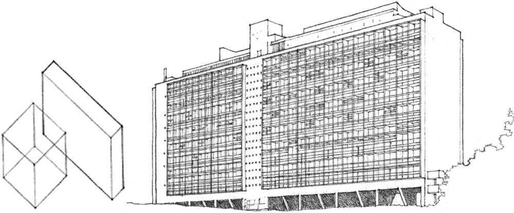
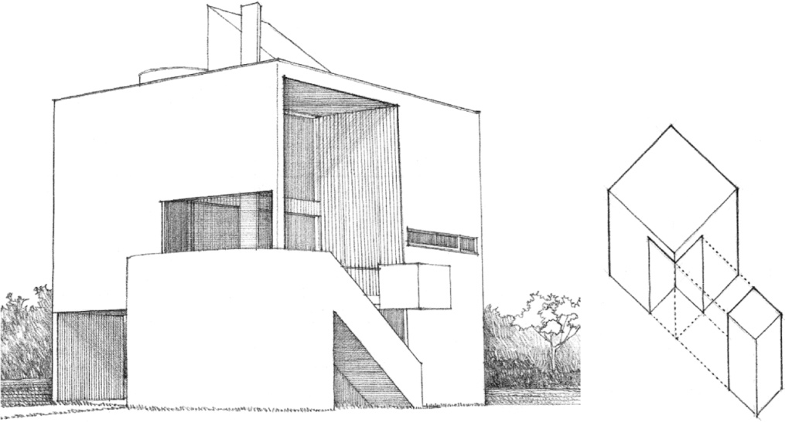
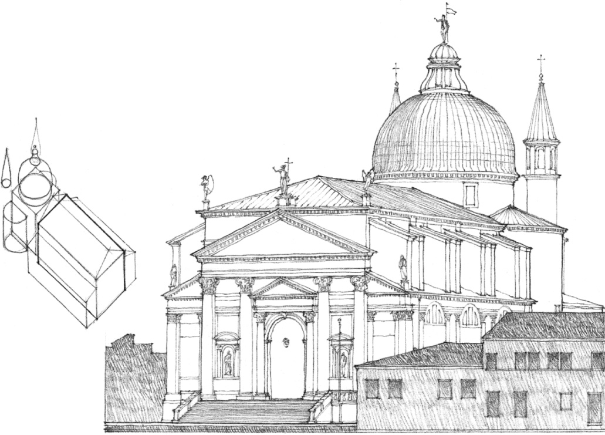

> [BREADCRUMB_CTX: 《Architecture》 > Transformation of Form]

## TRANSFORMATION OF FORM

All other forms can be understood to be transformations of the primary solids, variations which are generated by the manipulation of one or more dimensions or by the addition or subtraction of elements.

### Dimensional Transformation

A form can be transformed by altering one or more of its dimensions and still retain its identity as a member of a family of forms. A cube, for example, can be transformed into similar prismatic forms through discrete changes in height, width, or length. It can be compressed into a planar form or be stretched out into a linear one.

### Subtractive Transformation

A form can be transformed by subtracting a portion of its volume. Depending on the extent of the subtractive process, the form can retain its initial identity or be transformed into a form of another family. For example, a cube can retain its identity as a cube even though a portion of it is removed, or be transformed into a series of regular polyhedrons that begin to approximate a sphere.

### Additive Transformation

A form can be transformed by the addition of elements to its volume. The nature of the additive process and the number and relative sizes of the elements being attached determine whether the identity of the initial form is altered or retained.

**Dimensional Transformation of a Cube into a Vertical Slab:**  
**Unité d’Habitation**, Firminy-Vert, France, 1963–1968, Le Corbusier

**Subtractive Transformation Creating Volumes of Space:**  
**Gwathmey Residence**, Amagansett, New York, 1967, Charles Gwathmey/Gwathmey Siegel

**Additive Transformation of a Parent Form by the Attachment of Subordinate Parts:**  
**Il Redentore**, Venice, 1577–1592, Andrea Palladio