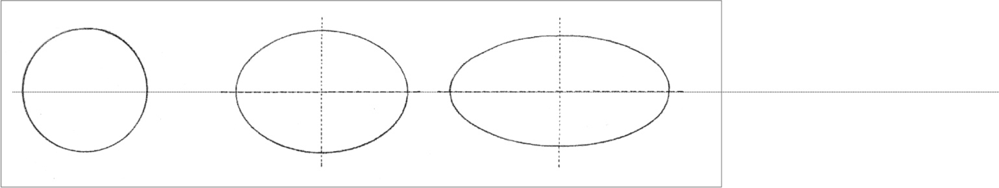
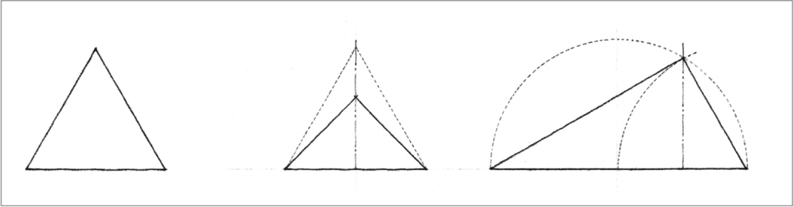
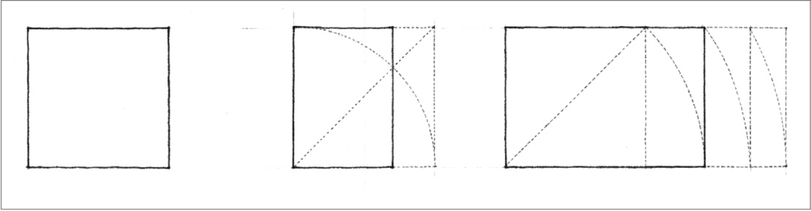
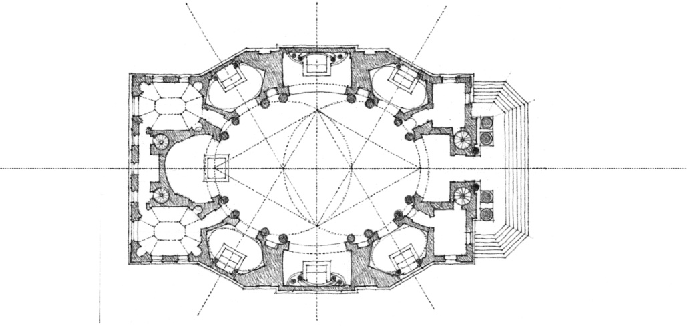
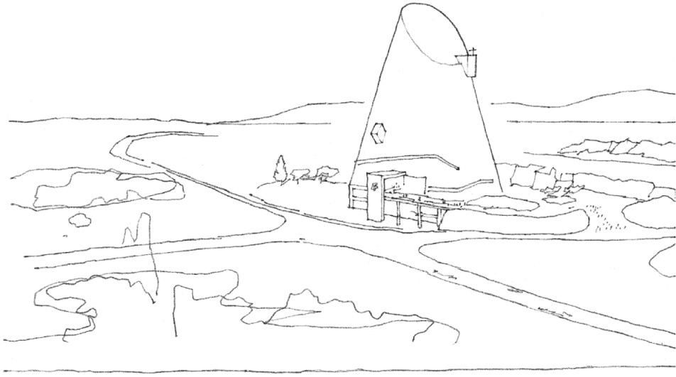
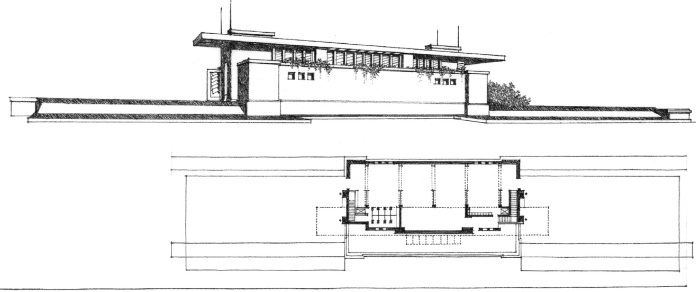

> [BREADCRUMB_CTX: 《Architecture》 > Dimensional Transformation]

## DIMENSIONAL TRANSFORMATION

A sphere can be transformed into any number of ovoid or ellipsoidal forms by elongating it along an axis.

A pyramid can be transformed by altering the dimensions of the base, modifying the height of the apex, or tilting the normally vertical axis.

A cube can be transformed into similar prismatic forms by shortening or elongating its height, width, or depth.

**Plan of an Elliptical Church, Pensiero Della Chiesa S. Carlo**, Project, 17th century, Francesco Borromini

**St. Pierre**, Firminy-Vert, France, 1965, Le Corbusier

**Project for Yahara Boat Club**, Madison, Wisconsin, 1902, Frank Lloyd Wright