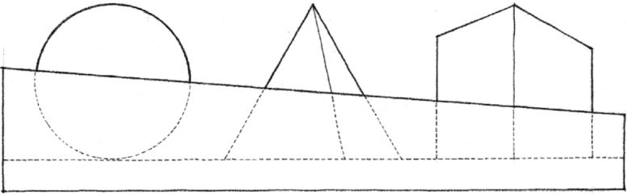
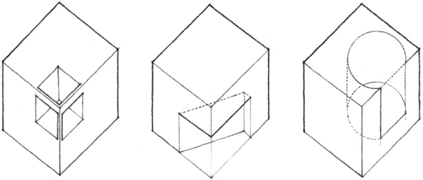
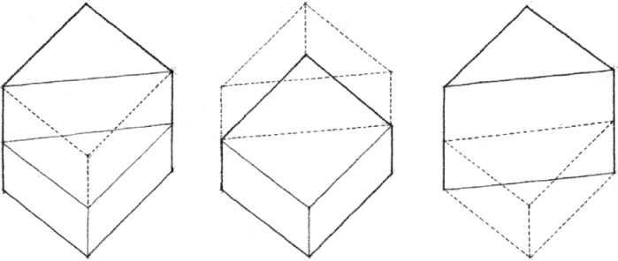
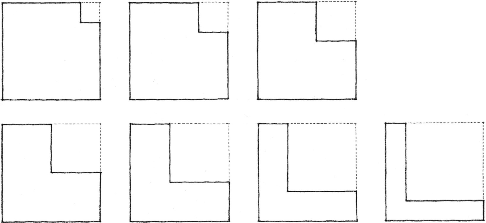
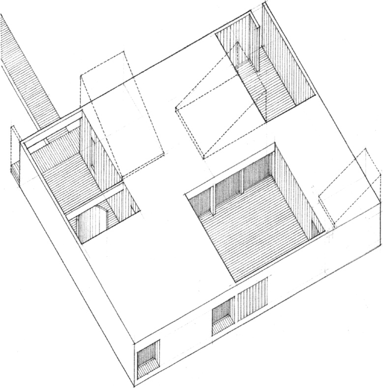
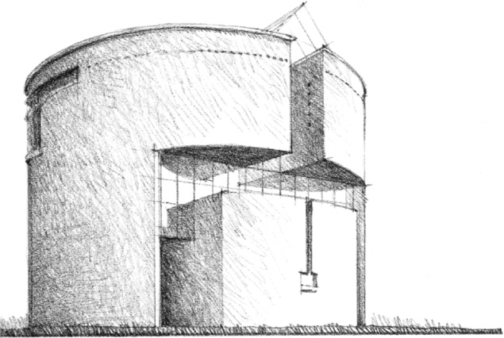
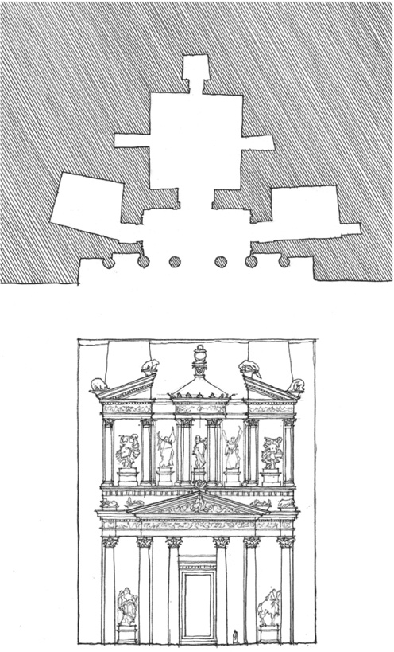
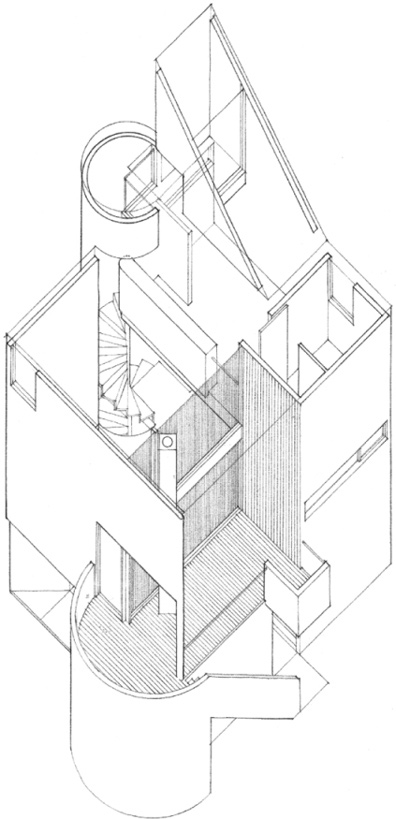
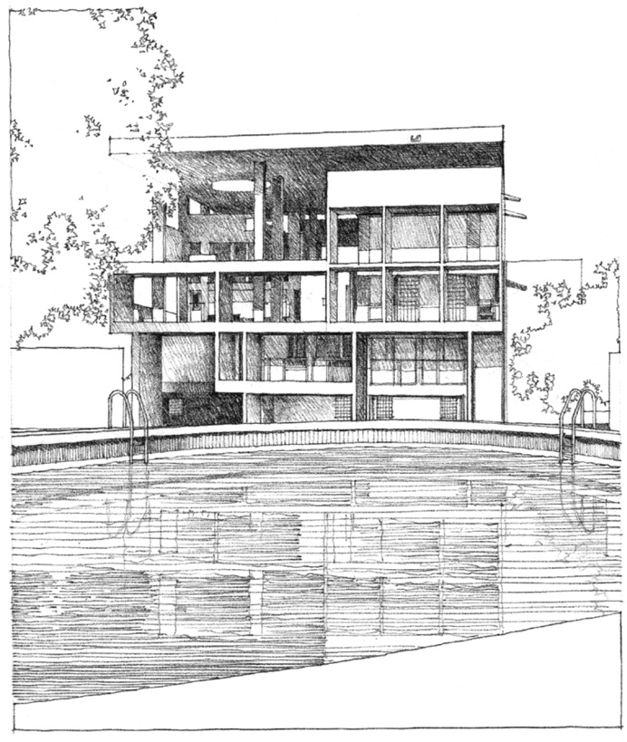
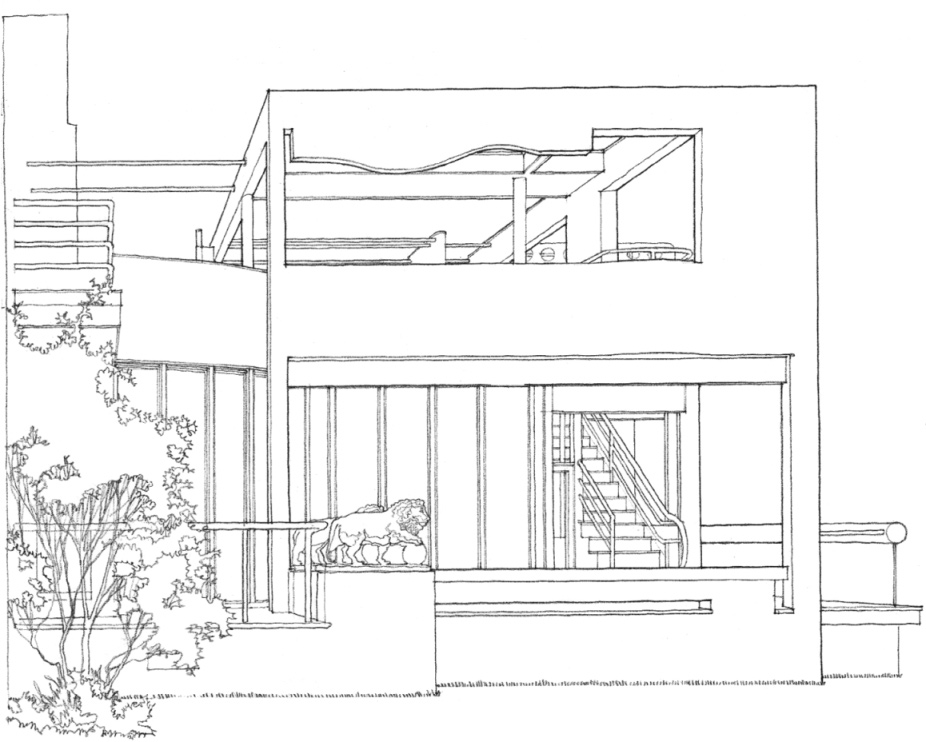

> [BREADCRUMB_CTX: 《Architecture》 > Subtractive Form]

## SUBTRACTIVE FORM

We search for regularity and continuity in the forms we see within our field of vision. If any of the primary solids is partially hidden from our view, we tend to complete its form and visualize it as if it were whole because the mind fills in what the eyes do not see. In a similar manner, when regular forms have fragments missing from their volumes, they retain their formal identities if we perceive them as incomplete wholes. We refer to these mutilated forms as subtractive forms.

Because they are easily recognizable, simple geometric forms, such as the primary solids, adapt readily to subtractive treatment. These forms will retain their formal identities if portions of their volumes are removed without deteriorating their edges, corners, and overall profile.

Ambiguity regarding the original identity of a form will result if the portion removed from its volume erodes its edges and drastically alters its profile.

In this series of figures, at what point does the square shape with a corner portion removed become an L- shaped configuration of two rectangular planes?

**Gorman Residence**, Amagansett, New York, 1968, Julian and Barbara Neski

**House at Stabio**, Ticino, Switzerland, 1981, Mario Botta

Spatial volumes may be subtracted from a form to create recessed entrances, positive courtyard spaces, or window openings shaded by the vertical and horizontal surfaces of the recess.

**Khasneh al Faroun**, Petra, 1st century A.D.

**Gwathmey Residence**, Amagansett, New York, 1967, Charles Gwathmey/Gwathmey Siegel & Associates

**Shodhan House**, Ahmedabad, India, 1956, Le Corbusier

**Benacerraf House Addition**, Princeton, New Jersey, 1969, Michael Graves