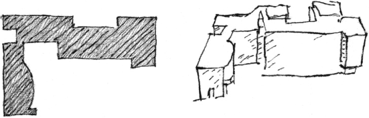
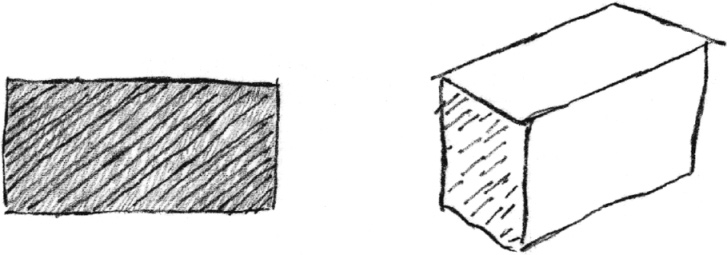
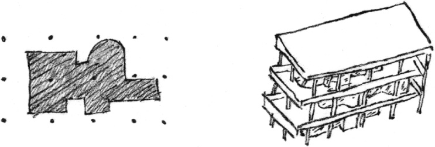
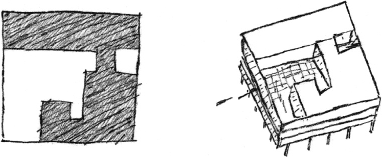

> [BREADCRUMB_CTX: 《Architecture》 > Subtractive & Additive Forms]

## SUBTRACTIVE & ADDITIVE FORMS

---

Le Corbusier comments on form:

“Cumulative Composition

* additive form
* a rather easy type
* picturesque; full of movement
* can be completely disciplined by classification and hierarchy”

**La Roche-Jeanneret Houses**, Paris

“Cubic Compositions (Pure Prisms)

* very difficult  
  (to satisfy the spirit)”

**Villa at Garches**

* “very easy  
  (convenient combining)”

**House at Stuttgart**

“Subtractive Form

* very generous
* on the exterior an architectural will is confirmed
* on the interior all functional needs are satisfied (light penetration, continuity, circulation)”

**House at Poissy**

---

After a sketch, *Four House Forms*, by Le Corbusier for the cover of Volume Two of the *Oeuvre Complète*, published in 1935