> [BREADCRUMB_CTX: 《Architecture》 > Additive Form]

## ADDITIVE FORM

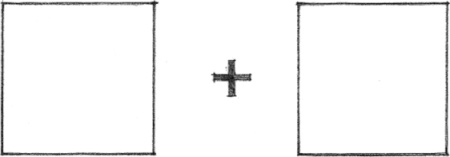

While a subtractive form results from the removal of a portion of its original volume, an additive form is produced by relating or physically attaching one or more subordinate forms to its volume.

The basic possibilities for grouping two or more forms are by:

### Spatial Tension

This type of relationship relies on the close proximity of the forms or their sharing of a common visual trait, such as shape, color, or material.

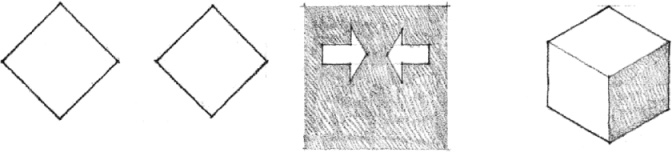

### Edge-to-Edge Contact

In this type of relationship, the forms share a common edge and can pivot about that edge.

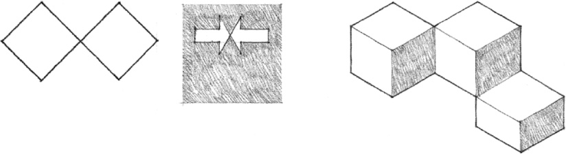

### Face-to-Face Contact

This type of relationship requires that the two forms have corresponding planar surfaces which are parallel to each other.

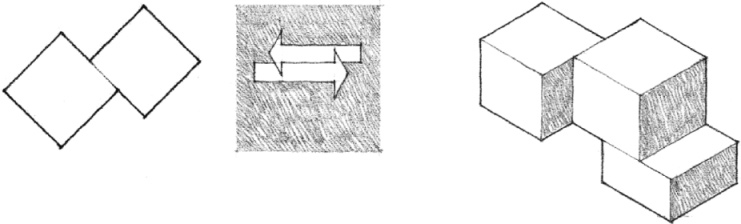

### Interlocking Volumes

In this type of relationship, the forms interpenetrate each other’s space. The forms need not share any visual traits.

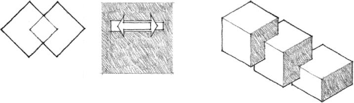

Additive forms resulting from the accretion of discrete elements can be characterized by their ability to grow and merge with other forms. For us to perceive additive groupings as unified compositions of form—as figures in our visual field—the combining elements must be related to one another in a coherent manner.

These diagrams categorize additive forms according to the nature of the relationships that exist among the component forms as well as their overall configurations. This outline of formal organizations should be compared with a parallel discussion of spatial organizations in Chapter 4.

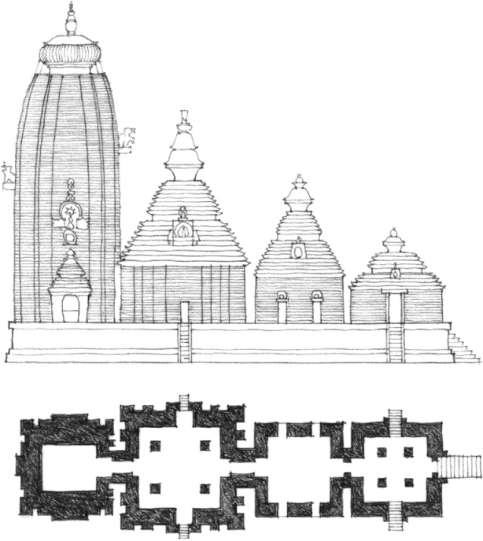

**Lingaraja Temple**, Bhubaneshwar, India, c. A.D. 1100

### Centralized Form

A number of secondary forms clustered about a dominant, central parent-form

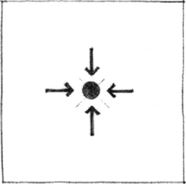

### Linear Form

A series of forms arranged sequentially in a row

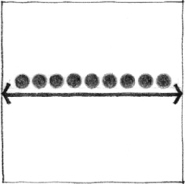

### Radial Form

A composition of linear forms extending outward from a central form in a radial manner

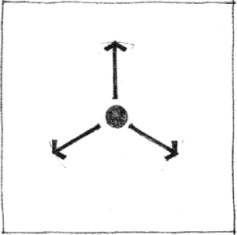

### Clustered Form

A collection of forms grouped together by proximity or the sharing of a common visual trait

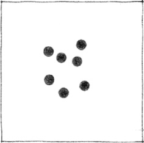

### Grid Form

A set of modular forms related and regulated by a three-dimensional grid

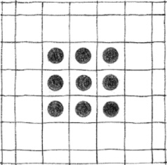