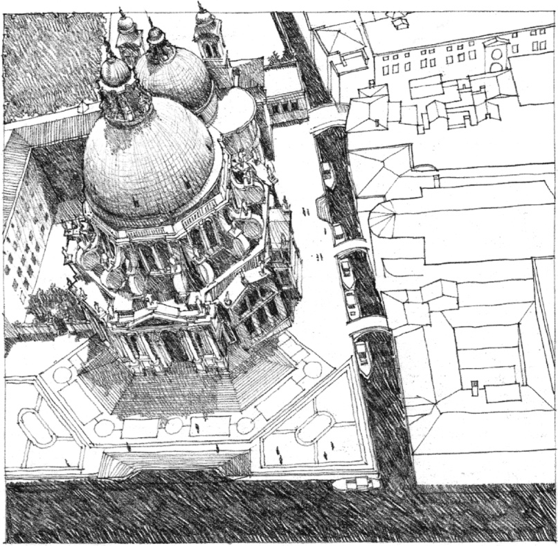
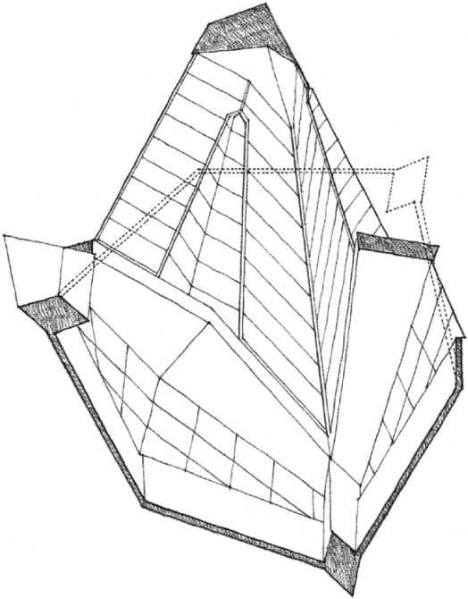
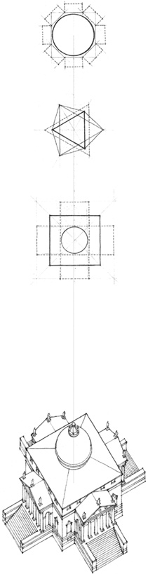
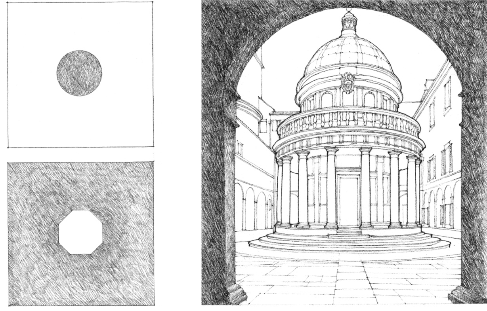
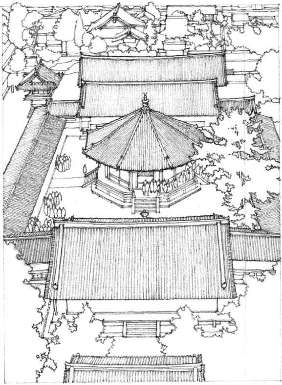

> [BREADCRUMB_CTX: 《Architecture》 > Centralized Form]

## CENTRALIZED FORM

**St. Maria Della Salute**, Venice, 1631–1682, Baldassare Longhena

**Beth Sholom Synagogue**, Elkins Park, Pennsylvania, 1959, Frank Lloyd Wright

**Villa Capra (The Rotunda)**, Vicenza, Italy, 1552–1567, Andrea Palladio

**Tempietto, S. Pietro in Montorio**, Rome, 1502, Donato Bramante

Centralized forms require the visual dominance of a geometrically regular, centrally located form, such as a sphere, cone, or cylinder. Because of their inherent centrality, these forms share the self-centering properties of the point and circle. They are ideal as freestanding structures isolated within their context, dominating a point in space, or occupying the center of a defined field. They can embody sacred or honorific places, or commemorate significant persons or events.

**Yume-Dono, Eastern precinct of Horyu-Ji Temple**, Nara, Japan, A.D. 607