> [BREADCRUMB_CTX: 《Architecture》 > Linear Form]

## LINEAR FORM

* A linear form can result from a proportional change in a form’s dimensions or the arrangement of a series of discrete forms along a line. In the latter case, the series of forms may be either repetitive or dissimilar in nature and organized by a separate and distinct element such as a wall or path.

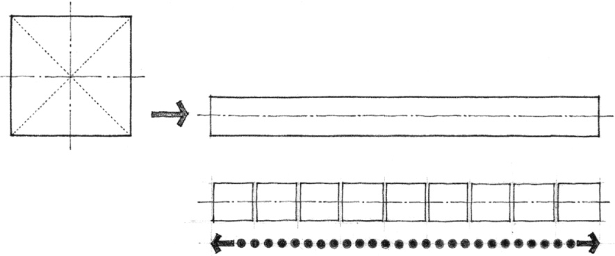

* A linear form can be segmented or curvilinear to respond to topography, vegetation, views, or other features of a site.

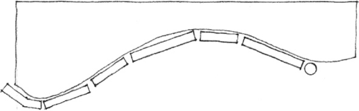

* A linear form can front on or define an edge of an exterior space, or define a plane of entry into the spaces behind it.

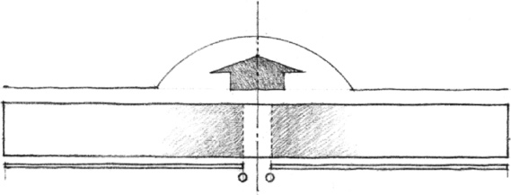

* A linear form can be manipulated to enclose a portion of space.

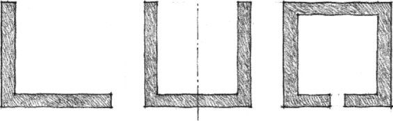
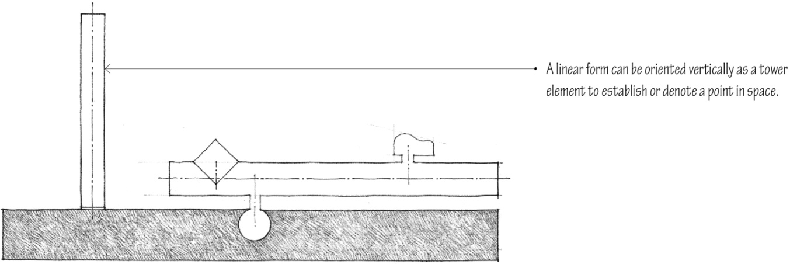

* A linear form can serve as an organizing element to which a variety of secondary forms are attached.

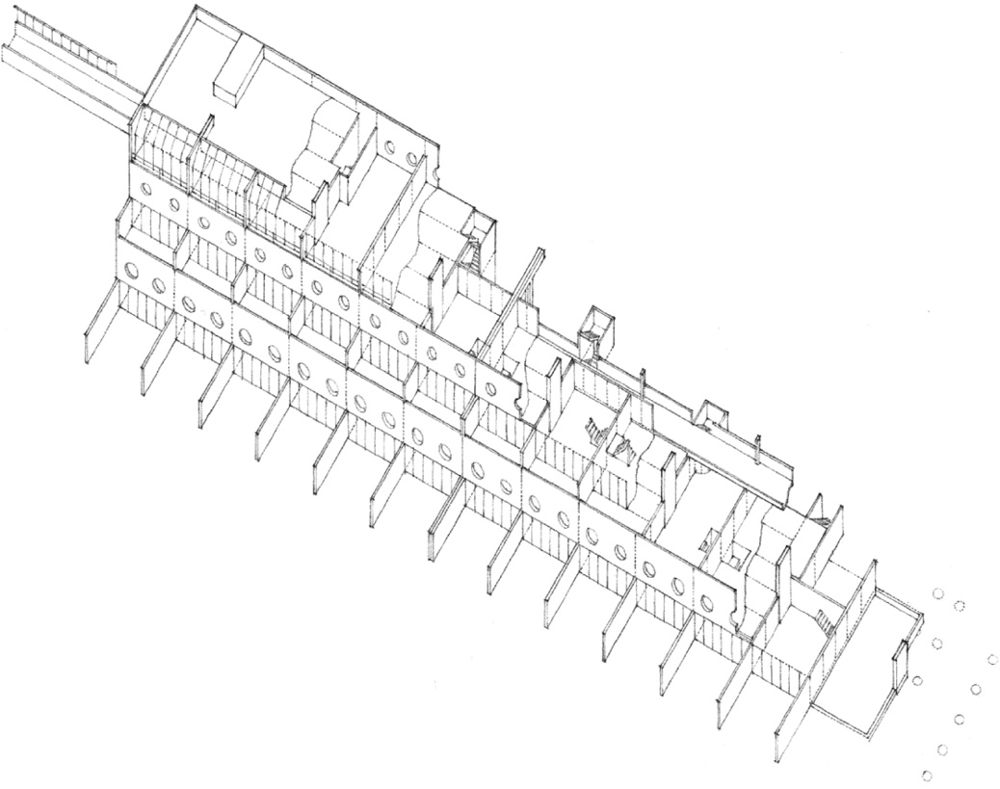

**Runcorn New Town Housing**, England,1967, James Stirling

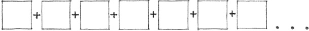

Linear Growth through the Repetition of Forms

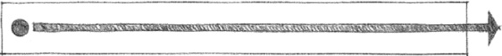

Linear Form Expressing Procession or Movement

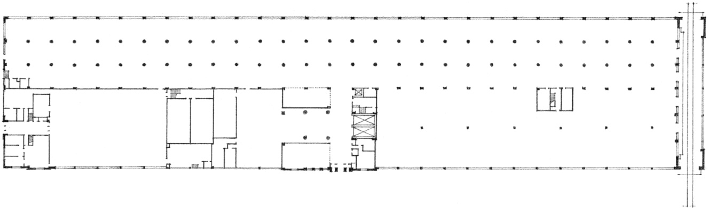

**Burroughs Adding Machine Company**, Detroit, Michigan, 1904, Albert Kahn

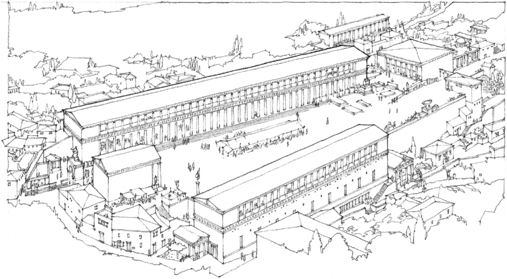

**Agora of Assos**, Asia Minor, 2nd century B.C.

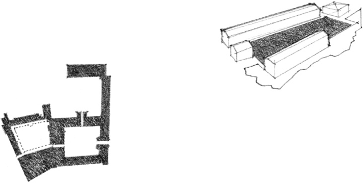

### Linear Forms Fronting on or Defining Exterior Space

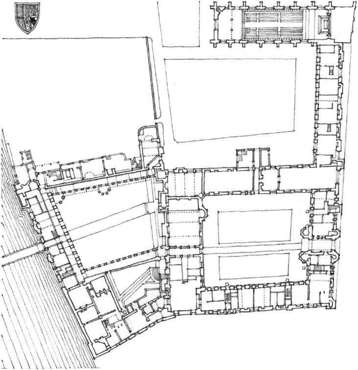

**Queen’s College**, Cambridge, England, 1709–1738, Nicholas Hawksmoor

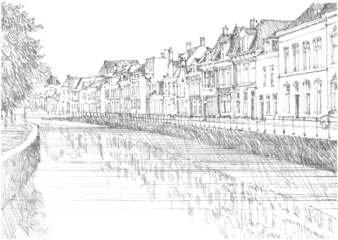

18th-century buildings fronting a tree-lined canal in Kampen, Holland

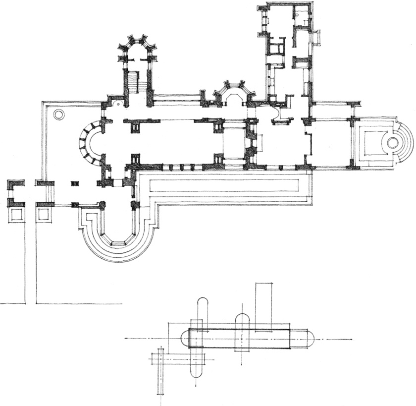

**Henry Babson House**, Riverside, Illinois, 1907, Louis Sullivan

### Linear Organizations of Space

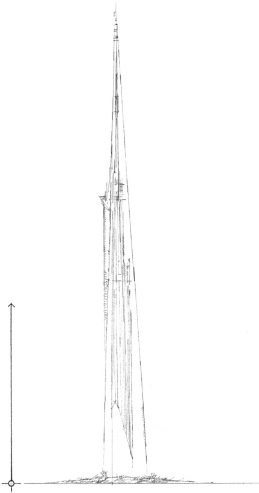

**Mile-High Illinois Skyscraper Project**, Chicago, Illinois, 1956, Frank Lloyd Wright