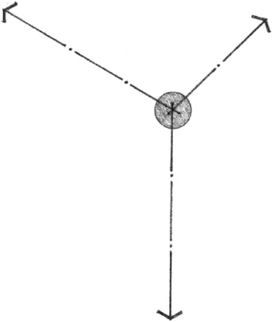
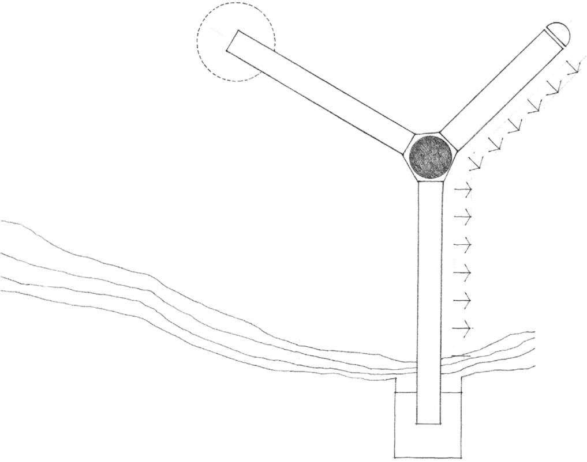
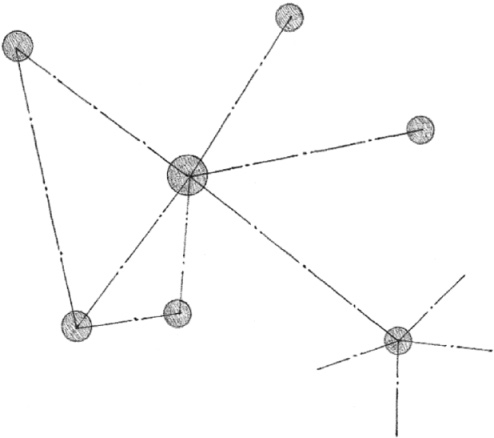
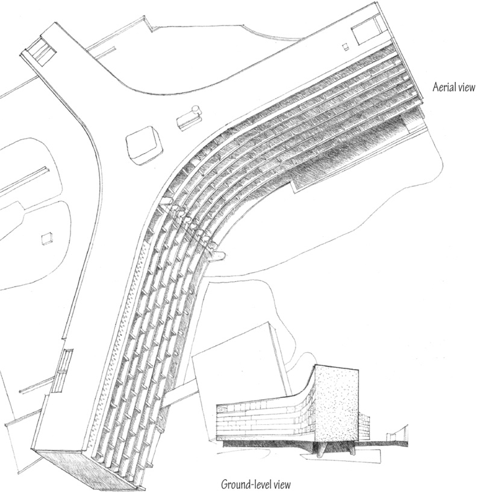
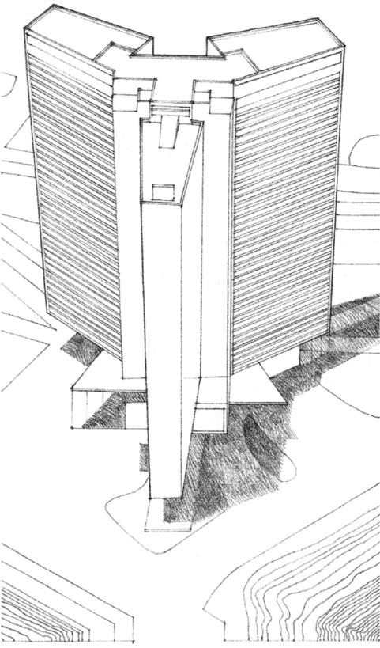

> [BREADCRUMB_CTX: 《Architecture》 > Radial Form]

## RADIAL FORM

A radial form consists of linear forms that extend outward from a centrally located core element in a radiating manner. It combines the aspects of centrality and linearity into a single composition.

The core is either the symbolic or functional center of the organization. Its central position can be articulated with a visually dominant form, or it can merge with and become subservient to the radiating arms.

The radiating arms, having properties similar to those of linear forms, give a radial form its extroverted nature. They can reach out and relate to or attach themselves to specific features of a site. They can expose their elongated surfaces to desirable conditions of sun, wind, view, or space.

Radial forms can grow into a network of centers linked by linear arms.

**Secretariat Building, UNESCO Headquarters**, Place de Fontenoy, Paris, 1953–1958, Marcel Breuer

The organization of a radial form can best be seen and understood from an aerial viewpoint. When viewed from ground level, its central core element may not be clearly visible and the radiating pattern of its linear arms may be obscured or distorted through perspective foreshortening.

**Skyscraper by the Sea**, Project for Algiers, 1938, Le Corbusier