> [BREADCRUMB_CTX: 《Architecture》 > Clustered Form]

## CLUSTERED FORM

While a centralized organization has a strong geometric basis for the ordering of its forms, a clustered organization groups its forms according to functional requirements of size, shape, or proximity. While it lacks the geometric regularity and introverted nature of centralized forms, a clustered organization is flexible enough to incorporate forms of various shapes, sizes, and orientations into its structure.

Considering their flexibility, clustered organizations of forms may be organized in the following ways:

* They can be attached as appendages to a larger parent form or space.
* They can be related by proximity alone to articulate and express their volumes as individual entities.
* They can interlock their volumes and merge into a single form having a variety of faces.

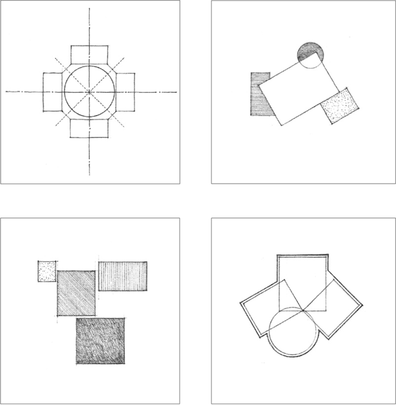

A clustered organization can also consist of forms that are generally equivalent in size, shape, and function. These forms are visually ordered into a coherent, nonhierarchical organization not only by their close proximity to one another, but also by the similarity of their visual properties.

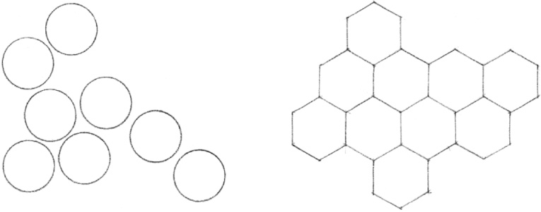
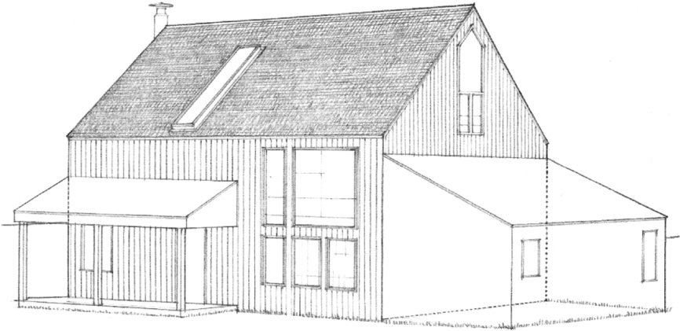

**A Cluster of Forms Attached to a Parent Form:**  
**Vacation House,** Sea Ranch, California, 1968, MLTW

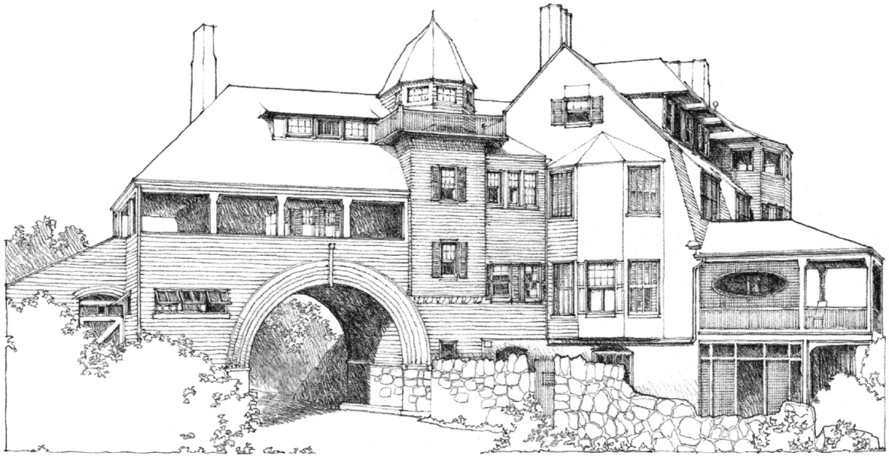

**A Cluster of Interlocking Forms:**  
**G.N. Black House (Kragsyde)**, Manchester-by-the Sea, Massachusetts, 1882–1883, Peabody & Stearns

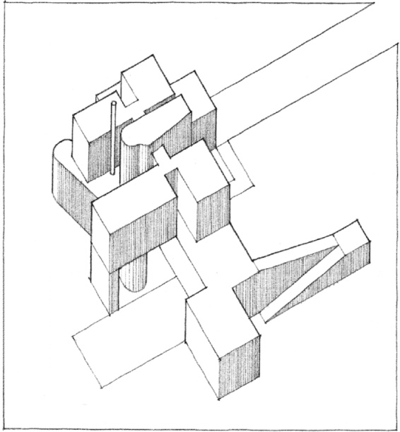

**A Cluster of Articulated Forms:**  
House Study, 1956, James Stirling & James Gowan

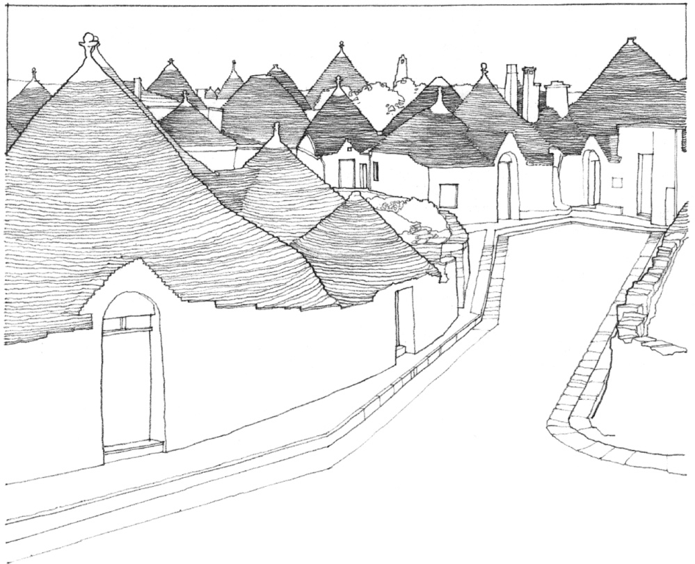

**Trulli Village**, Alberobello, Italy  
Traditional dry-stone shelters in existence since the 17th century.

Numerous examples of clustered housing forms can be found in the vernacular architecture of various cultures. Even though each culture produced a unique style in response to differing technical, climatic, and sociocultural factors, these clustered housing organizations usually maintained the individuality of each unit and a moderate degree of diversity within the context of an ordered whole.

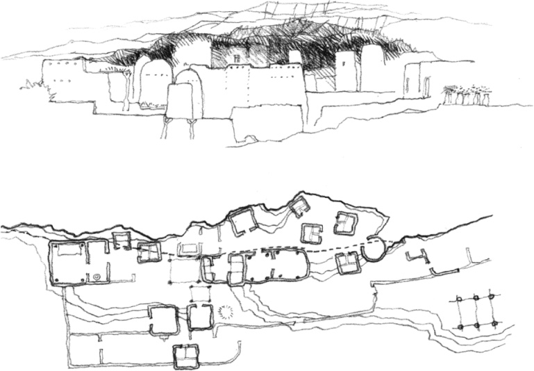

**Dogon Housing Cluster**, Southeastern Mali, West Africa, 15th century–present

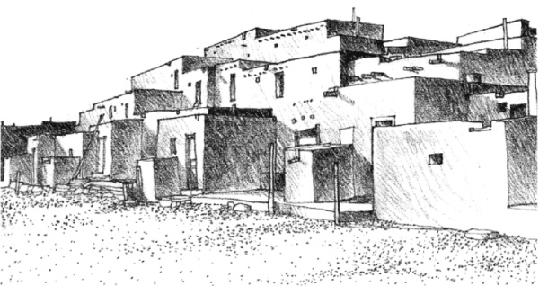

**Taos Pueblo**, New Mexico, 13th century

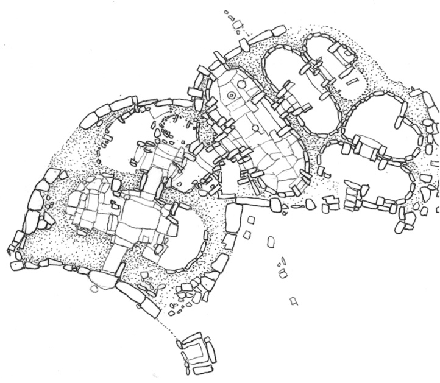

**Ggantija Temple Complex**, Malta, c. 3000 B.C.

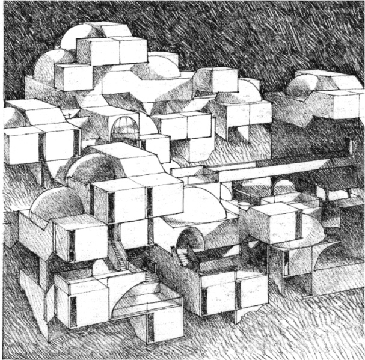

**Habitat Israel**, Project, Jerusalem, 1969, Moshe Safdie

Vernacular examples of clustered forms can be readily transformed into modular, geometrically ordered compositions which are related to grid organizations of form.

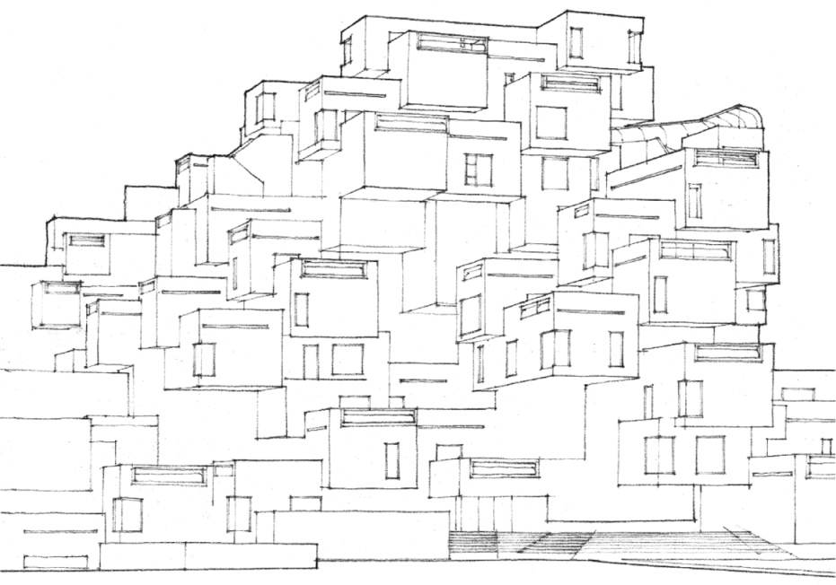

**Habitat Montreal**, 1967, Moshe Safdie