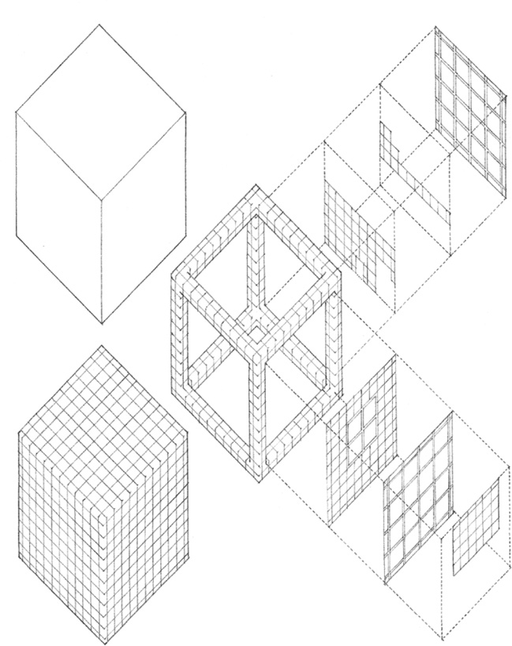
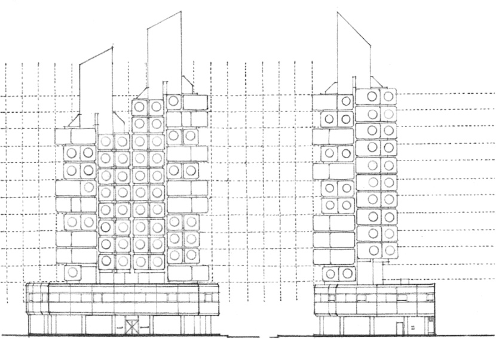
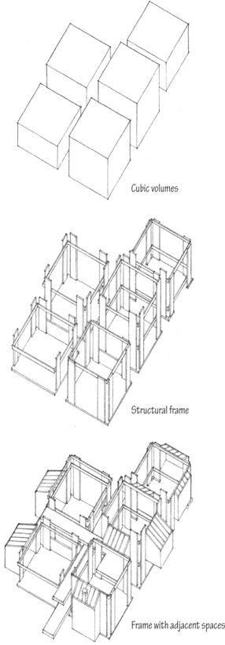
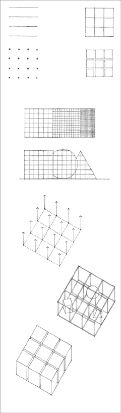

> [BREADCRUMB_CTX: 《Architecture》 > Grid Form]

## GRID FORM

A grid is a system of two or more intersecting sets of regularly spaced parallel lines. It generates a geometric pattern of regularly spaced points at the intersections of the grid lines and regularly shaped fields defined by the grid lines themselves.

The most common grid is based on the geometry of the square. Because of the equality of its dimensions and its bilateral symmetry, a square grid is essentially nonhierarchical and bidirectional. It can be used to break down the scale of a surface into measurable units and give it an even texture. It can be used to wrap several surfaces of a form and unify them with its repetitive and pervasive geometry.

The square grid, when projected into the third dimension, generates a spatial network of reference points and lines. Within this modular framework, any number of forms and spaces can be visually organized.

**Conceptual Diagram, Museum of Modern Art**, Gunma Prefecture, Japan, 1974, Arata Isozaki

**Nakagin Capsule Tower**, Tokyo, 1972, Kisho Kurokawa

**Hattenbach Residence**, Santa Monica, California, 1971–1973, Raymond Kappe

