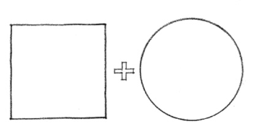
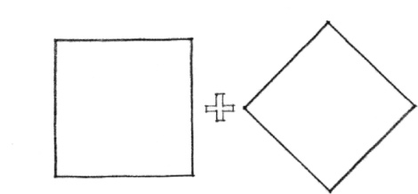
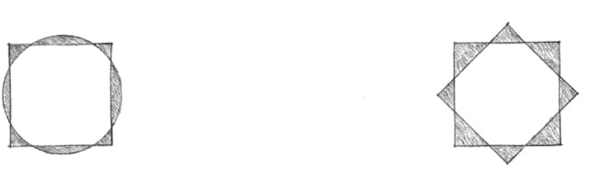
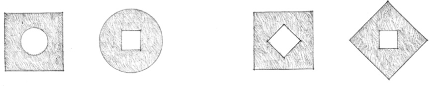
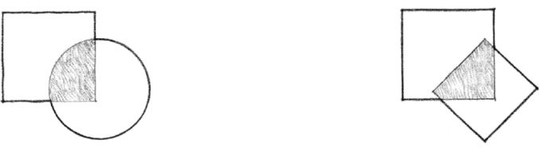
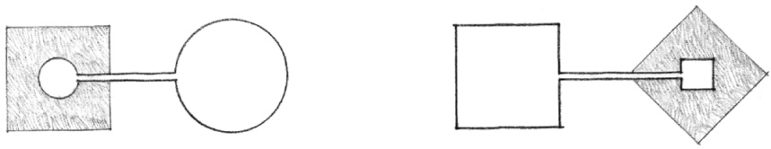
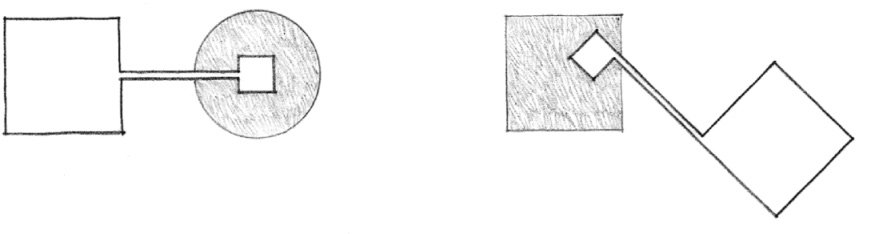
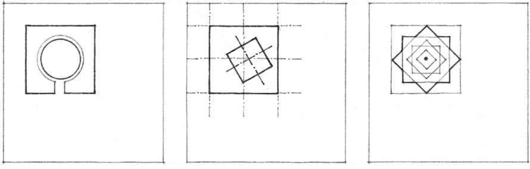
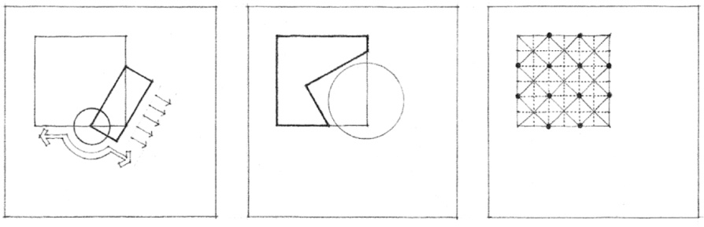
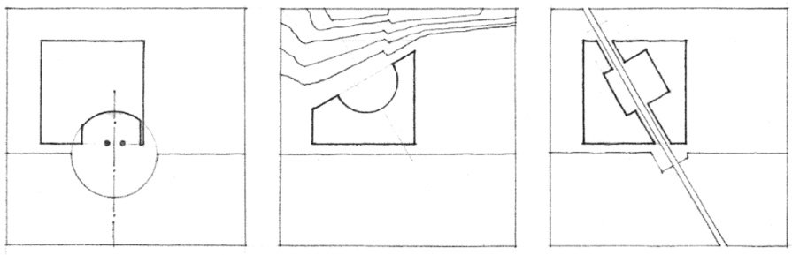

> [BREADCRUMB_CTX: 《Architecture》 > Formal Collisions of Geometry]

## FORMAL COLLISIONS OF GEOMETRY

When two forms differing in geometry or orientation collide and interpenetrate each other’s boundaries, each will vie for visual supremacy and dominance. In these situations, the following forms can evolve:

**Circle and Square**

**Rotated Grid**

* The two forms can subvert their individual identities and merge to create a new composite form.

* One of the two forms can receive the other totally within its volume.

* The two forms can retain their individual identities and share the interlocking portion of their volumes.

* The two forms can separate and be linked by a third element that recalls the geometry of one of the original forms.

Forms differing in geometry or orientation may be incorporated into a single organization for any of the following reasons:

* To accommodate or accentuate the differing requirements of interior space and exterior form
* To express the functional or symbolic importance of a form or space within its context
* To generate a composite form that incorporates the contrasting geometries into its centralized organization

* To inflect a space toward a specific feature of a building site
* To carve a well-defined volume of space from a building form
* To express and articulate the various constructional or mechanical systems that exist within a building form

* To reinforce a local condition of symmetry in a building form
* To respond to contrasting geometries of the topography, vegetation, boundaries, or existing structures of a site
* To acknowledge an already existing path of movement through a building site

