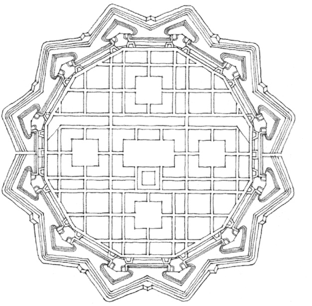
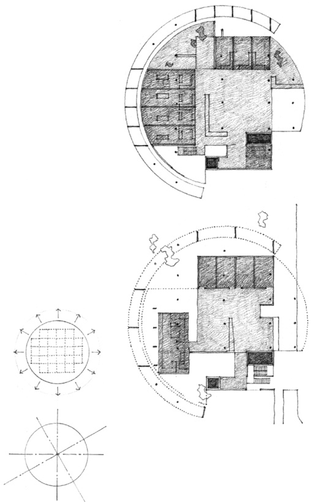
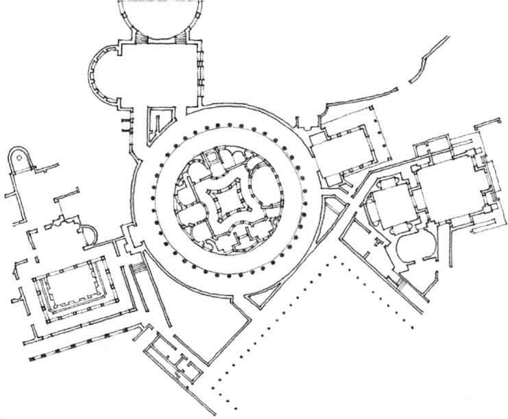
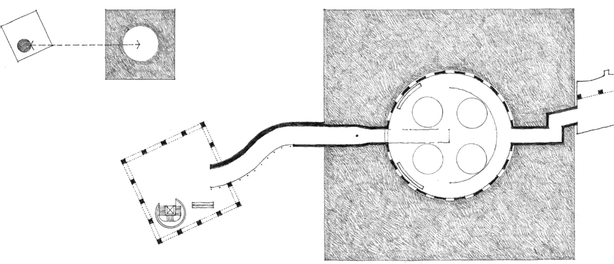
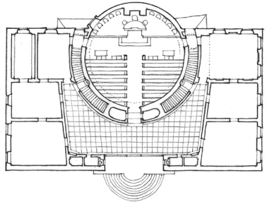
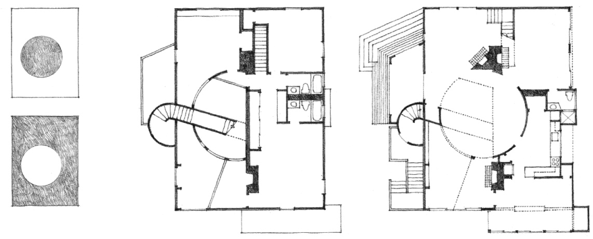

> [BREADCRUMB_CTX: 《Architecture》 > Circle & Square]

## CIRCLE & SQUARE

**Plan for an Ideal City**, 1615, Vincenzo Scamozzi

A circular form can be freestanding in its context to express its ideal shape and still incorporate a more functional, rectilinear geometry within its boundaries.

The centrality of a circular form enables it to act as a hub and unify forms of contrasting geometry or orientation about itself.

**Chancellery Building, French Embassy** (Project),Brasilia, 1964–1965, Le Corbusier

**The Island Villa (Teatro Marittimo)**, Hadrian’s Villa, Tivoli, Italy, A.D. 118–125

**Museum for North Rhine–Westphalia** (Project), Dusseldorf, Germany, 1975, James Stirling & Michael Wilford

**Lister County Courthouse**, Solvesborg, Sweden, 1917–1921, Gunnar Asplund

A circular or cylindrical space can serve to organize the spaces within a rectangular enclosure.

**Murray House**, Cambridge, Massachusetts, 1969, Charles Moore