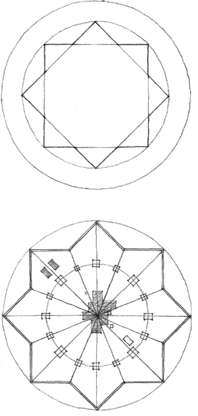
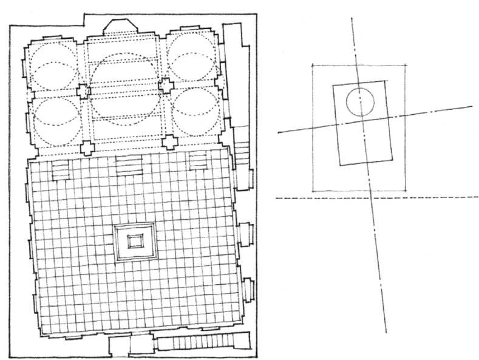
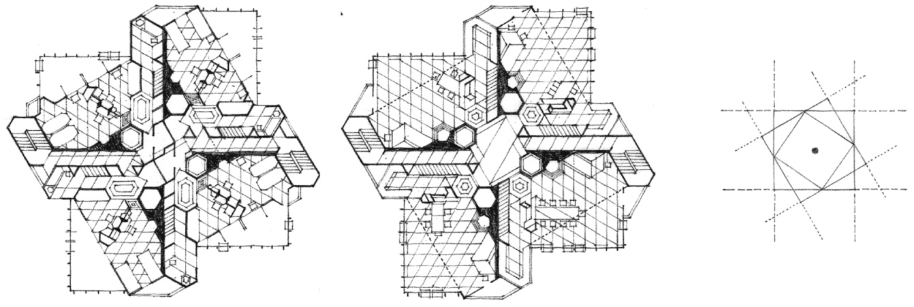
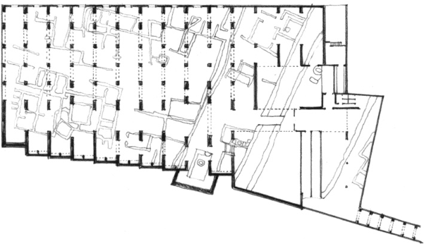
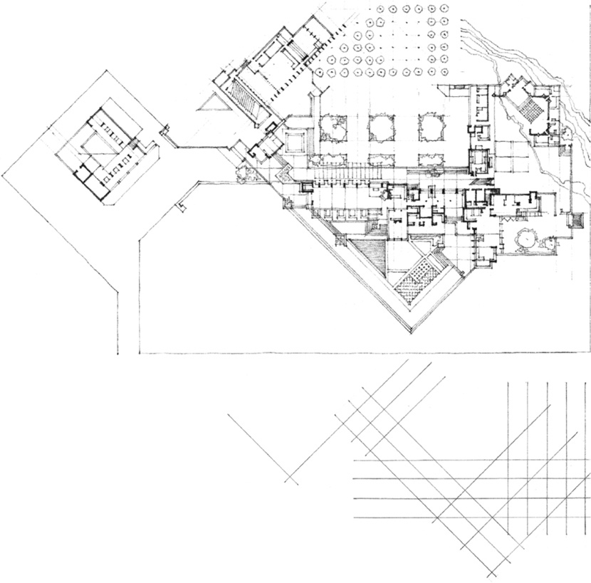
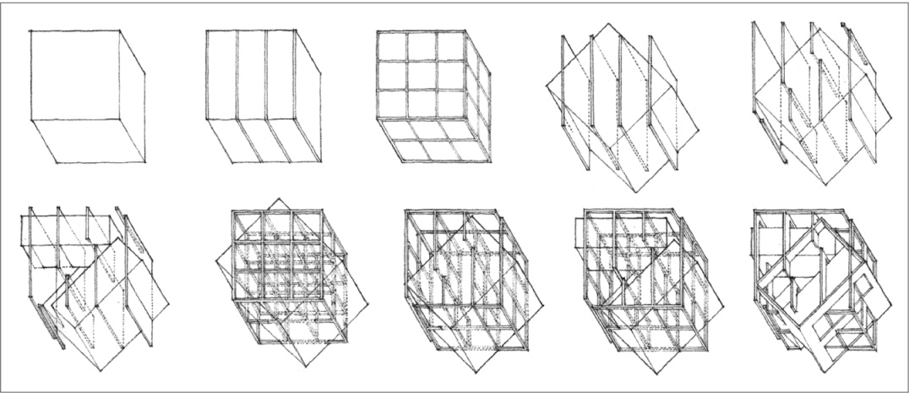

> [BREADCRUMB_CTX: 《Architecture》 > Rotated Grid]

## ROTATED GRID

**Plan of the Ideal City of Sforzinda**, 1464, Antonio Filarete

**Pearl Mosque**, within the Red Fort, an imperial palace at Agra, India, 1658–1707. The interior space of this mosque is oriented exactly with the cardinal points so that the quibla wall faces in the direction of the holy city of Mecca, while its exterior conforms to the existing layout of the fort.

**St. Mark’s Tower**, Project, New York City, 1929, Frank Lloyd Wright

**National Museum of Roman Art**, Mérida, Spain, 1980–1986, Rafael Moneo. The structural grid of the lower level of the museum floats over and contrasts with the geometry of the ancient Roman remains of Mérida.

**A Diagram of Architecture:**  
**Taliesin West**, near Scottsdale, Arizona, 1938–1959, Frank Lloyd Wright

A diagram by Bernhard Hoesli of the geometry regulating the layout of Taliesin West

**Diagram as Architecture:**  
**House III for Robert Miller**, Lakeville, Connecticut, 1971, Design Development Drawings, Peter Eisenman