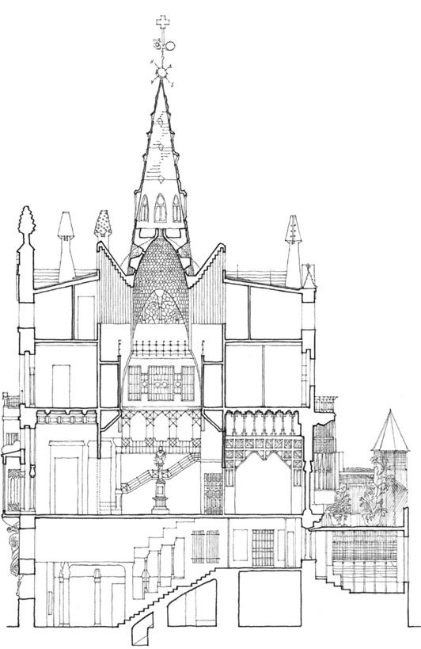
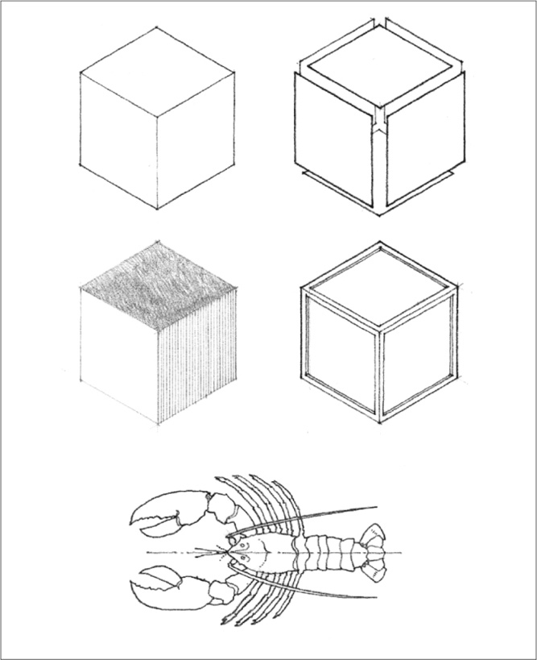
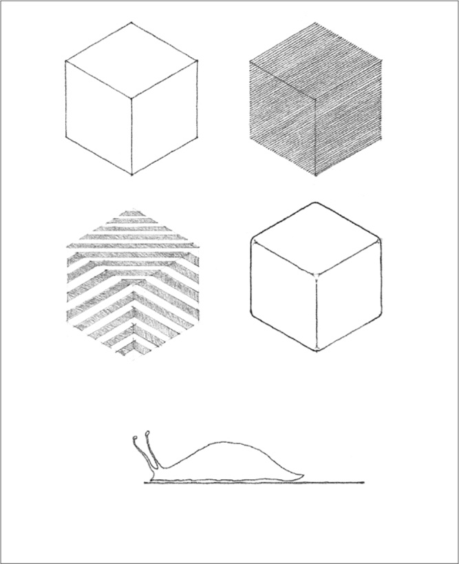

> [BREADCRUMB_CTX: 《Architecture》 > Articulation of Form]

## ARTICULATION OF FORM

**Palacio Güell**, Barcelona, 1885–1889, Antonio Gaudi

Articulation refers to the manner in which the surfaces of a form come together to define its shape and volume. An articulated form clearly reveals the precise nature of its parts and their relationships to each other and to the whole. Its surfaces appear as discrete planes with distinct shapes and their overall configuration is legible and easily perceived. In a similar manner, an articulated group of forms accentuates the joints between the constituent parts in order to visually express their individuality.

A form can be articulated by:

* differentiating adjoining planes with a change in material, color, texture, or pattern
* developing corners as distinct linear elements independent of the abutting planes
* removing corners to physically separate neighboring planes
* lighting the form to create sharp contrasts in tonal value along edges and corners

In opposition to the emphasis on joints and joinery, the corners of a form can be rounded and smoothed over to emphasize the continuity of its surfaces. Or a material, color, texture, or pattern can be carried across a corner onto the adjoining surfaces to de-emphasize the individuality of the surface planes and emphasize instead the volume of a form.