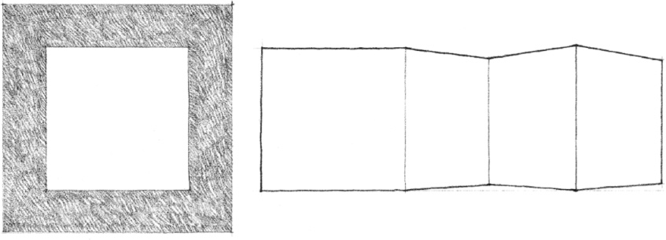
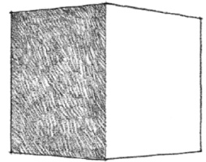
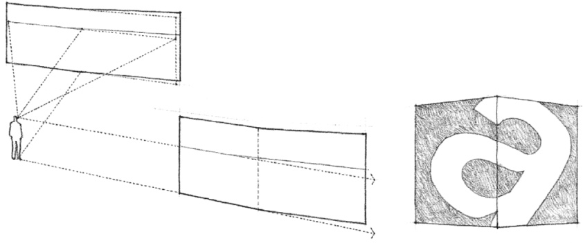
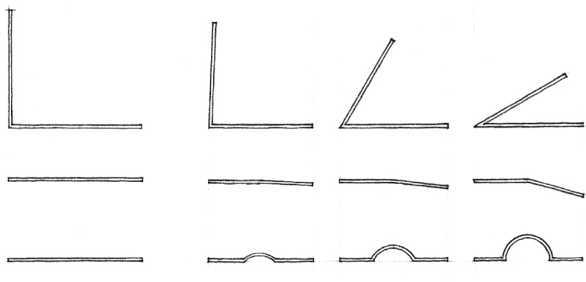

> [BREADCRUMB_CTX: 《Architecture》 > Edges & Corners]

## EDGES & CORNERS

Since the articulation of a form depends to a great degree on how its surfaces meet each other at corners, how these edge conditions are resolved is critical to the definition and clarity of a form.

While a corner can be articulated by simply contrasting the surface qualities of the adjoining planes, or obscured by layering their joining with an optical pattern, our perception of its existence is also affected by the laws of perspective and the quality of light that illuminates the form.

For a corner to be formally active, there must be more than a slight deviation in the angle between the adjoining planes. Since we constantly search for regularity and continuity within our field of vision, we tend to regularize or smooth out slight irregularities in the forms we see. For example, a wall plane that is bent only slightly will appear to be a single flat plane, perhaps with a surface imperfection. A corner would not be perceived.

At what point do these formal deviations become an acute angle? … a right angle?

a segmented line? … a straight line?

a circular segment? … a change in a line’s contour?

