> [BREADCRUMB_CTX: 《Architecture》 > Corners]

## CORNERS

Corners define the meeting of two planes. If the two planes simply touch and the corner remains unadorned, the presence of the corner will depend on the visual treatment of the adjoining surfaces. This corner condition emphasizes the volume of a form.

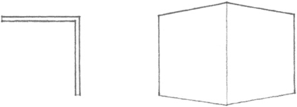

A corner condition can be visually reinforced by introducing a separate and distinct element that is independent of the surfaces it joins. This element articulates the corner as a linear condition, defines the edges of the adjoining planes, and becomes a positive feature of the form.

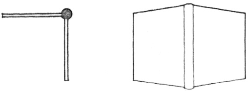

If an opening is introduced to one side of the corner, one of the planes will appear to bypass the other. The opening diminishes the corner condition, weakens the definition of the volume within the form, and emphasizes the planar qualities of the neighboring surfaces.

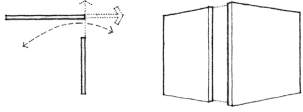

If neither plane is extended to define the corner, a volume of space is created to replace the corner. This corner condition deteriorates the volume of the form, allows the interior space to leak outward, and clearly reveals the surfaces as planes in space.

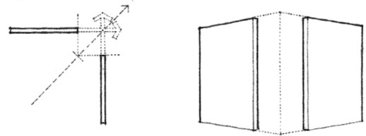

Rounding off the corner emphasizes the continuity of the bounding surfaces of a form, the compactness of its volume, and softness of its contour. The scale of the radius of curvature is important. If too small, it becomes visually insignificant; if too large, it affects the interior space it encloses and the exterior form it describes.

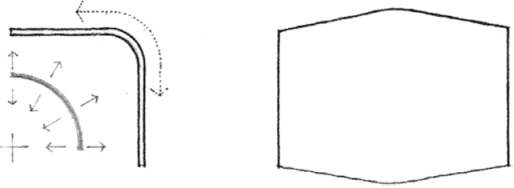
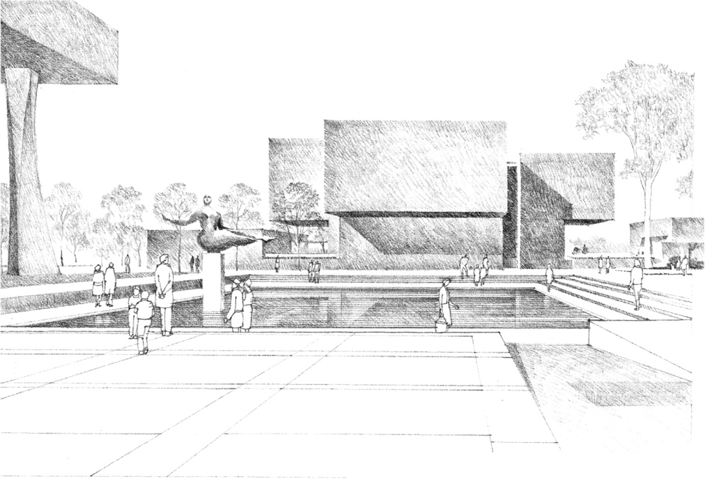

**Everson Museum**, Syracuse, New York, 1968, I.M. Pei.  
The unadorned corners of the forms emphasize the volume of their mass.

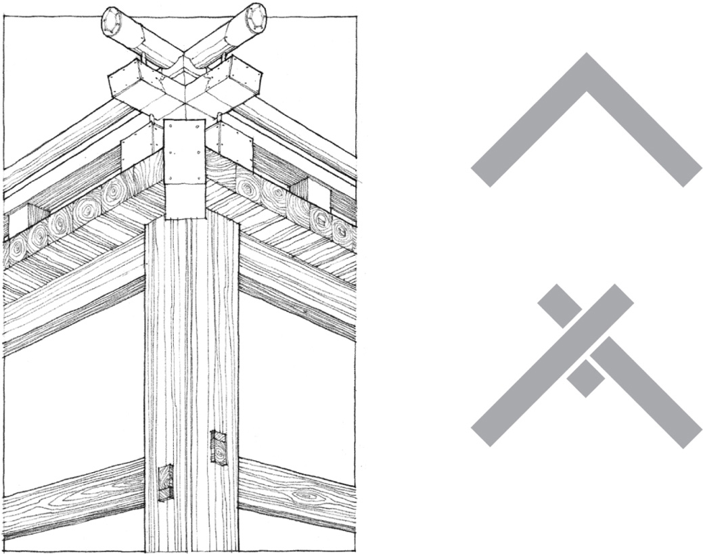

Corner Detail, **Izumo Shrine**, Shimane Prefecture, Japan, A.D. 717 (last rebuilt in 1744). The timber joinery articulates the individuality of the members meeting at the corner.

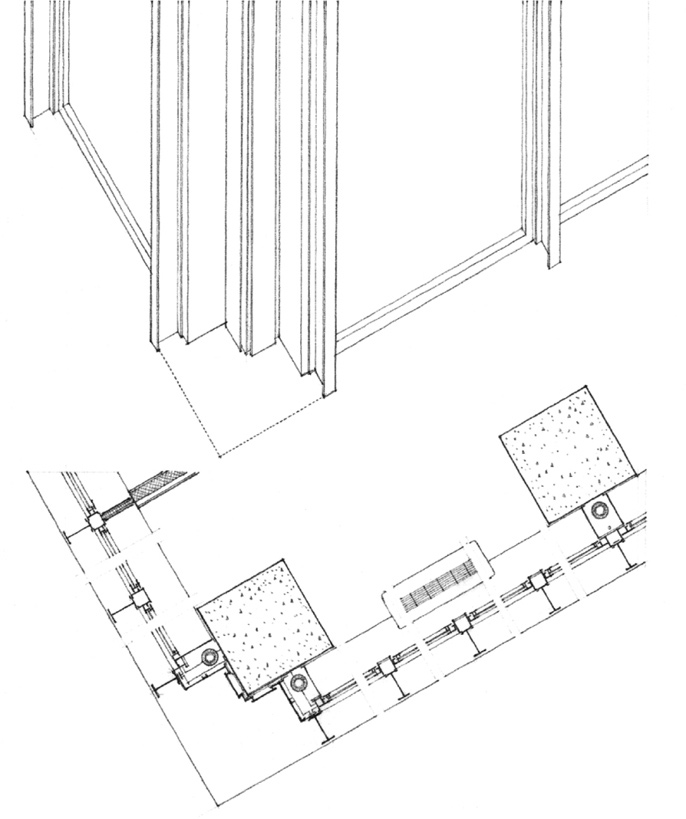

Corner Detail, **Commonwealth Promenade Apartments**, Chicago, 1953–1956, Mies van der Rohe. The corner member is recessed to be independent of the adjoining wall planes.

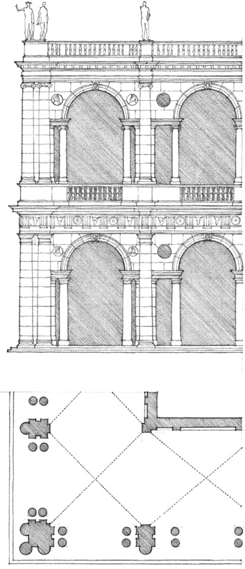

Corner Detail, **The Basilica**, Vicenza, Italy, 1545, Andrea Palladio. The corner column emphasizes the edge of the building form.

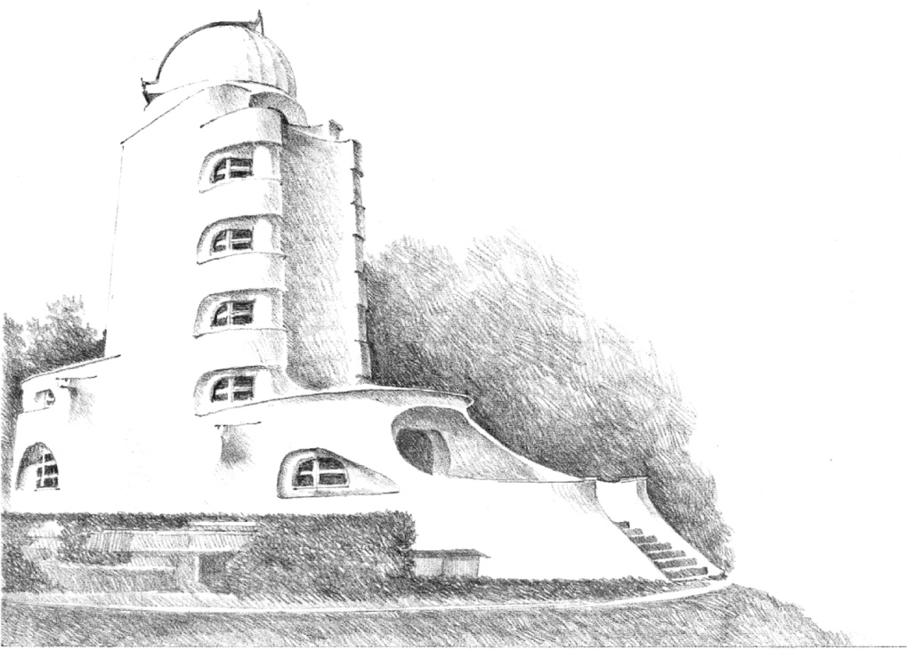

**Einstein Tower**, Potsdam, Germany, 1919, Eric Mendelsohn

Rounded corners express continuity of surface, compactness of volume, and softness of form.

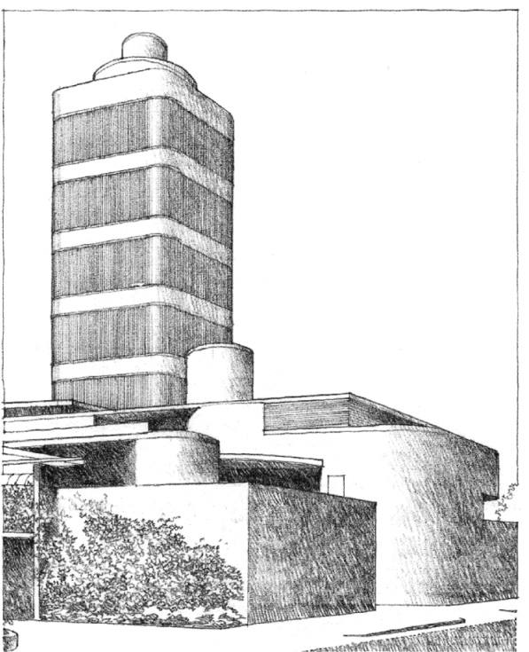

**Laboratory Tower, Johnson Wax Building**, Racine, Wisconsin, 1950, Frank Lloyd Wright

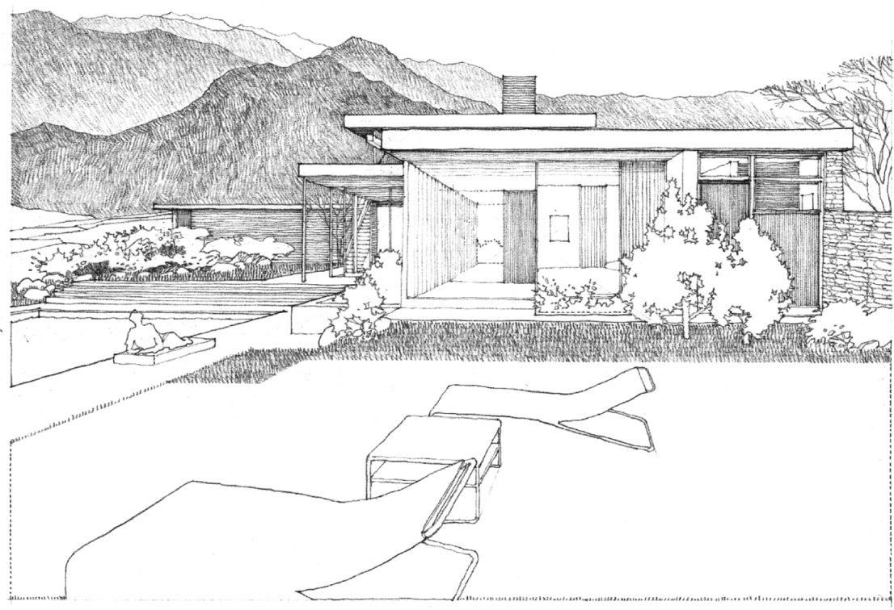

**Kaufmann Desert House**, Palm Springs, California, 1946, Richard Neutra

Openings at corners emphasize the definition of planes over volume.

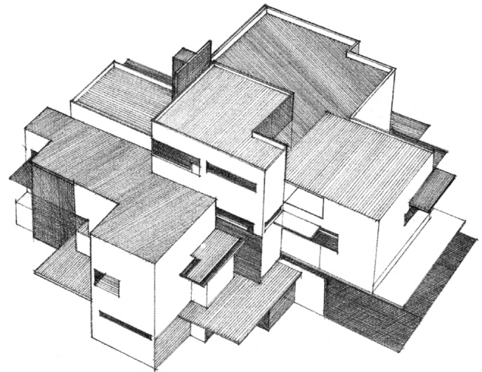

**Architectural Design Study**, 1923, Van Doesburg and Van Esteren