> [BREADCRUMB_CTX: 《Architecture》 > Surface Articulation]

## SURFACE ARTICULATION

Our perception of the shape, size, scale, proportion, and visual weight of a plane is influenced by its surface properties as well as its visual context.

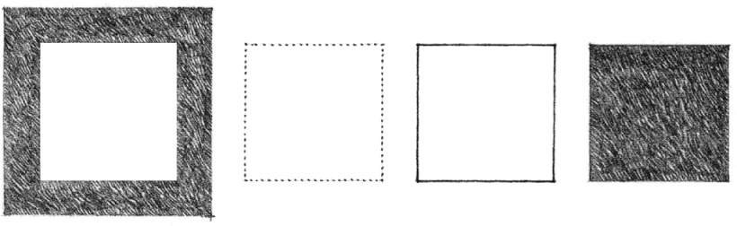

* A distinct contrast between the surface color of a plane and that of the surrounding field can clarify its shape, while modifying its tonal value can either increase or decrease its visual weight.

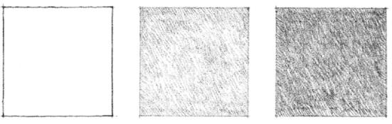

* A frontal view reveals the true shape of a plane; oblique views distort it.

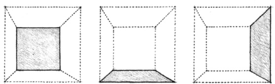

* Elements of known size within the visual context of a plane can aid our perception of its size and scale.

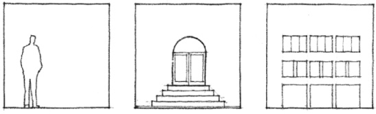

* Texture and color together affect the visual weight and scale of a plane and the degree to which it absorbs or reflects light and sound.

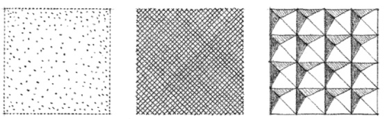

* Directional or oversized optical patterns can distort the shape or exaggerate the proportions of a plane.

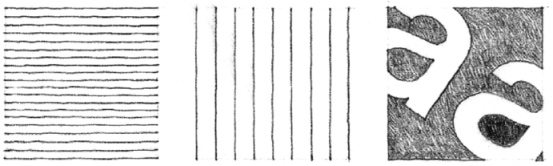
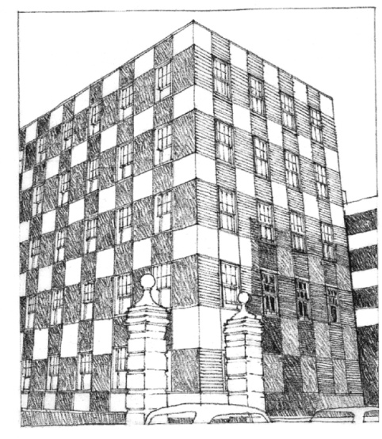

**Vincent Street Flats**, London, 1928, Sir Edwin Lutyens

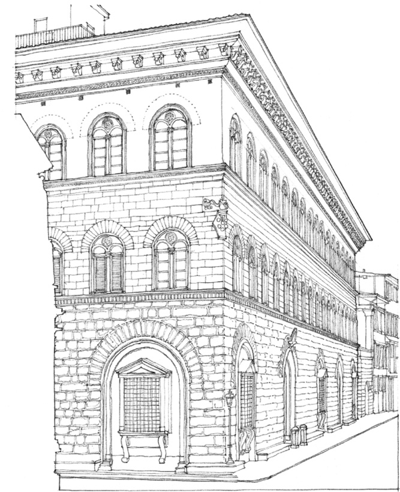

**Palazzo Medici-Ricardo**, Florence, Italy, 1444–1460, Michelozzi

The color, texture, and pattern of surfaces articulate the existence of planes and influence the visual weight of a form.

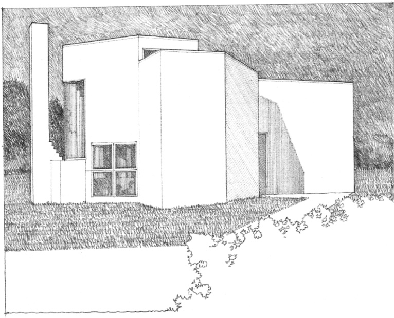

**Hoffman House**, East Hampton, New York, 1966–1967, Richard Meier

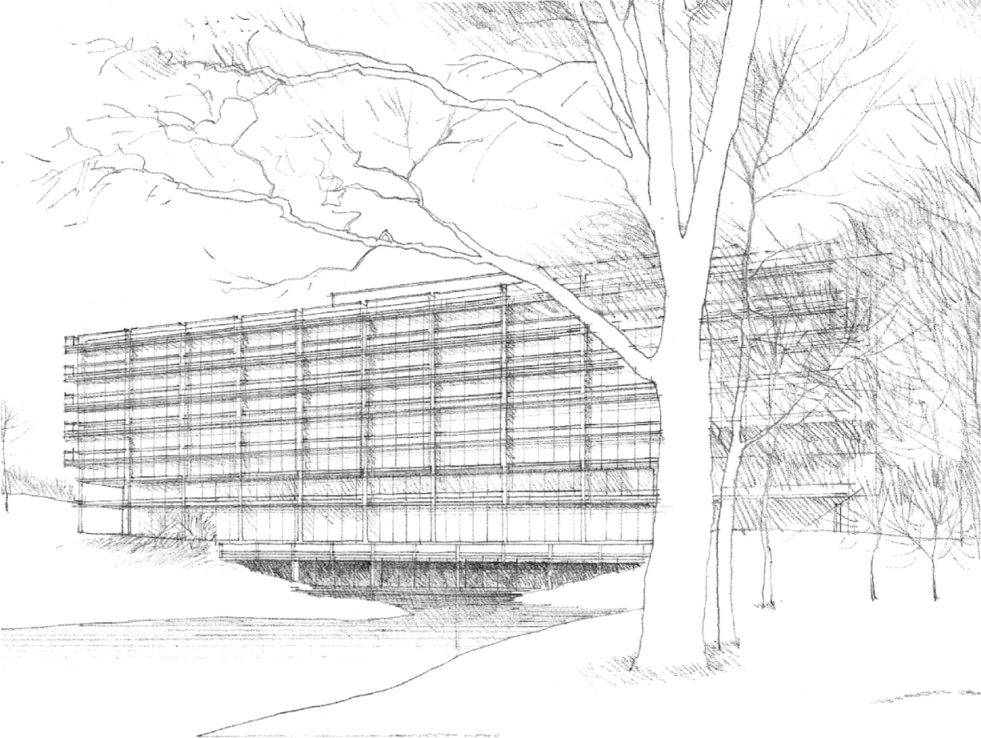

**John Deere & Company Building**, Moline, Illinois, 1961–1964, Eero Saarinen & Associates. The linear sun-shading devices accentuate the horizontality of the building form.

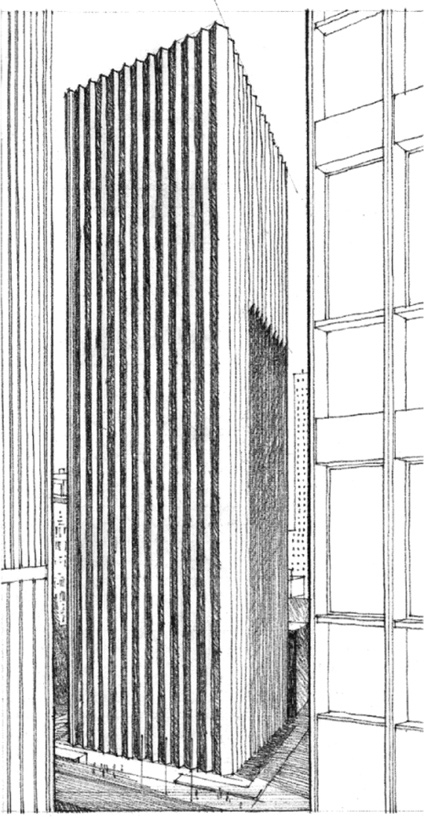

**CBS Building**, New York City,1962–1964, Eero Saarinen & Associates. Linear columnar elements emphasize the verticality of this high-rise structure.

Linear patterns have the ability to emphasize the height or length of a form, unify its surfaces, and define its textural quality.

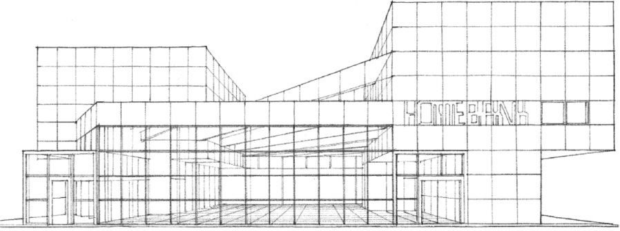

**Fukuoka Sogo Bank**, Study of the Saga Branch, 1971, Arata Isozaki. A grid pattern unifies the surfaces of the three-dimensional composition.

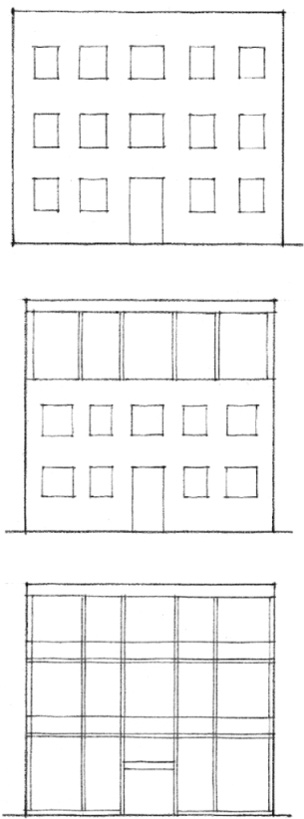

A transformation from a pattern of openings in a plane to an open facade articulated by a linear framework.

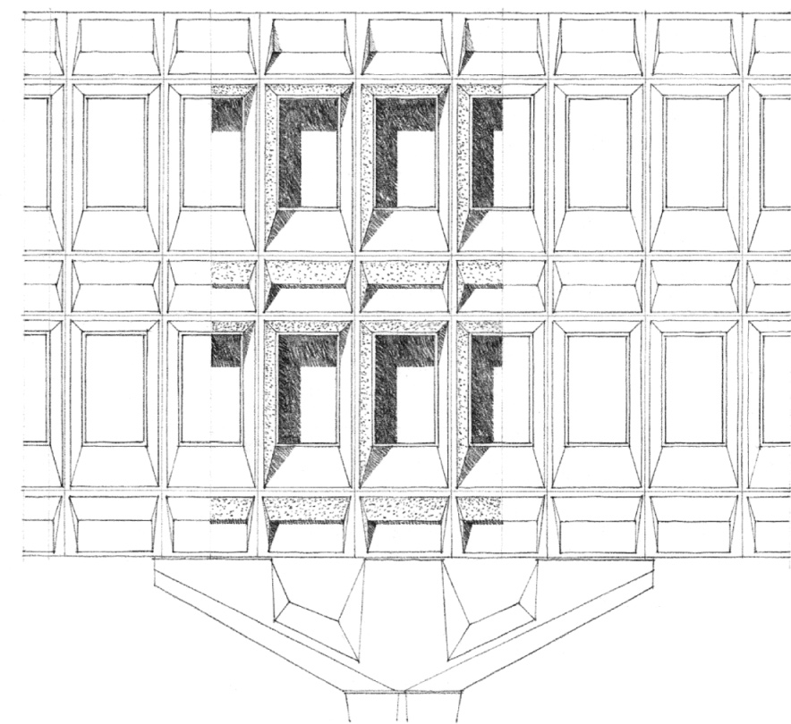

**IBM Research Center**, La Guade, Var, France, 1960–1961, Marcel Breuer. The three-dimensional form of the openings creates a texture of light, shade, and shadows.

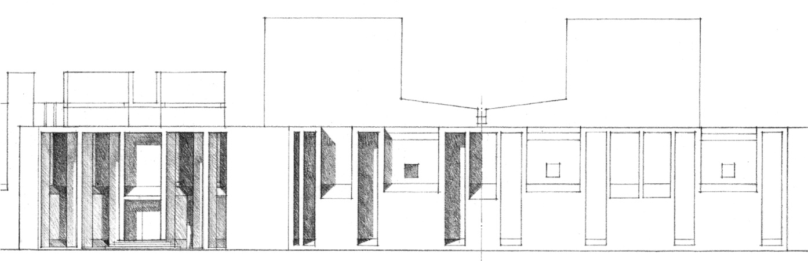

**First Unitarian Church**, Rochester, New York, 1956–1967, Louis Kahn. The pattern of openings and cavities interrupts the continuity of the exterior wall planes.

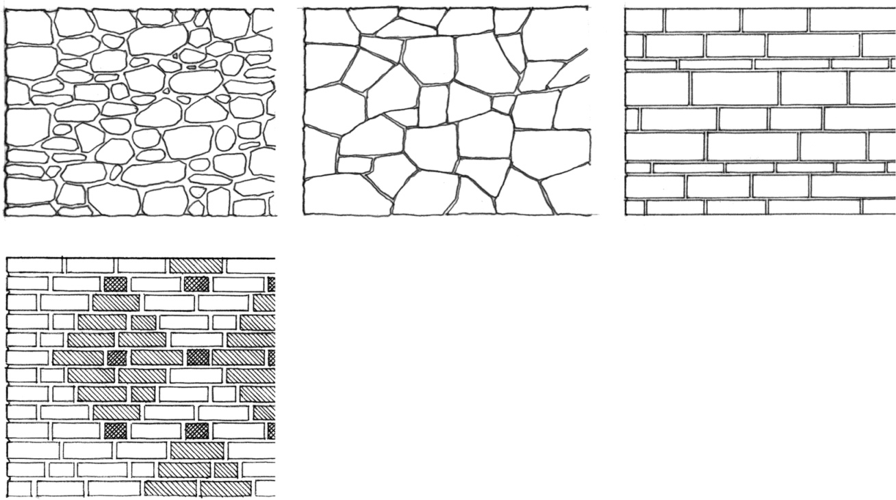

At a smaller scale, the surfaces of buildings owe their visual characteristics to the way their materials are joined and assembled in construction.

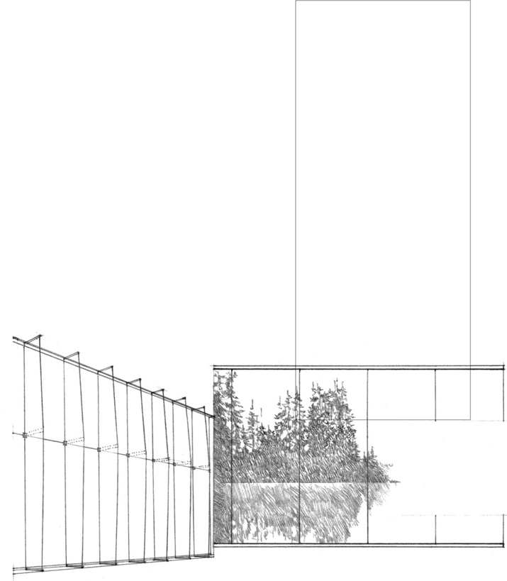

**From rough to smooth…**

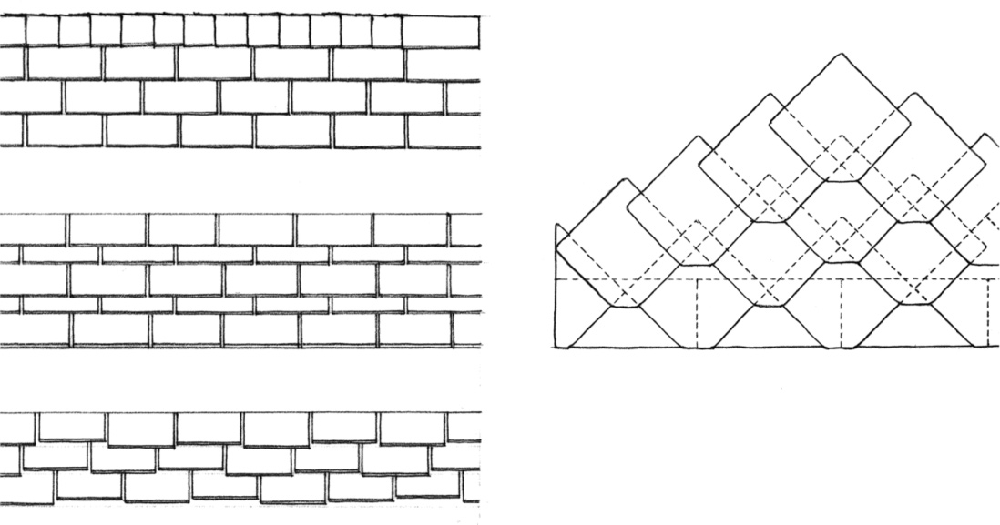

**From orthogonal to skewed…**

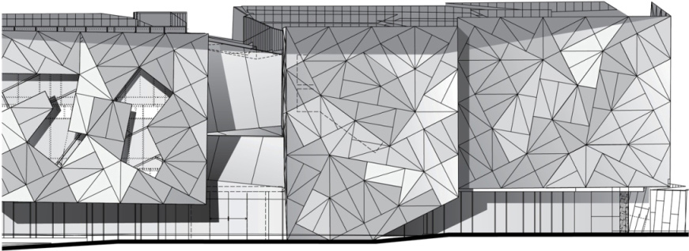

Partial facade, **Federation Square**, Melbourne, Australia, 2003, LAB Architecture Studio & Bates Smart, Architects

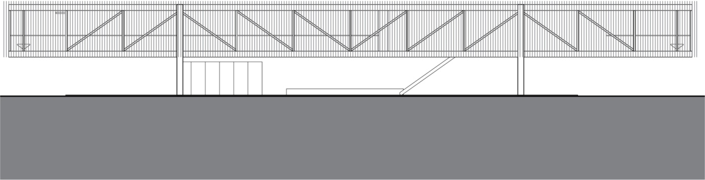

**St. Andrew’s Beach House**, Victoria, Australia, 2006, Sean Godsell Architects

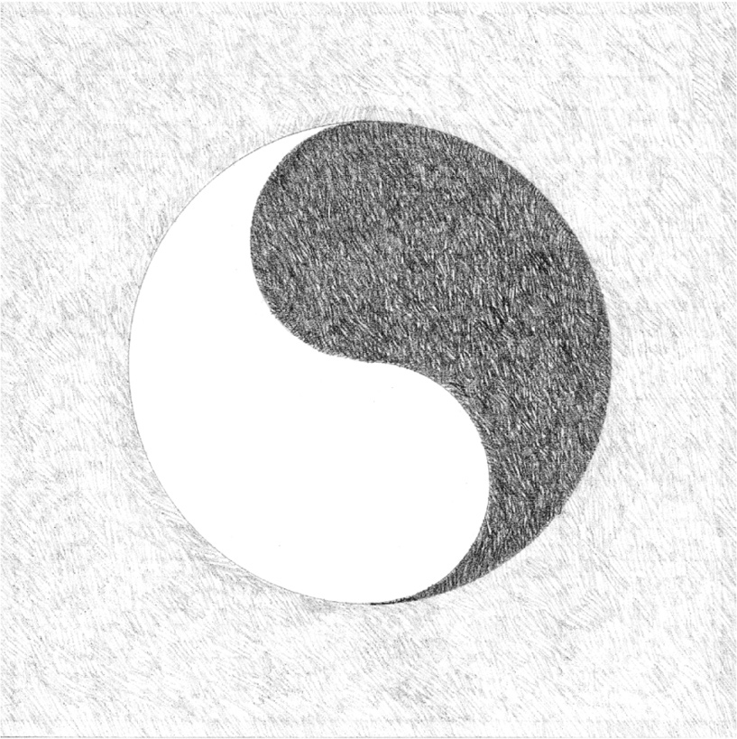