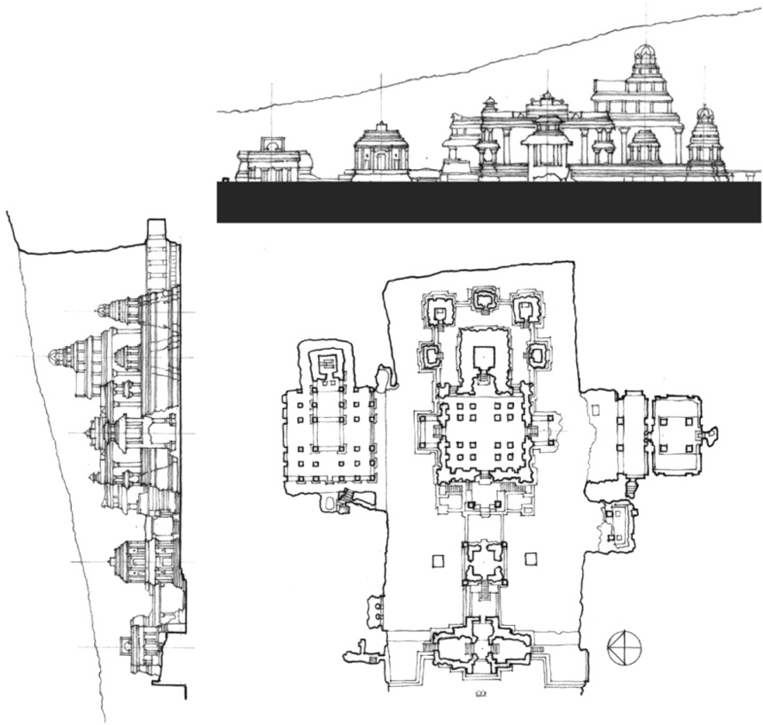
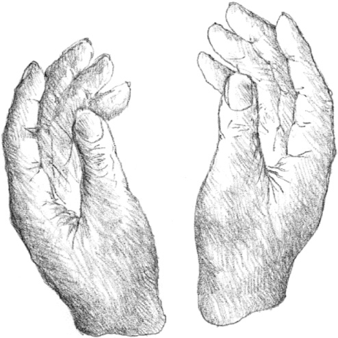
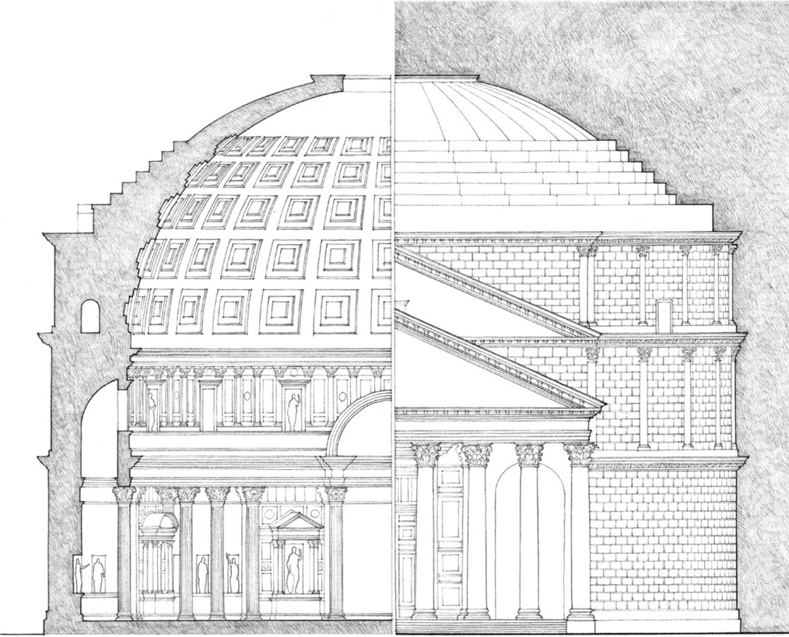

> [BREADCRUMB_CTX: 《Architecture》 > Form & Space]

## FORM & SPACE

Space constantly encompasses our being. Through the volume of space, we move, see forms, hear sounds, feel breezes, smell the fragrances of a flower garden in bloom. It is a material substance like wood or stone. Yet it is an inherently formless vapor. Its visual form, its dimensions and scale, the quality of its light—all of these qualities depend on our perception of the spatial boundaries defined by elements of form. As space begins to be captured, enclosed, molded, and organized by the elements of mass, architecture comes into being.

**Temple of Kailasnath** at Ellora, near Aurangabad, India, A.D. 600–1000

**The Pantheon**, Rome, A.D. 120–124