> [BREADCRUMB_CTX: 《Architecture》 > Form & Space: The Unity of Opposites]

## FORM & SPACE: THE UNITY OF OPPOSITES

Our visual field normally consists of heterogeneous elements that differ in shape, size, color, or orienta-tion. To better comprehend the structure of a visual field, we tend to organize its elements into two opposing groups: positive elements, which are perceived as figures and negative elements, which provide a background for the figures.

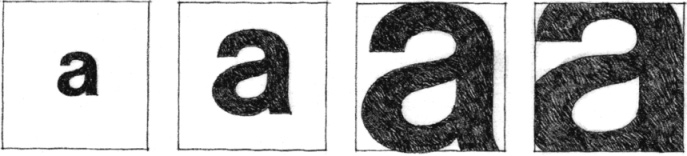

Our perception and understanding of a composition depends on how we interpret the visual interaction between the positive and negative elements within its field. On this page, for example, letters are seen as dark figures against the white background of the paper surface. Consequently, we are able to perceive their organization into words, sentences, and paragraphs. In the diagrams to the left, the letter “a” is seen as a figure not only because we recognize it as a letter in our alphabet but also because its profile is distinct, its value contrasts with that of its background, and its placement isolates it from its context. As it grows in size relative to its field, however, other elements within and around it begin to compete for our attention as figures. At times, the relationship between figures and their background is so ambiguous that we visually switch their identities back and forth almost simultaneously.

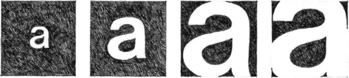
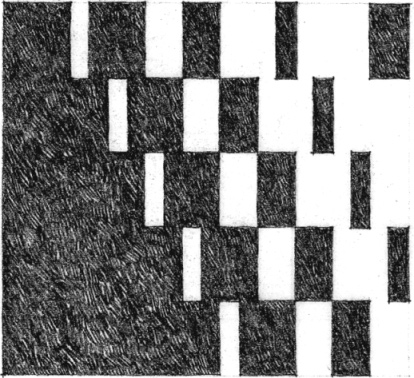

**White-on-Black or Black-on-White?**

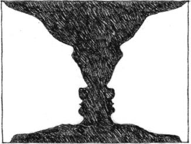

**Two Faces or a Vase?**

In all cases, however, we should understand that figures, the positive elements that attract our attention, could not exist without a contrasting background. Figures and their background, therefore, are more than opposing elements. Together, they form an inseparable reality—a unity of opposites—just as the elements of form and space together form the reality of architecture.

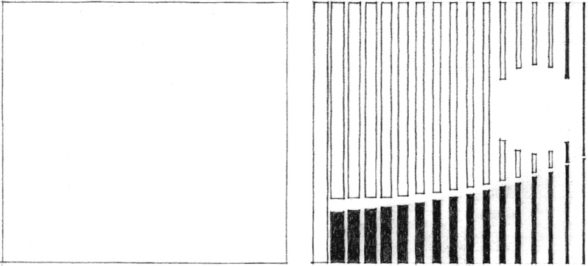
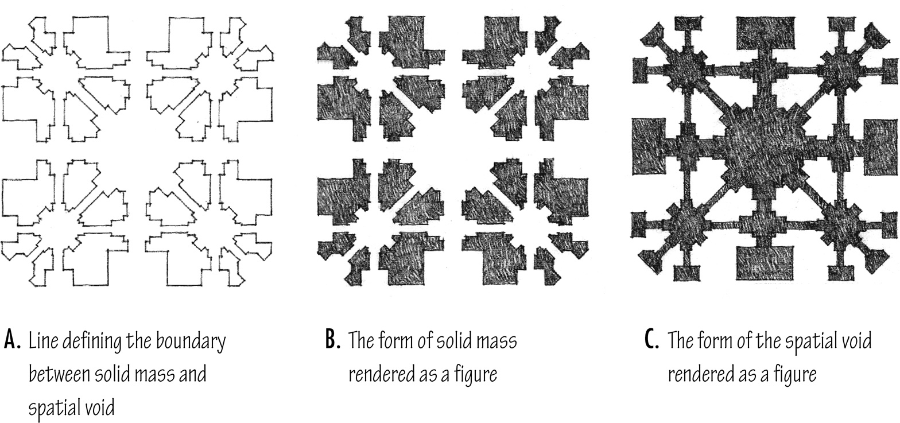

Plan Diagrams, **Taj Mahal**, Agra, India, 1630–1653. Shah Jahan built this white marble mausoleum for his favorite wife, Muntaz Mahal.

Architectural form occurs at the juncture between mass and space. In executing and reading design drawings, we should be concerned with both the form of the mass containing a volume of space as well as the form of the spatial volume itself.

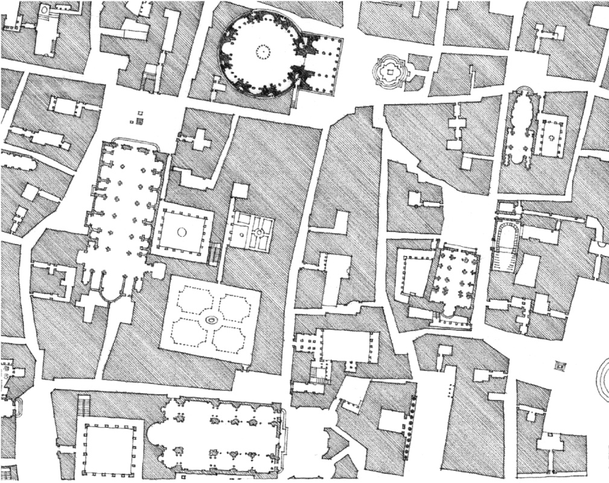

Fragment of a **Map of Rome**, drawn by Giambattista Nolli in 1748

Depending on what we perceive to be positive elements, the figure-ground relationship of the forms of mass and space can be inverted in different parts of this map of Rome. In portions of the map, buildings appear to be positive forms that define street spaces. In other parts of the drawing, urban squares, courtyards, and major spaces within important public buildings read as positive elements seen against the background of the surrounding building mass.

The symbiotic relationship of the forms of mass and space in architecture can be examined and found to exist at several different scales. At each level, we should be concerned not only with the form of a building but also its impact on the space around it. At an urban scale, we should carefully consider whether the role of a building is to continue the existing fabric of a place, form a backdrop for other buildings, or define a positive urban space, or whether it might be appropriate for it to stand free as a significant object in space.

At the scale of a building site, there are various strategies for relating the form of a building to the space around it. A building can:

1. form a wall along an edge of its site and begin to define a positive outdoor space;
   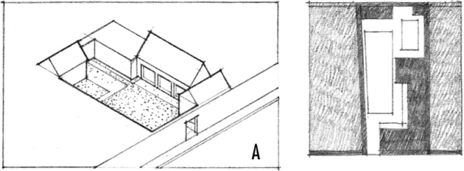
2. merge its interior space with the private outdoor space of a walled site;
   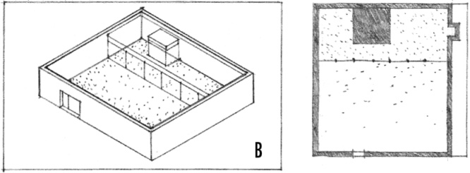
3. enclose a portion of its site as an outdoor room and shelter it from undesirable climatic conditions;
   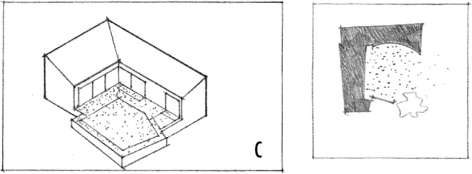
4. surround and enclose a courtyard or atrium space within its volume— an introverted scheme.

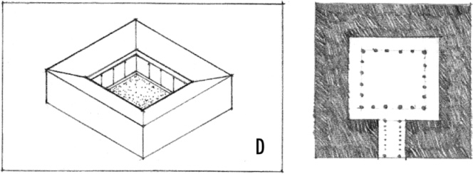
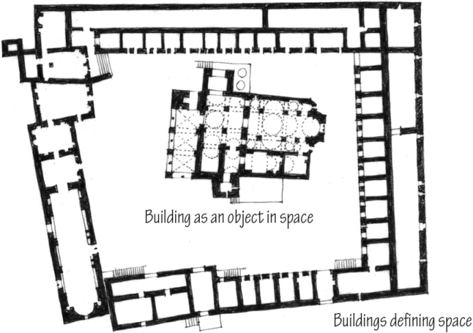

**Monastery of St. Meletios** on Mt. Kithairon, Greece, 9th century A.D.

1. E. stand as a distinct object in space and dominate its site through its form and topographical positioning—an extroverted scheme;
   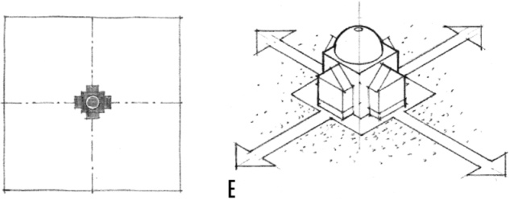
2. F. stretch out and present a broad face to address a view, terminate an axis, or define an edge of an urban space;
   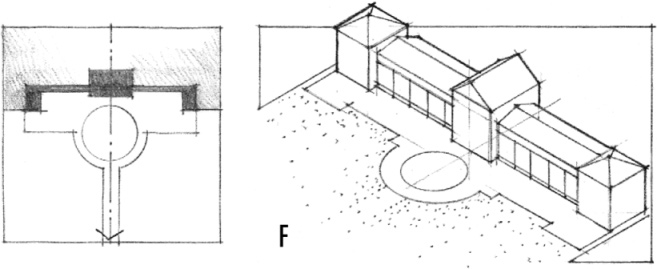
3. G. stand free within its site but extend its interior spaces to merge with private exterior spaces;
   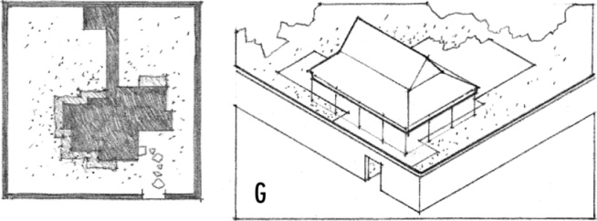
4. H. stand as a positive form in a negative space.

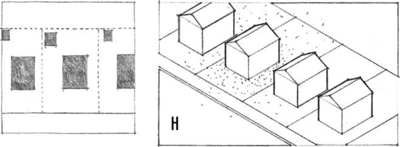
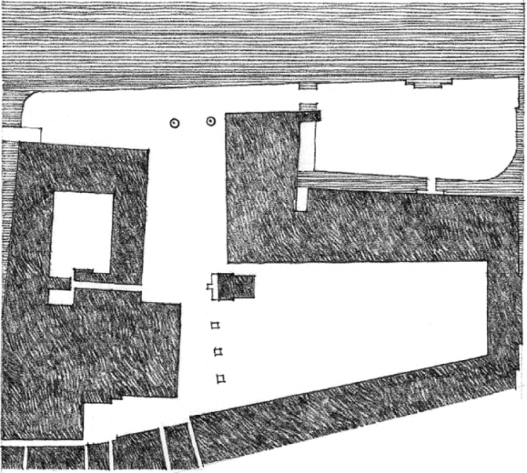

**Buildings Defining Space:**  
**Piazza San Marco**, Venice

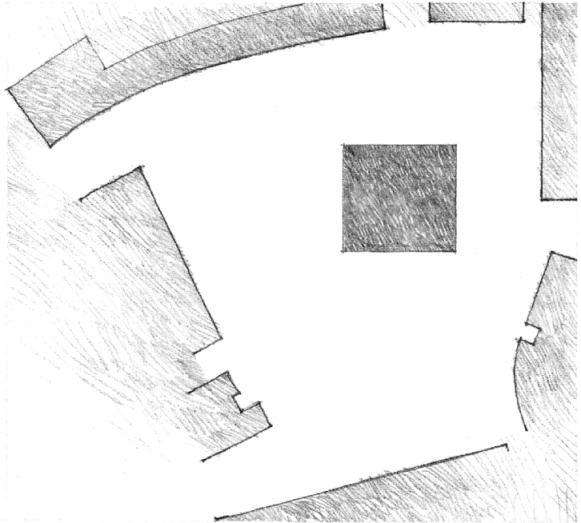

**Building as an Object in Space:**  
**Boston City Hall**, 1960, Kallmann, McKinnell & Knowles

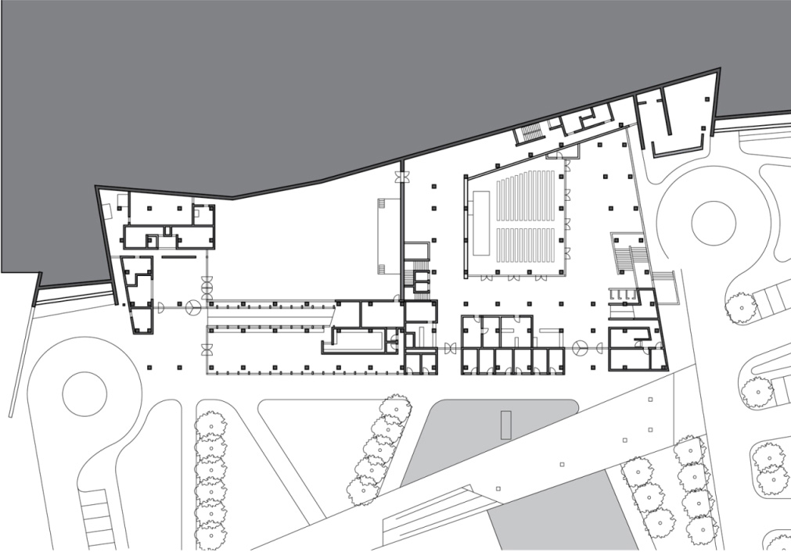

**Building Embedded in the Landscape:**  
**Eyüp Cultural Center**, Istanbul, Turkey, 2013, EAA-Emre Arolat Architects

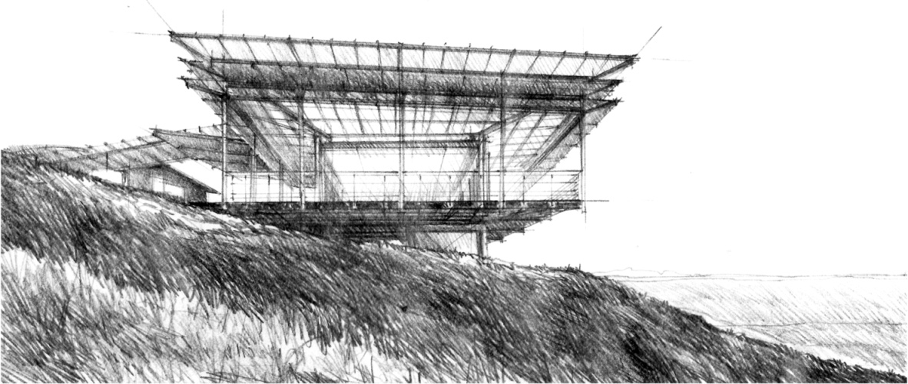

**Building Dominating the Landscape:**  
**Cooroy Art Temple**, Cooroy Mountain, Australia, 2008, Paolo Denti JMA Architects

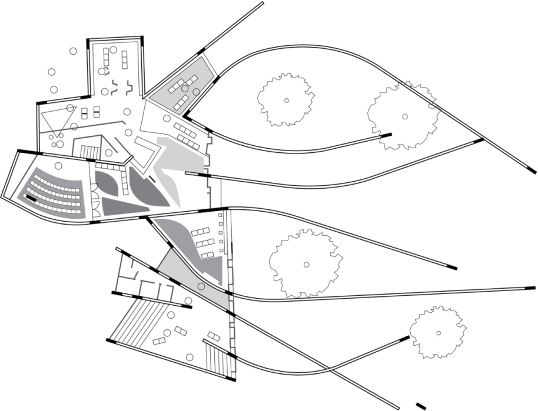

**Building as Landscape:**  
**Palafolls Public Library**, Palafolls, Spain, 2009, Enric Miralles and Benedetta Tagliabue/Miralles Tagliabue EMBT

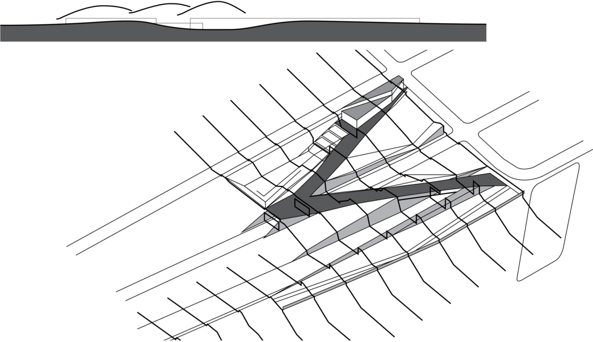

**Landscape as Building:**  
**Olympic Sculpture Park**, Seattle Art Museum, Seattle, Washington, 2008, Weiss/Manfredi Architecture/Landscape/Urbanism

At the scale of a building, we tend to read the configurations of walls as the positive elements of a plan. The white space in between, however, should not be seen simply as background for the walls, but also as figures in the drawing that have shape and form.

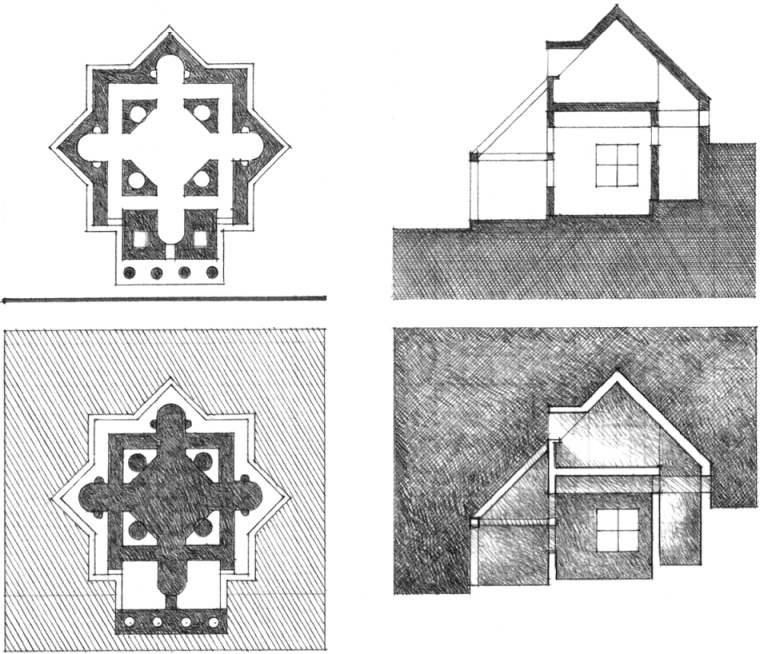

Even at the scale of a room, articles of furnishings can either stand as forms within a field of space or serve to define the form of a spatial field.

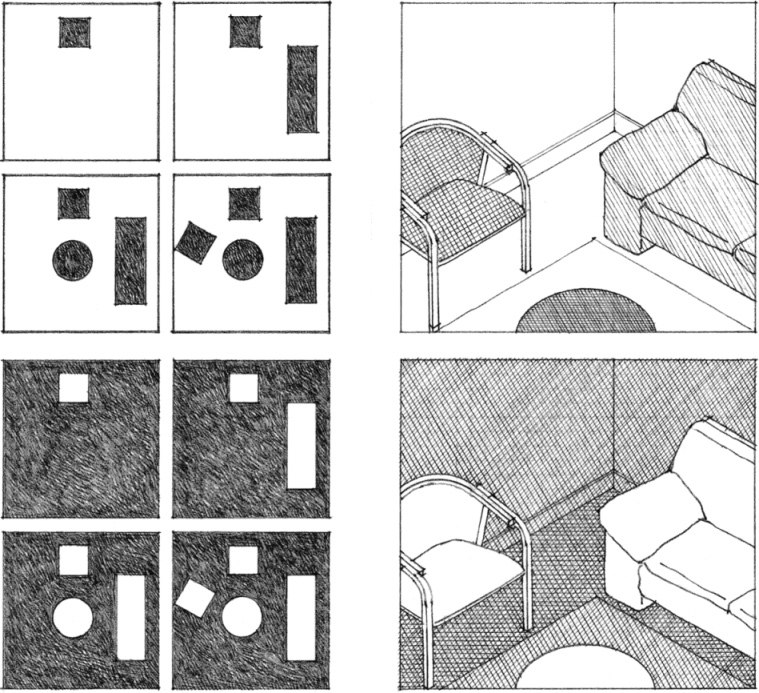
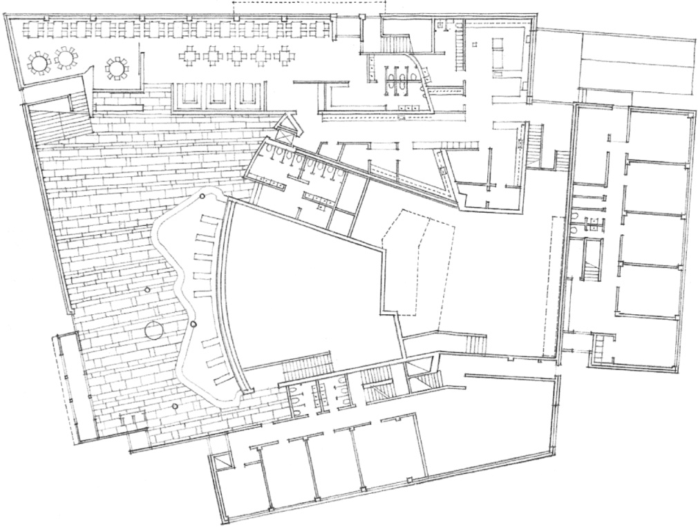

**Seinäjoki Theater**, Finland,1968–1969, Alvar Aalto

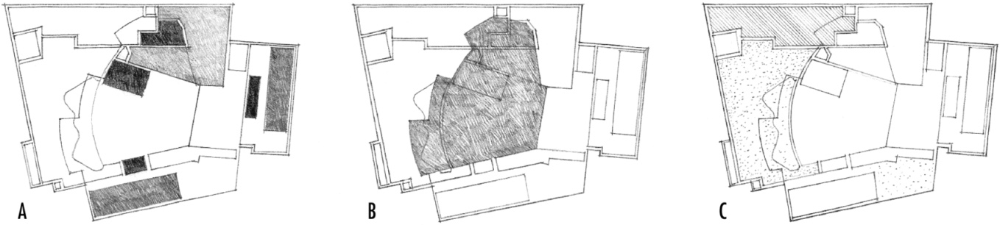

The form and enclosure of each space in a building either determines, or is determined by, the form of the spaces around it. In the Theater in Seinäjoki by Alvar Aalto, for example, we can distinguish several categories of spatial forms and analyze how they interact. Each category has an active or passive role in defining space.

1. Some spaces, such as offices, have specific but similar functions and can be grouped into single, linear, or clustered forms.
2. Some spaces, such as concert halls, have specific functional and technical requirements, and require specific forms that will affect the forms of the spaces around them.
3. Some spaces, such as lobbies, are flexible in nature and can therefore be freely defined by the spaces or grouping of spaces around them.