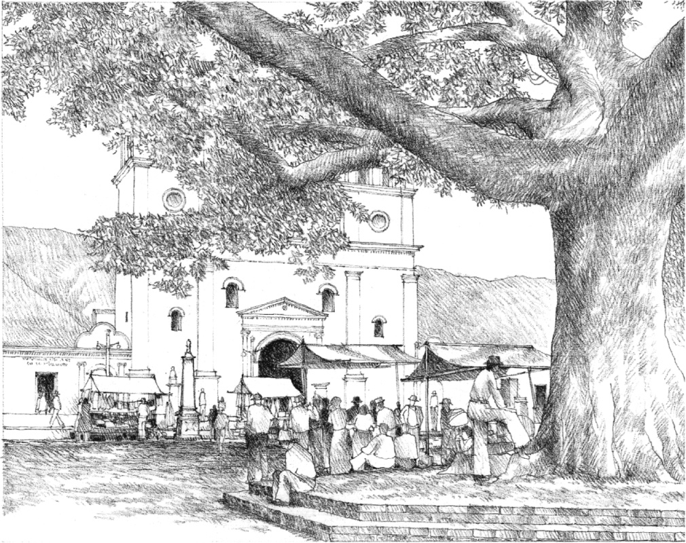

> [BREADCRUMB_CTX: 《Architecture》 > Form Defining Space]

## FORM DEFINING SPACE

**Square in Giron, Colombia**, South America

When we place a two-dimensional figure on a piece of paper, it influences the shape of the white space around it. In a similar manner, any three-dimensional form naturally articulates the volume of space surrounding it and generates a field of influence or territory which it claims as its own. The following section of this chapter looks at horizontal and vertical elements of form and presents examples of how various configurations of these formal elements generate and define specific types of space.