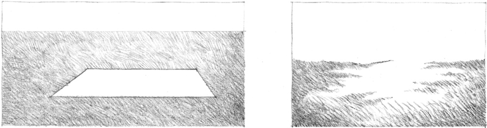
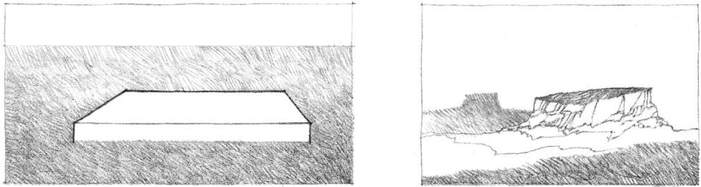
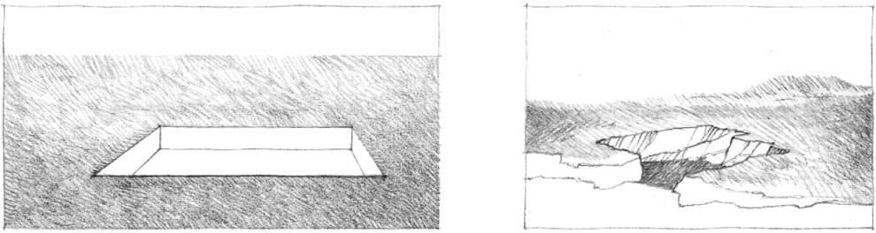
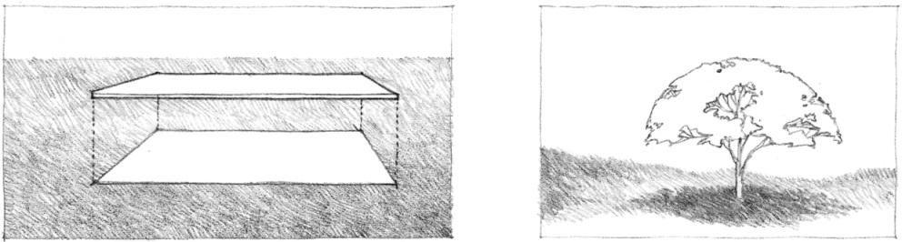

> [BREADCRUMB_CTX: 《Architecture》 > Horizontal Elements Defining Space]

## HORIZONTAL ELEMENTS DEFINING SPACE

### Base Plane

A horizontal plane laying as a figure on a contrasting background defines a simple field of space. This field can be visually reinforced in the following ways.

### Elevated Base Plane

A horizontal plane elevated above the ground plane establishes vertical surfaces along its edges that reinforce the visual separation between its field and the surrounding ground.

### Depressed Base Plane

A horizontal plane depressed into the ground plane utilizes the vertical surfaces of the lowered area to define a volume of space.

### Overhead Plane

A horizontal plane located overhead defines a volume of space between itself and the ground plane.

