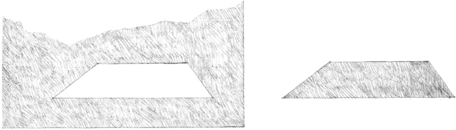
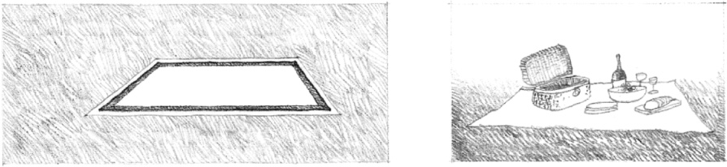
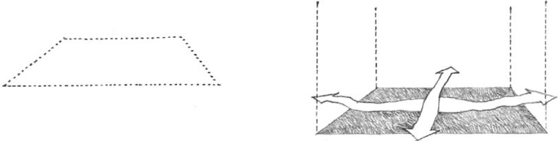
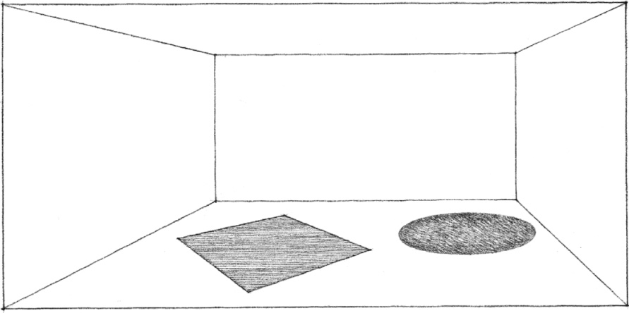
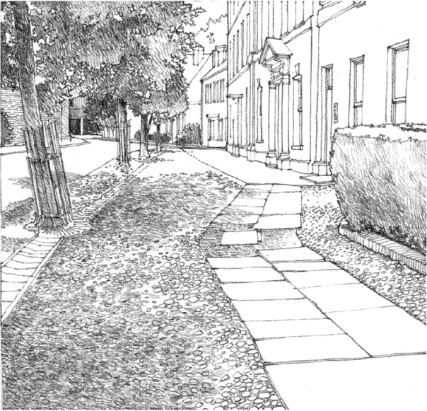
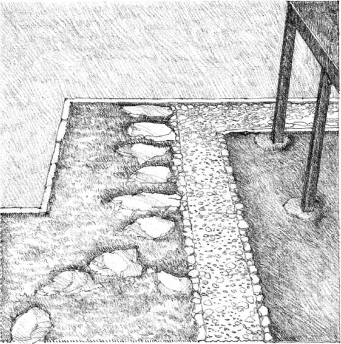
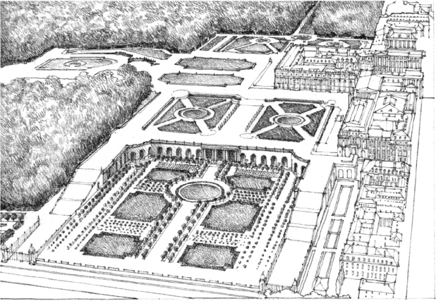
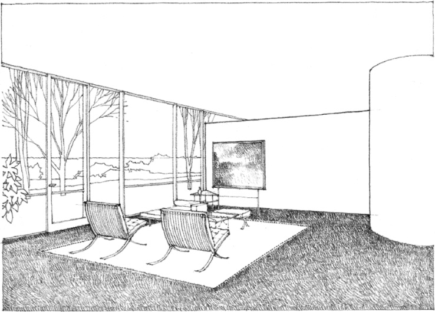

> [BREADCRUMB_CTX: 《Architecture》 > Base Plane]

## BASE PLANE

For a horizontal plane to be seen as a figure, there must be a perceptible change in color, tone, or texture between its surface and that of the surrounding area.

The stronger the edge definition of a horizontal plane is, the more distinct will be its field.

Although there is a continuous flow of space across it, the field nevertheless generates a spatial zone or realm within its boundaries.

The surface articulation of the ground or floor plane is often used in architecture to define a zone of space within a larger context. The examples on the facing page illustrate how this type of spatial definition can be used to differentiate between a path of movement and places of rest, establish a field from which the form of a building rises out of the ground, or articulate a functional zone within a one-room living environment.

**Street in Woodstock**, Oxfordshire, England

**Katsura Imperial Villa**, Kyoto, Japan, 17th century

**Parterre de Broderie, Palace of Versailles**, France, 17th century, André Le Nôtre

Interior of **Glass House**, New Canaan, Connecticut, 1949, Philip Johnson