> [BREADCRUMB_CTX: 《Architecture》 > Elevated Base Plane]

## ELEVATED BASE PLANE

Elevating a portion of the base plane creates a specific domain within a larger spatial context. The changes in level that occur along the edges of the elevated plane define the boundaries of its field and interrupt the flow of space across its surface.

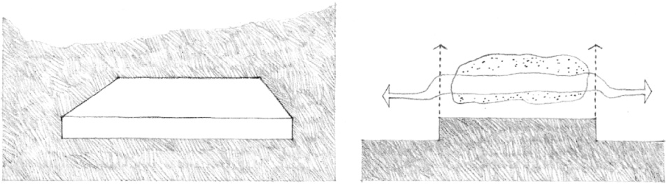

If the surface characteristics of the base plane continues up and across the elevated plane, then the field of the elevated plane will appear to be very much a part of the surrounding space. If, however, the edge condition is articulated by a change in form, color, or texture, then the field will become a plateau that is separate and distinct from its surroundings.

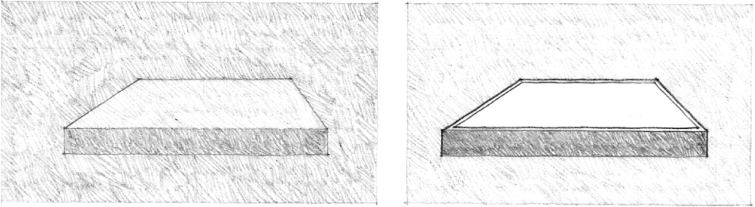
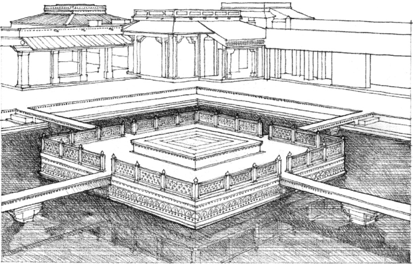

**Fatehpur Sikri**, Palace Complex of Akbar the Great, Mogul Emperor of India, 1569–1574. A special place is established by a platform in an artificial lake surrounded by the emperor’s living and sleeping quarters.

The degree to which spatial and visual continuity is maintained between an elevated space and its surroundings depends on the scale of the level change.

1. The edge of the field is well-defined; visual and spatial continuity is maintained; physical access is easily accommodated.
2. Visual continuity is maintained; spatial continuity is interrupted; physical access requires the use of stairs or ramps.
3. Visual and spatial continuity is interrupted; the field of the elevated plane is isolated from the ground or floor plane; the elevated plane is transformed into a sheltering element for the space below.

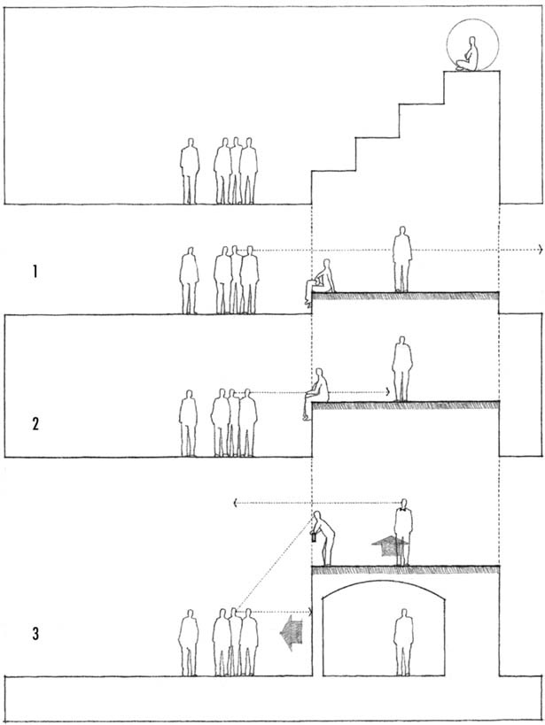
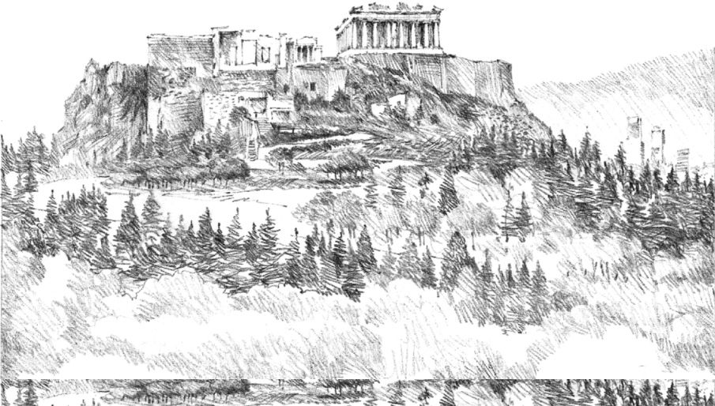

**The Acropolis**, the citadel of Athens, 5th century B.C.

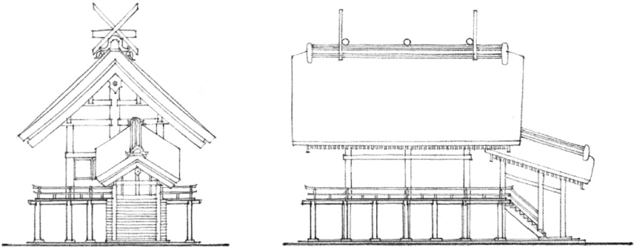

**Izumo Shrine**, Shimane Prefecture, Japan, A. D. 717 (last rebuilt in 1744)

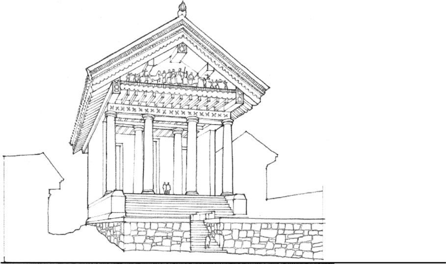

**Temple of Jupiter Capitolinus**, Rome, 509 B.C.

Elevating a portion of the ground plane establishes a platform or podium that structurally and visually supports the form and mass of a building. The elevated ground plane can be a preexisting site condition, or it can be artificially constructed to deliberately raise a building above the surrounding context or enhance its image in the landscape. The examples on this and the preceding page illustrate how these techniques have been used to venerate sacred and honorific buildings.

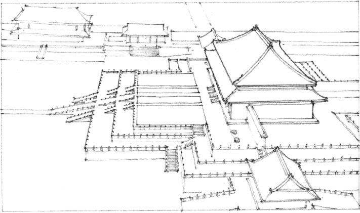
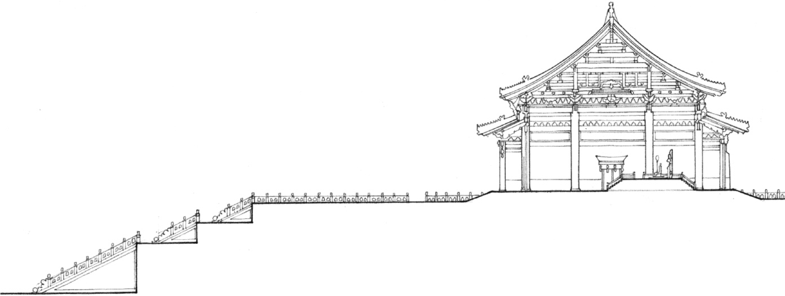

**Pavilion of Supreme Harmony (Taihe Dian)** in the Forbidden City, Beijing, 1627

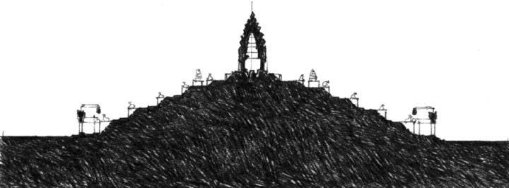

**Temple Mountain, Bakong Temple**, A.D. 881, Hariharalaya, Cambodia

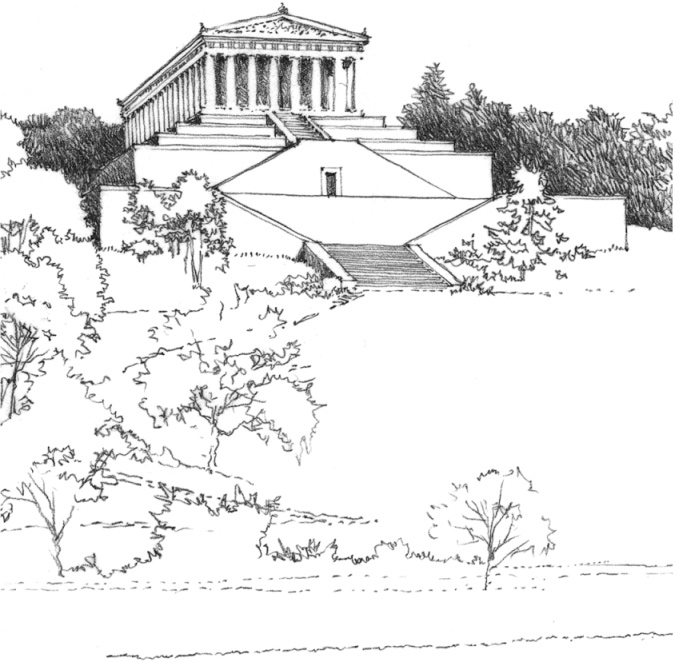

**Valhalla**, near Regensburg, Germany, Leon von Klenze, 1830–1842

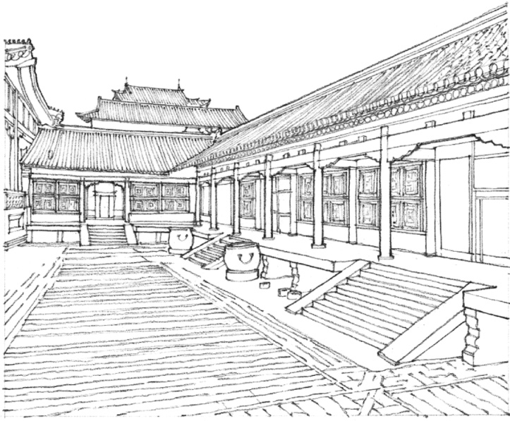

Private courtyard of the **Imperial Palace, the Forbidden City**, Beijing, China, 15th century

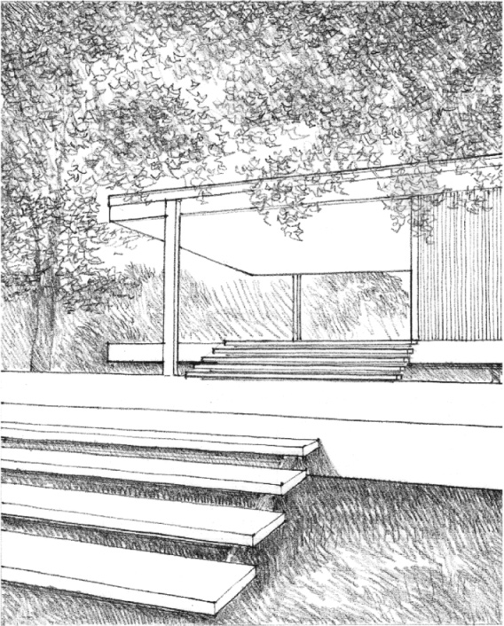

An elevated plane can define a transitional space between the interior of a building and the outdoor environment. Combined with a roof plane, it develops into the semiprivate realm of a porch or veranda.

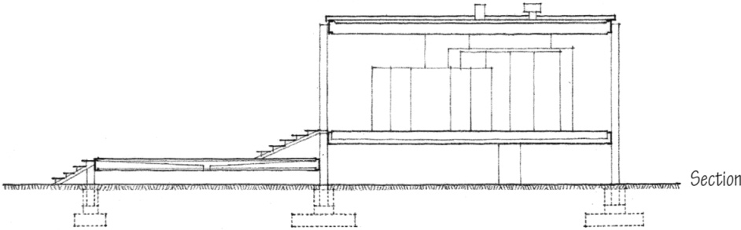

**Farnsworth House**, Plano, Illinois, 1950, Mies van der Rohe.  
The Farnsworth House was constructed to rise above the flood plain of the Fox River. This elevated floor plane, together with an overhead roof plane, defines a volume of space that hovers delicately above the surface of its site.

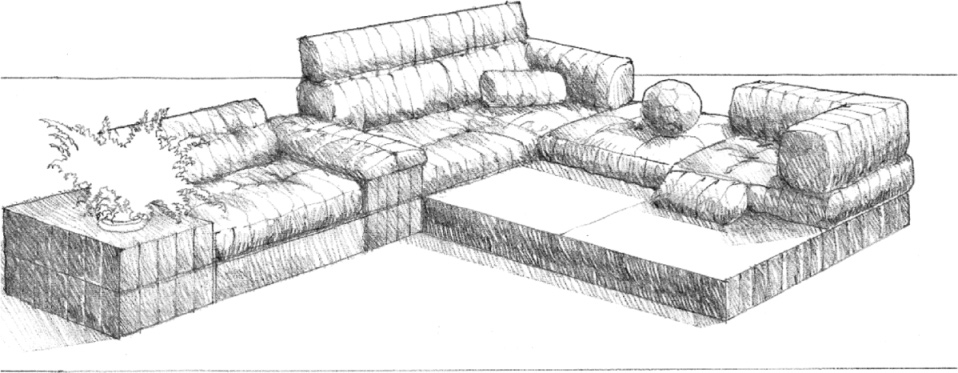
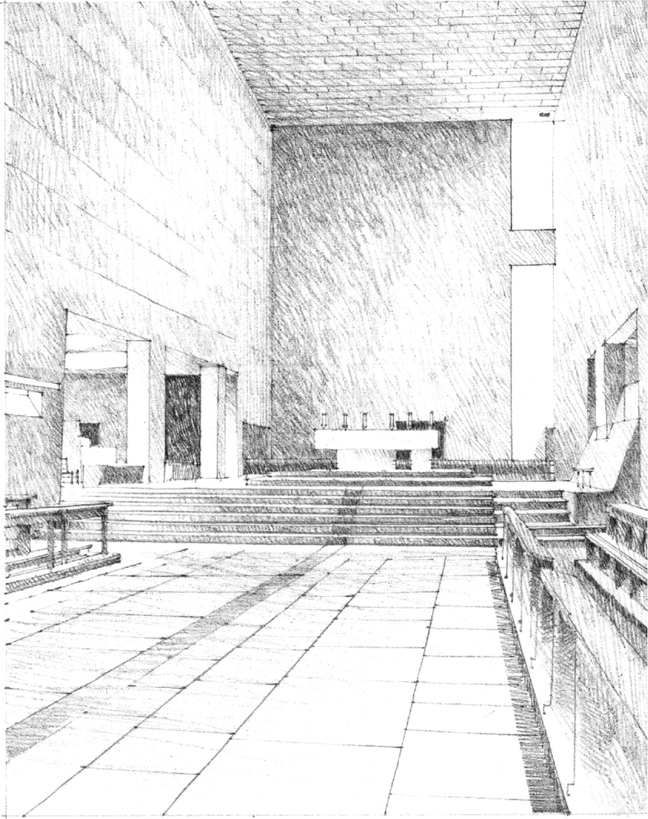

High Altar in the Chapel at the **Cistercian Monastery of La Tourette**, near Lyons, France, 1956–1959, Le Corbusier

A section of the floor plane can be elevated to establish a singular zone of space within a larger room or hall. This raised space can serve as a retreat from the activity around it or be a platform for viewing the surrounding space. Within a religious structure, it can demarcate a sacred, holy, or consecrated place.

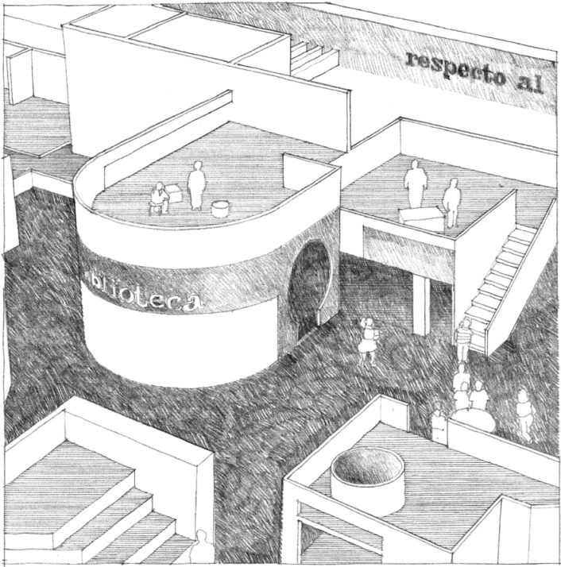

**East Harlem Preschool**, New York City, 1970, Hammel, Green & Abrahamson