> [BREADCRUMB_CTX: 《Architecture》 > Depressed Base Plane]

## DEPRESSED BASE PLANE

Lowering a portion of the base plane isolates a field of space from a larger context. The vertical surfaces of the depression establish the boundaries of the field. These boundaries are not implied as in the case of an elevated plane, but visible edges that begin to form the walls of the space.

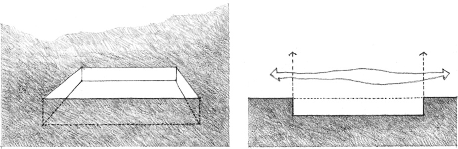

The field of space can be further articulated by contrasting the surface treatment of the lowered area and that of the surrounding base plane.

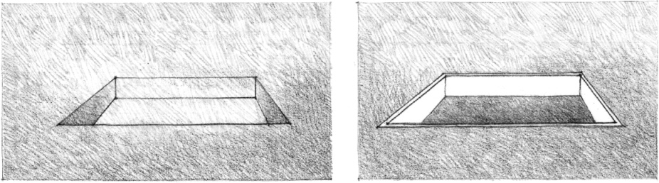

A contrast in form, geometry, or orientation can also visually reinforce the identity and independence of the sunken field from its larger spatial context.

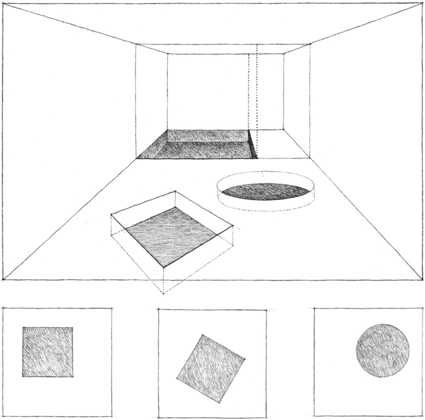

The degree of spatial continuity between a depressed field and the raised area surrounding it depends on the scale of the level change.

* The depressed field can be an interruption of the ground or floor plane and remain an integral part of the surrounding space.

* Increasing the depth of the depressed field weakens its visual relationship with the surrounding space and strengthens its definition as a distinct volume of space.

* Once the original base plane is above our eye level, the depressed field becomes a separate and distinct room in itself.

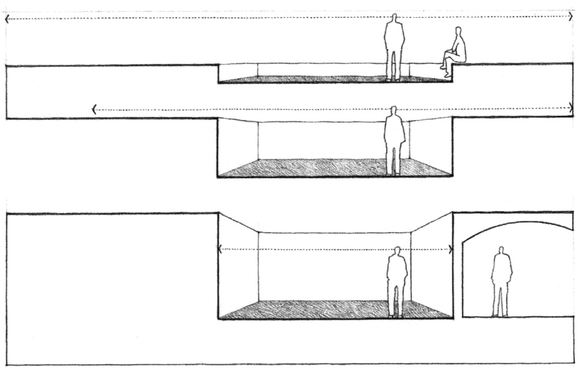

Creating a stepped, terraced, or ramped transition from one level to the next helps promote continuity between a sunken space and the area that rises around it.

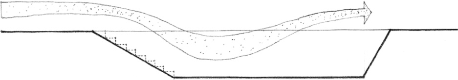
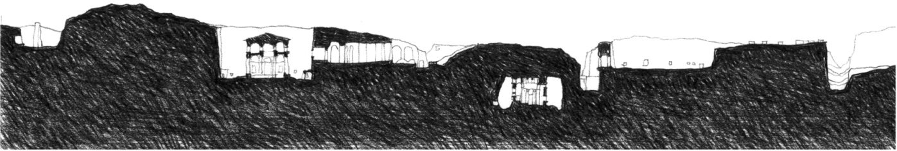

**Rock-cut churches of Lalibela**, 13th century

Whereas the act of stepping up to an elevated space might express the extroverted nature or significance of the space, the lowering of a space below its surroundings might allude to its introverted nature or to its sheltering and protective qualities.

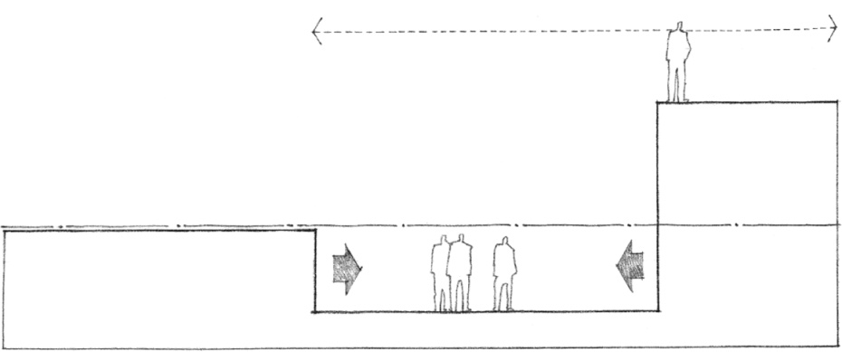
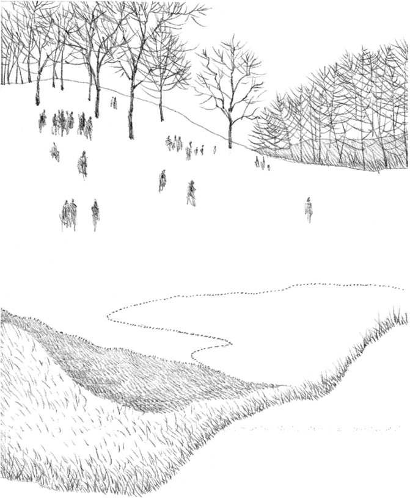

Depressed areas in the topography of a site can serve as stages for outdoor arenas and amphitheaters. The natural change in level benefits both the sightlines and the acoustical quality of these spaces.

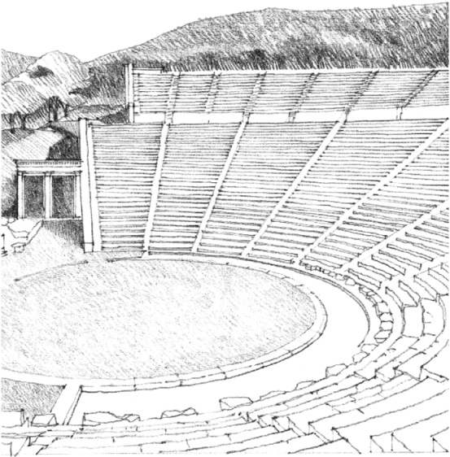

**Theater at Epidauros**, Greece, c. 350 B.C., Polycleitos

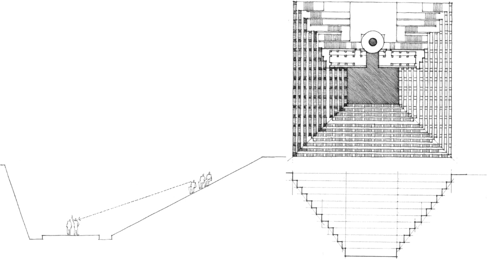

**Step well at Abhaneri**, near Agra, India, 9th century

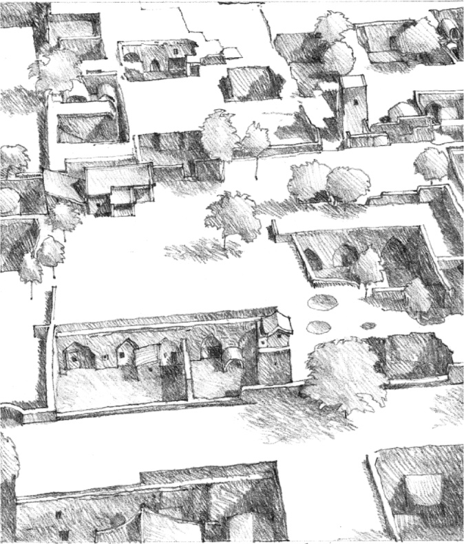

**Underground village near Loyang, China**

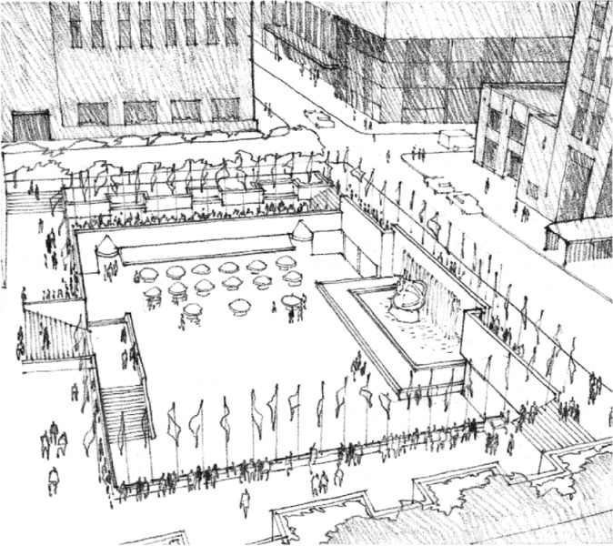

Lower Plaza, **Rockefeller Center**, New York City, 1930, Wallace K. Harrison & Max Abramovitz. Rockefeller Center’s lower plaza, an outdoor cafe in the summertime and a skating rink in the winter, can be viewed from the upper plaza while shops open onto it at the lower level.

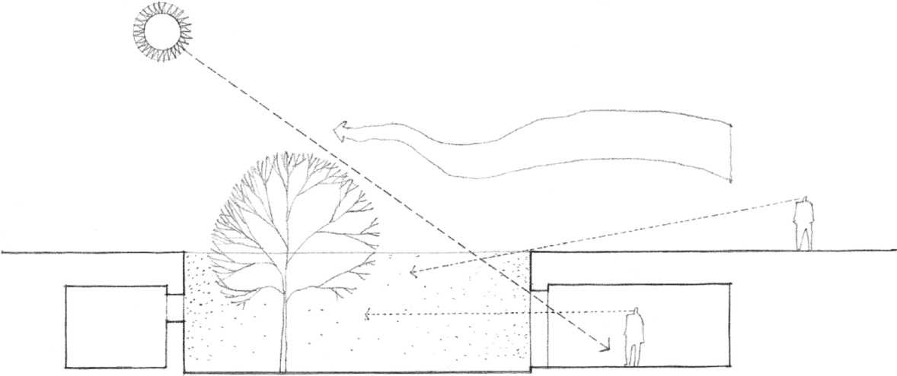

The ground plane can be lowered to define sheltered outdoor spaces for underground buildings. A sunken courtyard, while protected from surface-level wind and noise by the mass surrounding it, remains a source of air, light, and views for the underground spaces opening onto it.

In both of these examples, Alvar Aalto has defined a reading area within a larger library space by dropping its floor plane below the main level of the library. He then uses the vertical bounding surfaces of the reading area for additional book storage.

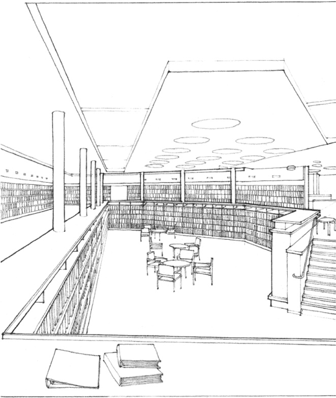

**Library, Wolfsburg Cultural Center**, Essen, Germany, 1962, Alvar Aalto

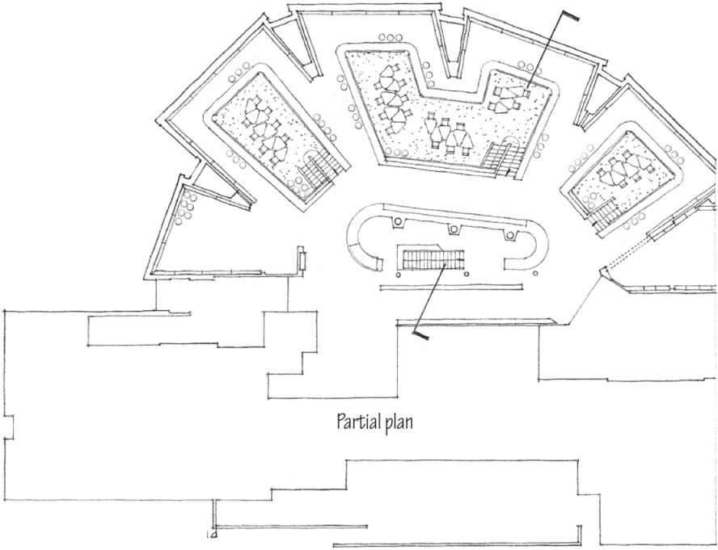

**Library in Rovaniemi**, Finland, 1965–1968, Alvar Aalto

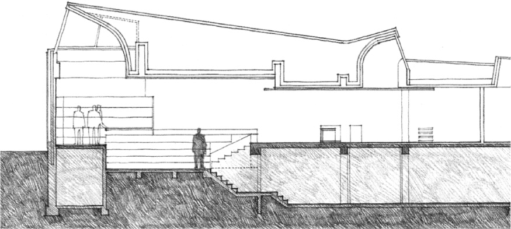

Partial section through the main reading room

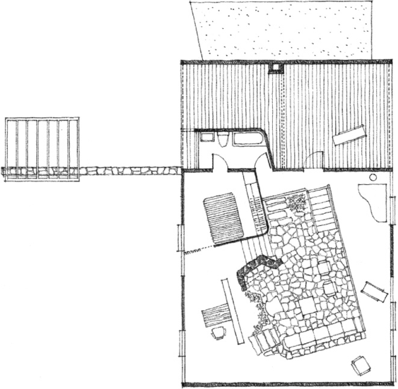

**House on the Massachusetts Coast**, 1948, Hugh Stubbins

An area within a large room can be sunken to reduce the scale of the room and define a more intimate space within it. A sunken area can also serve as a transitional space between two floors of a building.

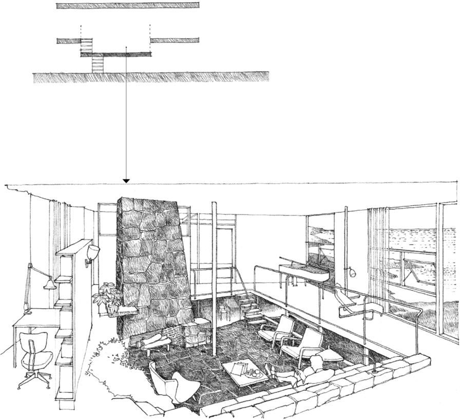

View of the lowered living level