> [BREADCRUMB_CTX: 《Architecture》 > Overhead Plane]

## OVERHEAD PLANE

Similar to the manner in which a shade tree offers a sense of enclosure beneath its umbrella structure, an overhead plane defines a field of space between itself and the ground plane. Since the edges of the overhead plane establish the boundaries of this field, its shape, size, and height above the ground plane determines the formal qualities of the space.

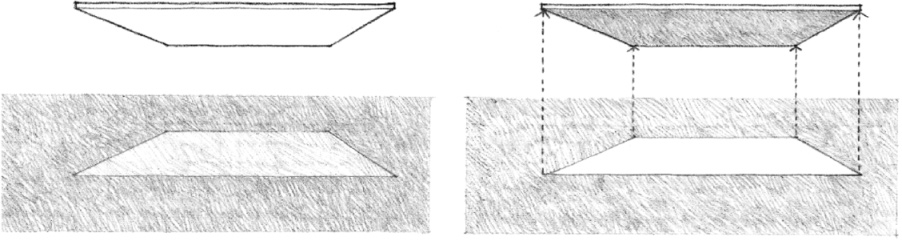

While the previous manipulations of the ground or floor plane defined fields of space whose upper limits were established by their context, an overhead plane has the ability to define a discrete volume of space virtually by itself.

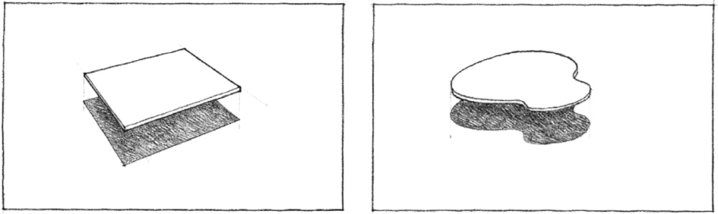

If vertical linear elements such as columns or posts are used to support the overhead plane, they will aid in visually establishing the limits of the defined space without disrupting the flow of space through the field.

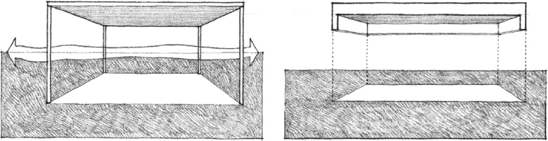

Similarly, if the edges of the overhead plane are turned downward, or if the base plane beneath it is articulated by a change in level, the boundaries of the defined volume of space will be visually reinforced.

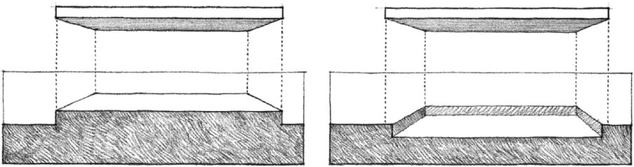
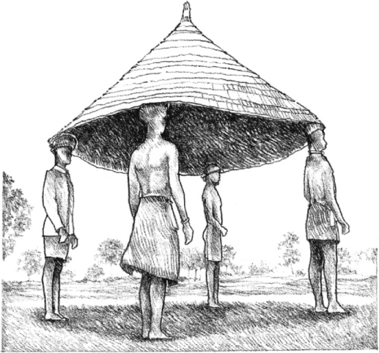

Moving the roof of a house in Guinea

The major overhead element of a building is its roof plane. It not only shelters the interior spaces of a building from sun, rain, and snow, but also has a major impact on the overall form of a building and the shaping of its spaces. The form of the roof plane, in turn, is determined by the material, geometry, and proportions of its structural system and the manner in which it transfers its loads across space to its supports.

### Wood Truss

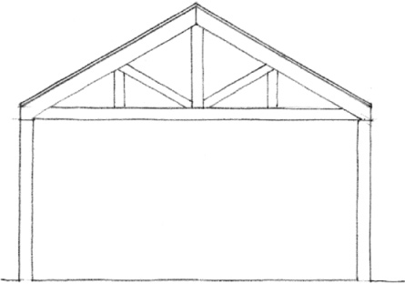

### Steel Joist

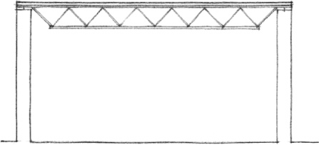

### Masonry Vault

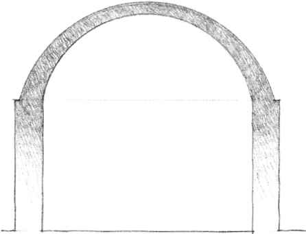
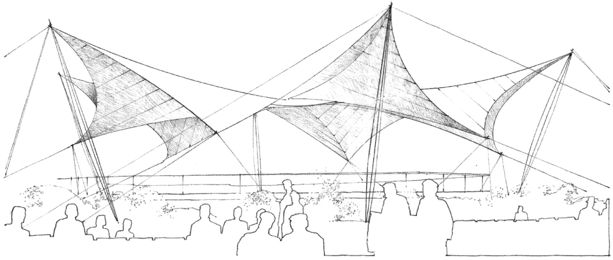

Tensile Structure, **National Garden Show**, Cologne, Germany, 1957, Frei Otto and Peter Stromeyer

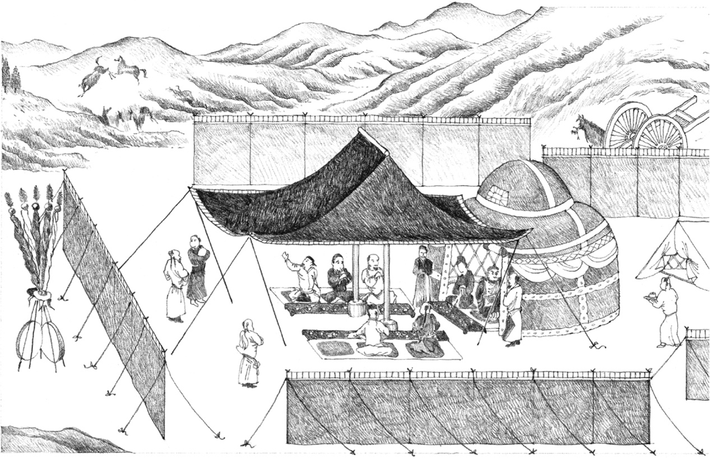

Chinese painting illustrating the use of a pavilion structure to define a shaded resting place within an encampment.

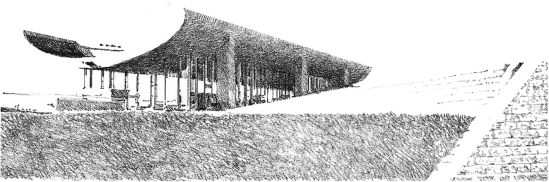

**Totsuka Country Club**, Yokohama, Japan, Kenzo Tange, 1960–1961

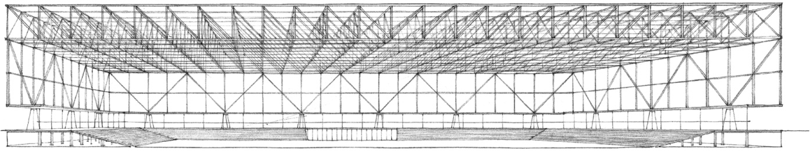

**Convention Hall for Chicago** (Project), 1953, Mies van der Rohe

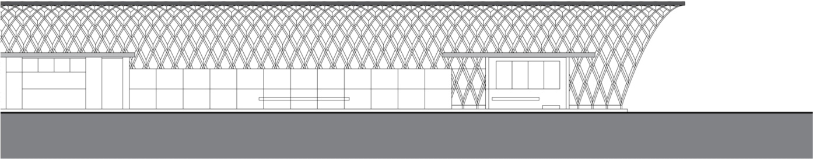

**Hale County Animal Shelter**, Greensboro, Alabama, 2008, Rural Studio, Auburn University

The roof plane can visually express how its pattern of structural members resolves forces and transfers loads to a system of supports.

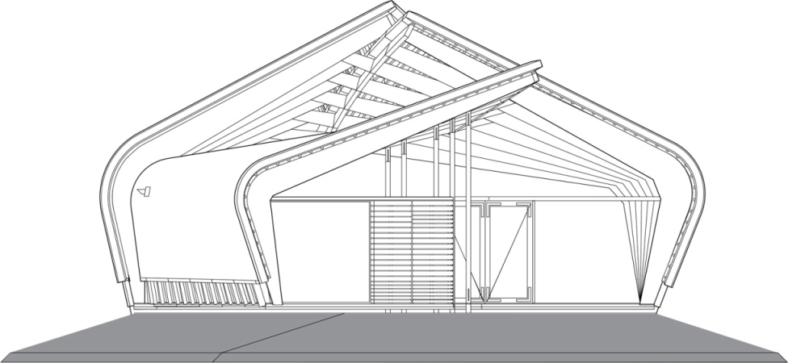

**Imagination Art Pavilion**, Zeewolde, The Netherlands, 2000, René van Zuuk

The roof plane can be the major space-defining element of a building and visually organize a series of forms and spaces beneath its sheltering canopy.

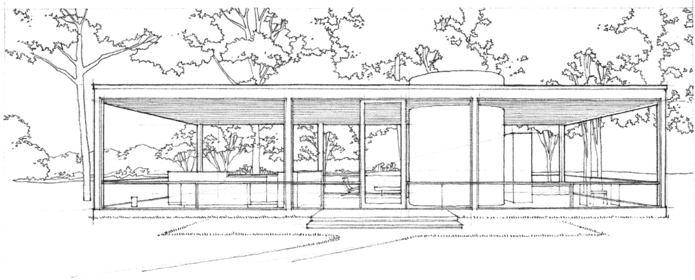

**Glass House**, New Canaan, Connecticut, 1949, Philip Johnson

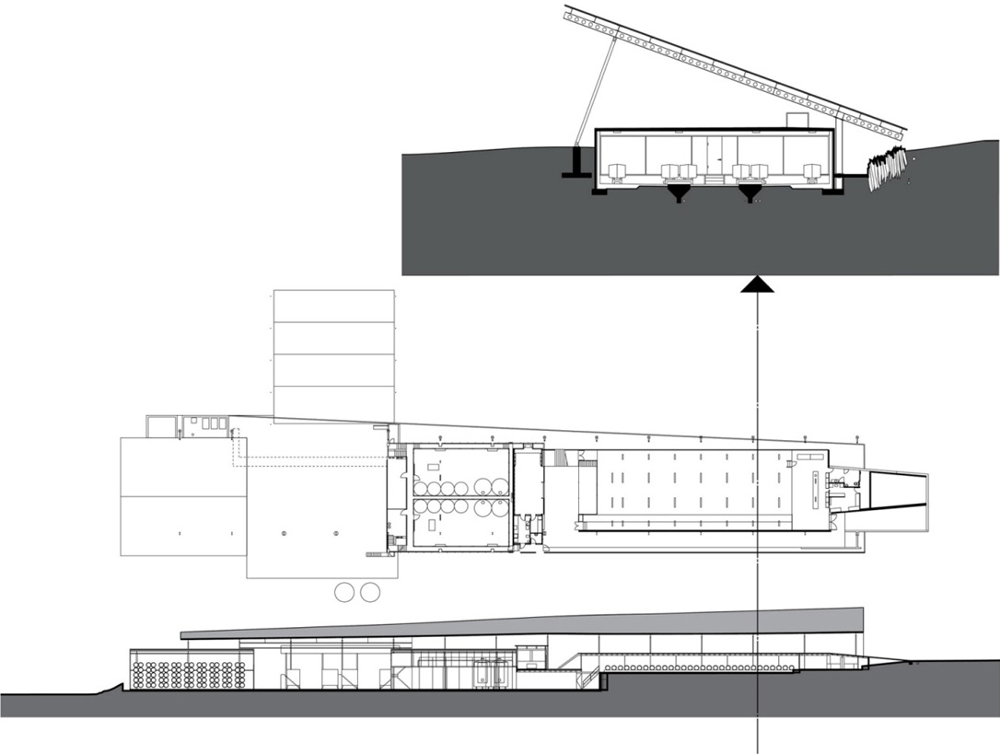

**Peregrine Winery**, Gibbston Valley, New Zealand, 2004, Architecture Workshop

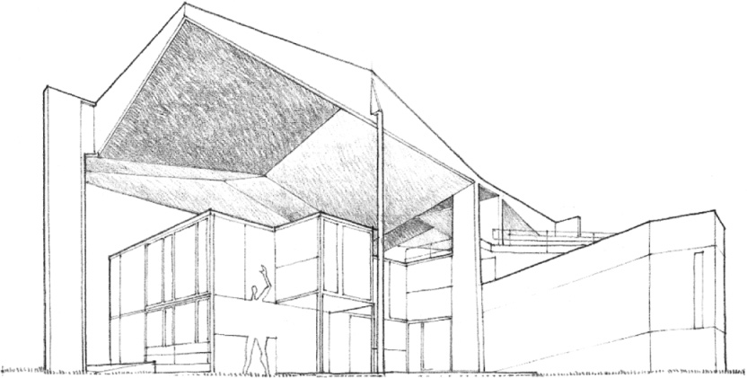

**Centre Le Corbusier**, Zurich, 1963–1967, Le Corbusier

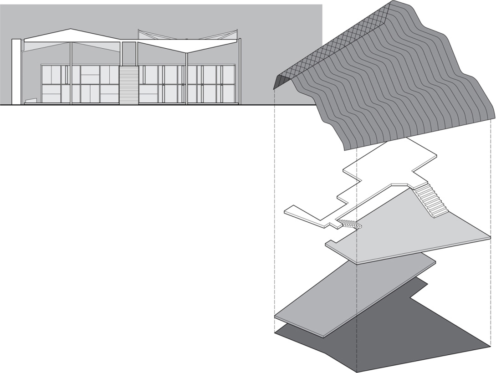

**Jasper Place Branch Library**, Edmonton, Canada, 2013, Hughes Condon Marier Architects + Dub Architects

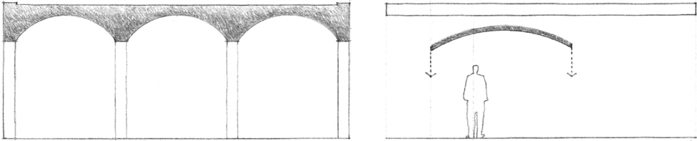

The ceiling plane of an interior space can reflect the form of the structural system supporting the overhead floor or roof plane. Since it need not resist any weathering forces nor carry any major loads, the ceiling plane can also be detached from the floor or roof plane and become a visually active element in a space.

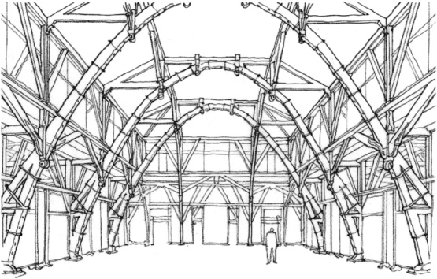

**Bandung Institute of Technology**, Bandung, Indonesia, 1920, Henri Maclaine Pont

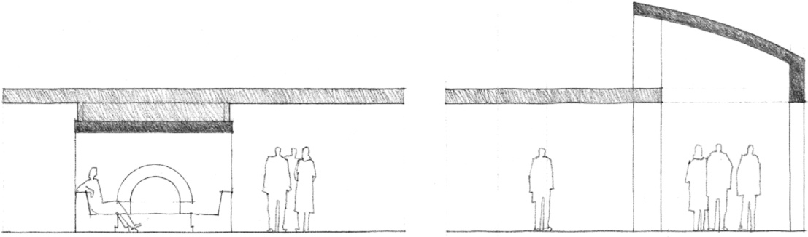

As in the case of the base plane, the ceiling plane can be manipulated to define and articulate zones of space within a room. It can be lowered or elevated to alter the scale of a space, define a path of movement through it, or allow natural light to enter it from above.

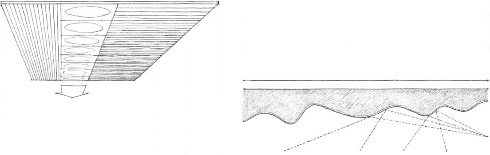

The form, color, texture, and pattern of the ceiling plane can be manipulated as well to improve the quality of light or sound within a space or give it a directional quality or orientation.

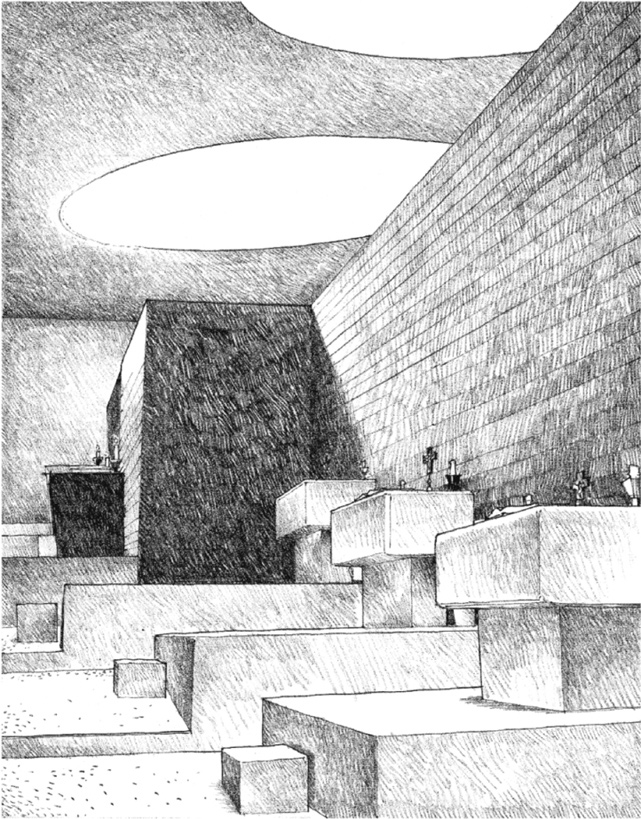

Side Chapels, **Cistercian Monastery of La Tourette**, near Lyons, France, 1956–1959, Le Corbusier

Well-defined negative areas or voids within an overhead plane, such as for skylights, can be seen as positive shapes that establish the presence of spatial fields below their openings.

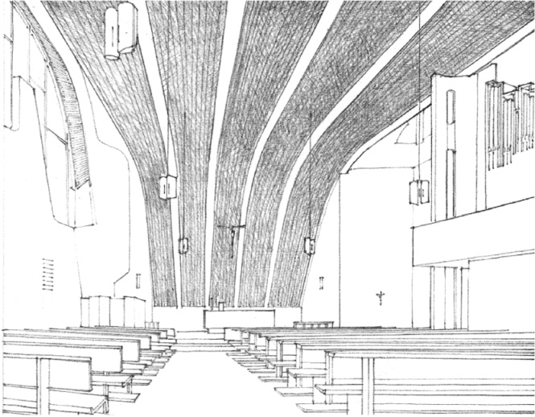

**Parish Center**, Wolfsburg, Germany, 1960–1962, Alvar Aalto

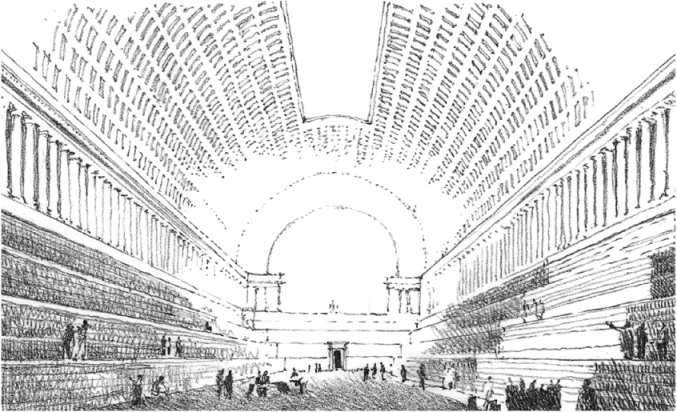

**Bibliothèque Nationale** (Project), 1788, Étienne-Louis Boullée